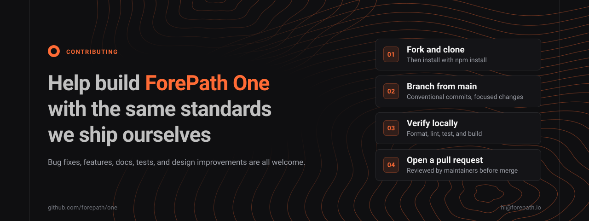

<p align="center">
  
</p>

<p align="center">
  <a href="./README.md"><b>README</b></a> ·
  <a href="./SECURITY.md"><b>Security</b></a> ·
  <a href="https://github.com/forepath/one/discussions"><b>Discussions</b></a> ·
  <a href="https://github.com/forepath/one/issues"><b>Issues</b></a> ·
  <a href="./CHANGELOG.md"><b>Changelog</b></a>
</p>

---

# Contributing to ForePath One

Thank you for your interest in contributing. This guide covers how to set up the monorepo, the standards we hold changes to, and how to get a pull request merged. It applies to every product in the repository: [Agenstra](./README.md#agenstra), [Decabill](./README.md#decabill), [Loadweaver](./README.md#loadweaver), the [ForePath](./README.md#forepath) website, and the [shared platform](./README.md#shared-platform).

## Ways to contribute

| Contribution      | What helps most                                                     |
| ----------------- | ------------------------------------------------------------------- |
| **Bug reports**   | Reproducible steps, environment details, and the affected product   |
| **Feature ideas** | The problem you want solved, not only the solution you have in mind |
| **Documentation** | Fixes, missing examples, and clearer structure and navigation       |
| **Code**          | Bug fixes and features with tests                                   |
| **Testing**       | Better coverage and more meaningful test cases                      |
| **Design**        | Improvements to user experience and visual design                   |

## Getting started

### Prerequisites

- [Node.js](https://nodejs.org/) in the version pinned in [`.nvmrc`](./.nvmrc) (run `nvm use`)
- [Git](https://git-scm.com/)
- [Docker](https://docs.docker.com/get-docker/) for local container stacks and MCP servers
- [Trivy](https://trivy.dev/) on your `PATH`, which the pre-commit hook needs

### Setup

1. **Fork and clone**

   ```bash
   git clone https://github.com/your-username/one.git
   cd one
   ```

2. **Install dependencies.** The workspace only allows npm.

   ```bash
   npm install
   ```

   Installing also sets up the Husky git hooks and applies the patches in [`patches/`](./patches/).

3. **Verify the setup**

   ```bash
   npx nx --version
   npx nx show projects
   ```

4. **Get to know the repository.** The [README](./README.md) describes every product, its components, and its documentation. The [repository layout](./README.md#repository-layout) explains how apps and libraries are grouped by domain.

## Contribution workflow

| Step           | What to do                                                                                                                                                                                                                     |
| -------------- | ------------------------------------------------------------------------------------------------------------------------------------------------------------------------------------------------------------------------------ |
| **1. Plan**    | Check existing [issues](https://github.com/forepath/one/issues) and [discussions](https://github.com/forepath/one/discussions). Open an issue before significant changes and discuss your approach with maintainers if needed. |
| **2. Develop** | Create a feature branch from `main`. Follow the [guidelines](#development-guidelines) below, write tests for new behavior, and update documentation.                                                                           |
| **3. Verify**  | Run the [local checks](#local-checks) and make sure your change works as expected.                                                                                                                                             |
| **4. Submit**  | Open a pull request against `main` with a complete description and request a review from maintainers.                                                                                                                          |

## Development guidelines

### Architecture

- Respect application and library boundaries and the domain dependency rules enforced by ESLint.
- Keep product code in its domain (`apps/<domain>/`, `libs/domains/<domain>/`) and put cross-product code in `shared`.
- Use Nx for all build, test, lint, and serve tasks.

### Code style

- Follow TypeScript best practices and write self-documenting code.
- Format with Prettier (`npx nx format:write`) and follow the ESLint rules.
- Follow the project's code quality and security practices.

### Commit messages

Commits follow [Conventional Commits](https://www.conventionalcommits.org/) and are validated by commitlint on every commit. The allowed types are `feat`, `fix`, `docs`, `refactor`, `cleanup`, `chore`, and `ci`. Headers can be at most 100 characters. Use a scope for the affected domain where it helps, for example `fix(agenstra): ...`.

### Testing

- Write unit tests for new functionality and integration tests for complex features.
- Make sure test coverage does not decrease.
- Use descriptive test names.

### Documentation

- Update the relevant docs under [`docs/`](./docs/) when behavior changes.
- Fix typos, clarify explanations, add missing examples, and improve navigation.
- Contact us before starting translations.

### Local checks

The Husky pre-commit hook runs these checks on every commit. Run them yourself before you push:

```bash
npx nx format:check                 # Prettier formatting
tools/ci/trivy-pre-commit.sh        # Trivy filesystem and config scan
npx nx affected -t lint,test,build  # Lint, test, and build affected projects
```

The hook also regenerates the knowledge graph (`npx nx run graph:generate-kg`) and stages `graph/graph.json` and `graph/graph.html`.

## Pull requests

Before you submit, check that:

- [ ] All local checks pass
- [ ] The code follows the style guidelines
- [ ] New functionality has tests
- [ ] Documentation is updated
- [ ] Commit messages follow the conventional format
- [ ] The pull request description explains what changed and why

When you change a sublicensed component, make sure your changes comply with that component's license. See [License](./README.md#license) in the README.

## Bug reports and feature requests

Check existing issues first, then use the matching template:

- **[Bug report](./.github/ISSUE_TEMPLATE/bug_report.md):** include steps to reproduce, environment information, and screenshots if applicable.
- **[Feature request](./.github/ISSUE_TEMPLATE/feature_request.md):** describe the problem and your proposed solution, and consider the impact on existing functionality.

> [!CAUTION]
> Never report security vulnerabilities in public issues or pull requests, and never include sensitive information in them. Follow the [Security Policy](./SECURITY.md) instead.

## Local containers

Run an application's local stack with `npx nx run <project>:start-containers`. The applications below expose this target. Image names use `ghcr.io/forepath/` and `:latest`, except for the manager's worker, which uses `registry.forenet.internal/forepath/agenstra-manager-worker:test`.

| Project                                                                                      | Test image name(s)                                | Build prerequisite | Image usage                                                |
| -------------------------------------------------------------------------------------------- | ------------------------------------------------- | ------------------ | ---------------------------------------------------------- |
| [agenstra-backend-agent-controller](apps/agenstra/backend-agent-controller/project.json)     | `agenstra-controller-api`                         | `prune`            | API, scheduler, and worker Compose services                |
| [agenstra-backend-agent-manager](apps/agenstra/backend-agent-manager/project.json)           | `agenstra-manager-api`, `agenstra-manager-worker` | `prune`            | API Compose service; worker containers created dynamically |
| [agenstra-frontend-agent-console](apps/agenstra/frontend-agent-console/project.json)         | `agenstra-console-server`                         | `server`           | Console server                                             |
| [agenstra-frontend-billing-console](apps/agenstra/frontend-billing-console/project.json)     | `agenstra-billing-console-server`                 | `server`           | Billing console server                                     |
| [agenstra-frontend-docs](apps/agenstra/frontend-docs/project.json)                           | `agenstra-docs-server`                            | `postbuild`        | Documentation server                                       |
| [agenstra-frontend-landingpage](apps/agenstra/frontend-landingpage/project.json)             | `agenstra-landingpage-server`                     | `postbuild`        | Landing page server                                        |
| [decabill-backend-billing-manager](apps/decabill/backend-billing-manager/project.json)       | `decabill-billing-api`                            | `prune`            | API, scheduler, and worker Compose services                |
| [decabill-frontend-billing-console](apps/decabill/frontend-billing-console/project.json)     | `decabill-billing-console-server`                 | `server`           | Billing console server                                     |
| [decabill-frontend-docs](apps/decabill/frontend-docs/project.json)                           | `decabill-docs-server`                            | `postbuild`        | Documentation server                                       |
| [decabill-frontend-landingpage](apps/decabill/frontend-landingpage/project.json)             | `decabill-landingpage-server`                     | `postbuild`        | Landing page server                                        |
| [forepath-backend-communication](apps/forepath/backend-communication/project.json)           | `forepath-communication-api`                      | `prune`            | API Compose service                                        |
| [forepath-frontend-billing-console](apps/forepath/frontend-billing-console/project.json)     | `forepath-billing-console-server`                 | `server`           | Billing console server                                     |
| [forepath-frontend-landingpage](apps/forepath/frontend-landingpage/project.json)             | `forepath-landingpage-server`                     | `postbuild`        | Landing page server                                        |
| [loadweaver-frontend-billing-console](apps/loadweaver/frontend-billing-console/project.json) | `loadweaver-billing-console-server`               | `server`           | Billing console server                                     |
| [loadweaver-frontend-landingpage](apps/loadweaver/frontend-landingpage/project.json)         | `loadweaver-landingpage-server`                   | `postbuild`        | Landing page server                                        |

Infrastructure images such as PostgreSQL, Redis, OpenSearch, and MailHog are pulled separately. After a successful start, each project's obsolete test images are pruned automatically. The details below explain how images are built and cleaned up.

<details>
<summary><b>How test images are built</b></summary>

All image targets use `@nx-tools/nx-container:build`, default to the `test` configuration, disable Nx caching, pass the `VERSION` build argument, and load the result into the local Docker image store with `load: true`. Docker layer caching still applies. The build paths are:

- **Backends:** `prune` prepares the compiled app, pruned dependencies, and workspace modules under `dist/apps/<domain>/<app>`. It is an Nx packaging target, not Docker cleanup. API Dockerfiles use Debian, install the runtime and production dependencies, copy the app, and launch `main.js` through an entrypoint. Agenstra and Decabill also prepare migrations and provider-plugin installation assets.
- **Agent and billing consoles:** `server` follows `prebuild-server` and prepares `dist/apps/<domain>/<app>/server`. Node Alpine images install production dependencies, copy the server output, and launch `server.cjs`. All billing consoles share Decabill's Dockerfile and Compose definition; environment variables select the appropriate image and container name.
- **Landing pages and documentation:** `postbuild` follows `build` and `build-delegating-server`, assembling `dist/apps/<domain>/<app>/server`. Node Alpine images copy that output and launch `server.mjs`. Both documentation apps share the documentation Dockerfile and Compose definition, with environment variables selecting their image and container name.
- **Manager worker:** a separate Debian image installs the desktop, development tools, and OpenCode, and copies `worker-desktop` assets from the manager's build output. Compose does not start this image. The manager's Docker service creates agent containers from `AGENT_DEFAULT_IMAGE`, whose Compose default is `ghcr.io/forepath/agenstra-manager-worker:latest`. The manager's `.start-containers.env.example` sets `AGENT_DEFAULT_IMAGE` and `OPENCODE_AGENT_DOCKER_IMAGE` to the internal-registry `:test` reference above, so the stack started via `start-containers` uses the locally built worker. An existing `.start-containers.env` is preserved; update it manually if it still points at `:latest`.

Compose uses `pull_policy: never` for the application services and runs `up -d --force-recreate --remove-orphans`.

</details>

<details>
<summary><b>Disk usage and image cleanup</b></summary>

Repeated starts do not necessarily create new image IDs: an unchanged Docker build can reuse its cached image. However, a changed build moves the fixed tag to a new image, leaving the previous image dangling once the old containers are recreated. Compose's `--remove-orphans` removes containers, not images. Without cleanup, these obsolete images can accumulate; this was reproduced with Docker.

Each test image carries `io.forepath.one.test-project=<project>`. After a successful Compose start, the target runs:

```bash
docker image prune --force --filter label=io.forepath.one.test-project=<project>
```

Without `--all`, this removes only that project's dangling, unused test images. Tagged images, images referenced by running or stopped containers, other projects' images, release images, and volumes are preserved. Failed starts and standalone image builds do not run cleanup; a later successful start can reclaim their obsolete labeled images. Release builds remain unlabeled and unchanged.

Images built before labeling cannot be safely attributed to a project by this cleanup. Inspect `docker system df -v` and `docker image ls --filter dangling=true` before manually removing specific legacy image IDs. No global prune runs automatically.

BuildKit cache is separate and may retain shared layers even after an image is removed. Inspect it with `docker buildx du`. Opt-in maintenance such as `docker buildx prune --filter until=168h` removes old unused cache but can affect rebuild speed for other projects using the same builder.

</details>

## Getting help

| Topic                 | Where to go                                                                                                                 |
| --------------------- | --------------------------------------------------------------------------------------------------------------------------- |
| Questions and ideas   | [GitHub Discussions](https://github.com/forepath/one/discussions)                                                           |
| Bugs and features     | [GitHub Issues](https://github.com/forepath/one/issues)                                                                     |
| Product documentation | [README](./README.md#documentation), [Agenstra docs](./docs/agenstra/README.md), [Decabill docs](./docs/decabill/README.md) |
| General questions     | hi@forepath.io                                                                                                              |
| Support               | support@forepath.io                                                                                                         |
| Enterprise            | hi@forepath.io                                                                                                              |
| Security              | [Vulnerability Disclosure Policy](https://forepath.io/legal/vulnerability-disclosure) or soc@forepath.io                    |

## Recognition

Contributors are recognized in release notes for significant contributions, in the contributors section of the project, and with special mentions for exceptional work.

## License

By contributing, you agree that your contributions are licensed under the MIT License or the respective sublicense of the component you change. See [License](./README.md#license) in the README for which components are sublicensed.

---

<p align="center">
  <sub>Thank you for helping build <a href="https://forepath.io/one">ForePath One</a>. Questions about contributing? Write to <a href="mailto:hi@forepath.io">hi@forepath.io</a>.</sub>
</p>
