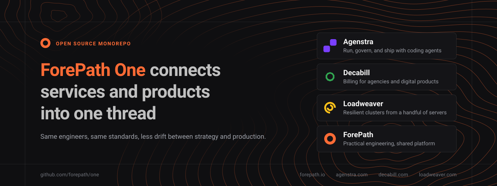
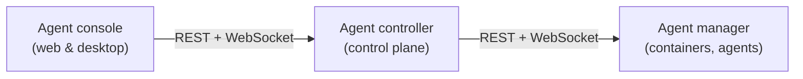

<p align="center">
  <a href="https://forepath.io/one">
    
  </a>
</p>

<p align="center">
  <a href="https://github.com/forepath/one"></a>
  <a href="./LICENSE"></a>
  <a href="https://nx.dev"></a>
  <a href="https://www.typescriptlang.org/"></a>
  <a href="https://angular.dev"></a>
  <a href="https://nestjs.com/"></a>
</p>

<p align="center">
  <a href="https://forepath.io"><b>Website</b></a> ·
  <a href="https://agenstra.com"><b>Agenstra</b></a> ·
  <a href="https://decabill.com"><b>Decabill</b></a> ·
  <a href="https://blog.forepath.io"><b>Blog</b></a> ·
  <a href="./CONTRIBUTING.md"><b>Contributing</b></a> ·
  <a href="./SECURITY.md"><b>Security</b></a>
</p>

---

# ForePath One

**The open source monorepo behind ForePath's services and products.**

ForePath One connects services and products into one thread. We advise your platform, operate your systems, build your software, and ship products we run ourselves, with the same engineers and the same standards from strategy to production.

This repository holds all of that in one place: the [Agenstra](#agenstra) agent platform, the [Decabill](#decabill) billing product, the upcoming [Loadweaver](#loadweaver) cluster product, the [ForePath](#forepath) website, and the [shared platform](#shared-platform) code they all build on.

## Products

###  Agenstra

**One place to run, govern, and ship with coding agents.**

Agenstra brings workspaces, tickets, knowledge, coding, and releases together on infrastructure you own. Agent-assisted work is held to the same bar as the rest of your engineering practice, with approvals, audit trails, and controls that match how you already review and release software. Self-host it or run it on Agenstra Cloud.

`Multi-workspace control` `Ticket automation` `Policy & audit trails` `Code & Git in the browser` `Deployments` `Team knowledge` `Roles & SSO` `Your cloud or ours`

<table>
  <tr>
    <td><b>Website</b></td>
    <td><a href="https://agenstra.com">agenstra.com</a> · <a href="https://docs.agenstra.com">docs.agenstra.com</a> · <a href="https://downloads.agenstra.com">downloads</a></td>
  </tr>
  <tr>
    <td><b>Start here</b></td>
    <td><a href="./docs/agenstra/getting-started.md">Getting started</a> · <a href="./docs/agenstra/architecture/system-overview.md">System overview</a> · <a href="./docs/agenstra/deployment/local-development.md">Local development</a></td>
  </tr>
  <tr>
    <td><b>Source</b></td>
    <td><a href="./apps/agenstra/">apps/agenstra</a> · <a href="./libs/domains/agenstra/">libs/domains/agenstra</a></td>
  </tr>
</table>



| Component                                                     | Description                                                    |
| ------------------------------------------------------------- | -------------------------------------------------------------- |
| [Agent console](./apps/agenstra/frontend-agent-console/)      | Web IDE with chat, Monaco editor, Git, tickets, and knowledge  |
| [Native agent console](./apps/agenstra/native-agent-console/) | Electron desktop client around the agent console               |
| [Agent controller](./apps/agenstra/backend-agent-controller/) | Control plane for clients, tickets, proxying, and statistics   |
| [Agent manager](./apps/agenstra/backend-agent-manager/)       | Agent lifecycle, Docker workloads, VNC, SSH, and worker images |
| [Docs](./apps/agenstra/frontend-docs/)                        | Documentation site served at docs.agenstra.com                 |
| [Landing page](./apps/agenstra/frontend-landingpage/)         | Marketing and pricing site served at agenstra.com              |

###  Decabill

**Billing for agencies and digital products.**

Decabill is one platform for agencies and digital product teams. Bill client services and projects, SaaS subscriptions, and managed hosting without stitching together separate tools. It covers invoicing, payments, and customer self-service in one multi-tenant platform.

`Services & projects` `SaaS subscriptions` `Automatic provisioning` `ZUGFeRD invoicing` `Stripe payments` `Multi-tenant`

<table>
  <tr>
    <td><b>Website</b></td>
    <td><a href="https://decabill.com">decabill.com</a> · <a href="https://docs.decabill.com">docs.decabill.com</a> · <a href="https://downloads.decabill.com">downloads</a></td>
  </tr>
  <tr>
    <td><b>Start here</b></td>
    <td><a href="./docs/decabill/getting-started.md">Getting started</a> · <a href="./docs/decabill/architecture/system-overview.md">System overview</a> · <a href="./docs/decabill/deployment/docker-deployment.md">Docker deployment</a></td>
  </tr>
  <tr>
    <td><b>Source</b></td>
    <td><a href="./apps/decabill/">apps/decabill</a> · <a href="./libs/domains/decabill/">libs/domains/decabill</a></td>
  </tr>
</table>

| Component                                                    | Description                                            |
| ------------------------------------------------------------ | ------------------------------------------------------ |
| [Billing manager](./apps/decabill/backend-billing-manager/)  | Subscriptions, invoicing, provisioning, and Stripe API |
| [Billing console](./apps/decabill/frontend-billing-console/) | Admin and customer self-service billing UI             |
| [Docs](./apps/decabill/frontend-docs/)                       | Documentation site served at docs.decabill.com         |
| [Landing page](./apps/decabill/frontend-landingpage/)        | Marketing and pricing site served at decabill.com      |

###  Loadweaver

**Resilient clusters from a handful of servers.** _Early access._

Loadweaver turns a handful of servers into a resilient multi-site cluster, with an encrypted network between your sites, shared storage on every node, and ingress that fails over on its own. Deployments are Docker Compose projects, and every change goes through plan and apply. The product is not released yet; this repository currently holds its landing page.

| Component                                                                       | Description                                         |
| ------------------------------------------------------------------------------- | --------------------------------------------------- |
| [Docs](./apps/loadweaver/frontend-docs/)                                        | Documentation site served at docs.loadweaver.com    |
| [Landing page](./apps/loadweaver/frontend-landingpage/)                         | Marketing and pricing site served at loadweaver.com |
| [Landing page feature](./libs/domains/loadweaver/frontend/feature-landingpage/) | Pages, layout, routes, and content for the site     |

###  ForePath

**Practical engineering for teams that ship and operate with confidence.**

ForePath partners with organizations to modernize infrastructure, deliver software, and adopt AI without trading away control, clarity, or long-term maintainability. The ForePath domain contains the company website at [forepath.io](https://forepath.io), which covers consulting, IT systems, software development, and the ForePath One portfolio, plus the services behind it.

| Component                                                                     | Description                                              |
| ----------------------------------------------------------------------------- | -------------------------------------------------------- |
| [Landing page](./apps/forepath/frontend-landingpage/)                         | Angular SSR company website served at forepath.io        |
| [Landing page feature](./libs/domains/forepath/frontend/feature-landingpage/) | Pages, layout, routes, and content for the website       |
| [Communication API](./apps/forepath/backend-communication/)                   | Contact request proxy to Chatwoot                        |
| [Billing console](./apps/forepath/frontend-billing-console/)                  | ForePath-branded Decabill console for ForePath customers |

Feature notes live under [`docs/forepath/features/`](./docs/forepath/features/).

### Shared platform

Cross-product building blocks used by every product in the repository.

| Component                                                         | Description                                                       |
| ----------------------------------------------------------------- | ----------------------------------------------------------------- |
| [Platform authentication](./apps/shared/platform-authentication/) | Keycloak Docker Compose setup for local and shared auth           |
| [MCP devkit](./apps/shared/mcp-devkit/)                           | Model Context Protocol server for workspace and Nx tooling        |
| [MCP proxy](./apps/shared/mcp-proxy/)                             | Proxy that routes MCP clients to the devkit                       |
| [Docs shell](./apps/shared/frontend-docs/)                        | Shared SSR docs app that the product docs sites patch             |
| [Shared libraries](./libs/domains/shared/)                        | UI components, monitoring, configuration, SSR, queue, and crypto  |
| [Identity libraries](./libs/domains/identity/)                    | Keycloak authentication for NestJS backends and Angular frontends |

## Quick start

Install the Node.js version from [`.nvmrc`](./.nvmrc), then:

```bash
git clone https://github.com/forepath/one.git
cd one
npm install

# Run a landing page locally
npx nx serve forepath-frontend-landingpage
npx nx serve agenstra-frontend-landingpage
npx nx serve decabill-frontend-landingpage
npx nx serve loadweaver-frontend-landingpage
```

Nx project names follow `<domain>-<type>-<name>` (for example `agenstra-backend-agent-manager`). Run `npx nx show projects` for the full list, or `npx nx graph` to explore dependencies.

## Repository layout

```text
apps/
  agenstra/      Agenstra apps: console, controller, manager, docs, landing page, desktop
  decabill/      Decabill apps: billing manager, billing console, docs, landing page
  forepath/      ForePath website, communication API, billing console
  shared/        Auth, MCP devkit and proxy, shared docs shell
libs/domains/
  <domain>/      Feature, data-access, UI, and utility libraries per domain
docs/            Product documentation (agenstra, decabill, forepath)
tools/           Generators, AI context, SBOM, release integrity, knowledge graph
```

Workspace tooling under [`tools/`](./tools/) covers [code generators](./tools/code/), [AI agent context](./tools/ai/), [release integrity](./tools/release-integrity/), and the [knowledge graph](./tools/graph/). Local port assignments are documented in [`docs/port-allocation.md`](./docs/port-allocation.md).

## Documentation

| Agenstra                                                                      | Decabill                                                                      | Workspace                                                                      |
| ----------------------------------------------------------------------------- | ----------------------------------------------------------------------------- | ------------------------------------------------------------------------------ |
| [Overview](./docs/agenstra/README.md)                                         | [Overview](./docs/decabill/README.md)                                         | [Contributing guide](./CONTRIBUTING.md)                                        |
| [Getting started](./docs/agenstra/getting-started.md)                         | [Getting started](./docs/decabill/getting-started.md)                         | [Security policy](./SECURITY.md)                                               |
| [Architecture](./docs/agenstra/architecture/system-overview.md)               | [Architecture](./docs/decabill/architecture/system-overview.md)               | [Vulnerability disclosure](https://forepath.io/legal/vulnerability-disclosure) |
| [Components](./docs/agenstra/architecture/components.md)                      | [Docker deployment](./docs/decabill/deployment/docker-deployment.md)          | [Changelog](./CHANGELOG.md)                                                    |
| [Docker deployment](./docs/agenstra/deployment/docker-deployment.md)          | [Environment config](./docs/decabill/deployment/environment-configuration.md) | [Port allocation](./docs/port-allocation.md)                                   |
| [Environment config](./docs/agenstra/deployment/environment-configuration.md) | [API reference](./docs/decabill/api-reference/README.md)                      | [ForePath features](./docs/forepath/features/)                                 |
| [API reference](./docs/agenstra/api-reference/README.md)                      | [Security](./docs/decabill/security/README.md)                                |                                                                                |
| [Security](./docs/agenstra/security/README.md)                                | [Feature guides](./docs/decabill/features/)                                   |                                                                                |
| [Feature guides](./docs/agenstra/features/)                                   |                                                                               |                                                                                |
| [Troubleshooting](./docs/agenstra/troubleshooting/common-issues.md)           |                                                                               |                                                                                |

## License

The repository default is the **MIT License** (see [LICENSE](./LICENSE)). Individual applications and libraries may be sublicensed. Always check the `LICENSE` file in a component before you use, modify, or distribute it.

Copyright (c) 2025 IPvX UG (haftungsbeschränkt). Portions of this software were originally Copyright (c) 2017-2025 Narwhal Technologies Inc.

<details>
<summary><b>AGPL-3.0 components</b></summary>

Modifications and derivative works must remain under AGPL-3.0 and must be made available to users, including when the software is accessed over a network.

- [`apps/agenstra/backend-agent-manager`](./apps/agenstra/backend-agent-manager/) ([LICENSE](./apps/agenstra/backend-agent-manager/LICENSE))
- [`libs/domains/agenstra/backend/feature-agent-manager`](./libs/domains/agenstra/backend/feature-agent-manager/) ([LICENSE](./libs/domains/agenstra/backend/feature-agent-manager/LICENSE))
- [`libs/domains/shared/backend/feature-monitoring`](./libs/domains/shared/backend/feature-monitoring/) ([LICENSE](./libs/domains/shared/backend/feature-monitoring/LICENSE))
- [`apps/agenstra/frontend-agent-console`](./apps/agenstra/frontend-agent-console/) ([LICENSE](./apps/agenstra/frontend-agent-console/LICENSE))
- [`libs/domains/agenstra/frontend/feature-agent-console`](./libs/domains/agenstra/frontend/feature-agent-console/) ([LICENSE](./libs/domains/agenstra/frontend/feature-agent-console/LICENSE))
- [`libs/domains/agenstra/frontend/data-access-agent-console`](./libs/domains/agenstra/frontend/data-access-agent-console/) ([LICENSE](./libs/domains/agenstra/frontend/data-access-agent-console/LICENSE))
- [`libs/domains/shared/frontend/util-configuration`](./libs/domains/shared/frontend/util-configuration/) ([LICENSE](./libs/domains/shared/frontend/util-configuration/LICENSE))
- [`libs/domains/shared/frontend/util-cookie-consent`](./libs/domains/shared/frontend/util-cookie-consent/) ([LICENSE](./libs/domains/shared/frontend/util-cookie-consent/LICENSE))
- [`libs/domains/shared/frontend/util-express-server`](./libs/domains/shared/frontend/util-express-server/) ([LICENSE](./libs/domains/shared/frontend/util-express-server/LICENSE))
- [`libs/domains/shared/frontend/util-docs-parser`](./libs/domains/shared/frontend/util-docs-parser/) ([LICENSE](./libs/domains/shared/frontend/util-docs-parser/LICENSE))
- [`libs/domains/shared/frontend/util-runtime-config-server`](./libs/domains/shared/frontend/util-runtime-config-server/) ([LICENSE](./libs/domains/shared/frontend/util-runtime-config-server/LICENSE))
- [`libs/domains/shared/frontend/util-meta`](./libs/domains/shared/frontend/util-meta/) ([LICENSE](./libs/domains/shared/frontend/util-meta/LICENSE))
- [`libs/domains/shared/backend/util-http-context`](./libs/domains/shared/backend/util-http-context/) ([LICENSE](./libs/domains/shared/backend/util-http-context/LICENSE))
- [`apps/decabill/backend-billing-manager`](./apps/decabill/backend-billing-manager/) ([LICENSE](./apps/decabill/backend-billing-manager/LICENSE))
- [`libs/domains/decabill/backend/feature-billing-manager`](./libs/domains/decabill/backend/feature-billing-manager/) ([LICENSE](./libs/domains/decabill/backend/feature-billing-manager/LICENSE))
- [`tools/graph`](./tools/graph/) ([LICENSE](./tools/graph/LICENSE))

</details>

<details>
<summary><b>BUSL-1.1 components</b></summary>

These components permit non-production use and limited production use subject to the Additional Use Grant. Each converts to AGPL-3.0 after its Change Date, three years from the release date.

- [`apps/agenstra/backend-agent-controller`](./apps/agenstra/backend-agent-controller/) ([LICENSE](./apps/agenstra/backend-agent-controller/LICENSE))
- [`libs/domains/agenstra/backend/feature-agent-controller`](./libs/domains/agenstra/backend/feature-agent-controller/) ([LICENSE](./libs/domains/agenstra/backend/feature-agent-controller/LICENSE))
- [`apps/decabill/frontend-billing-console`](./apps/decabill/frontend-billing-console/) ([LICENSE](./apps/decabill/frontend-billing-console/LICENSE))
- [`libs/domains/decabill/frontend/feature-billing-console`](./libs/domains/decabill/frontend/feature-billing-console/) ([LICENSE](./libs/domains/decabill/frontend/feature-billing-console/LICENSE))
- [`libs/domains/decabill/frontend/data-access-billing-console`](./libs/domains/decabill/frontend/data-access-billing-console/) ([LICENSE](./libs/domains/decabill/frontend/data-access-billing-console/LICENSE))

</details>

<details>
<summary><b>Source-available components</b></summary>

You may view the source code to understand how the software works. No other rights are granted, including copying, modifying, distributing, or running the software.

**ForePath**

- [`apps/forepath/frontend-landingpage`](./apps/forepath/frontend-landingpage/) ([LICENSE](./apps/forepath/frontend-landingpage/LICENSE))
- [`apps/forepath/backend-communication`](./apps/forepath/backend-communication/) ([LICENSE](./apps/forepath/backend-communication/LICENSE))
- [`libs/domains/forepath/frontend/feature-landingpage`](./libs/domains/forepath/frontend/feature-landingpage/) ([LICENSE](./libs/domains/forepath/frontend/feature-landingpage/LICENSE))
- [`libs/domains/forepath/backend/feature-communication-manager`](./libs/domains/forepath/backend/feature-communication-manager/) ([LICENSE](./libs/domains/forepath/backend/feature-communication-manager/LICENSE))

**Agenstra**

- [`apps/agenstra/frontend-landingpage`](./apps/agenstra/frontend-landingpage/) ([LICENSE](./apps/agenstra/frontend-landingpage/LICENSE))
- [`libs/domains/agenstra/frontend/feature-landingpage`](./libs/domains/agenstra/frontend/feature-landingpage/) ([LICENSE](./libs/domains/agenstra/frontend/feature-landingpage/LICENSE))
- [`apps/agenstra/frontend-docs`](./apps/agenstra/frontend-docs/) ([LICENSE](./apps/agenstra/frontend-docs/LICENSE))
- [`libs/domains/agenstra/frontend/data-access-portal`](./libs/domains/agenstra/frontend/data-access-portal/) ([LICENSE](./libs/domains/agenstra/frontend/data-access-portal/LICENSE))

**Decabill**

- [`apps/decabill/frontend-landingpage`](./apps/decabill/frontend-landingpage/) ([LICENSE](./apps/decabill/frontend-landingpage/LICENSE))
- [`apps/decabill/frontend-docs`](./apps/decabill/frontend-docs/) ([LICENSE](./apps/decabill/frontend-docs/LICENSE))

**Loadweaver**

- [`apps/loadweaver/frontend-landingpage`](./apps/loadweaver/frontend-landingpage/) ([LICENSE](./apps/loadweaver/frontend-landingpage/LICENSE))
- [`libs/domains/loadweaver/frontend/feature-landingpage`](./libs/domains/loadweaver/frontend/feature-landingpage/) ([LICENSE](./libs/domains/loadweaver/frontend/feature-landingpage/LICENSE))
- [`apps/loadweaver/frontend-docs`](./apps/loadweaver/frontend-docs/) ([LICENSE](./apps/loadweaver/frontend-docs/LICENSE))

**Shared**

- [`apps/shared/frontend-docs`](./apps/shared/frontend-docs/) ([LICENSE](./apps/shared/frontend-docs/LICENSE))
- [`libs/domains/shared/frontend/feature-docs`](./libs/domains/shared/frontend/feature-docs/) ([LICENSE](./libs/domains/shared/frontend/feature-docs/LICENSE))

</details>

## Contributing

Contributions are welcome across the monorepo, including bug fixes, features, documentation, tests, and design improvements. Read [CONTRIBUTING.md](./CONTRIBUTING.md) for setup, coding standards, and the pull request process. When you change a sublicensed component, make sure your changes comply with that component's license.

- Questions and ideas: [GitHub Discussions](https://github.com/forepath/one/discussions)
- Bugs and feature requests: [GitHub Issues](https://github.com/forepath/one/issues)
- Security reports: [Security policy](./SECURITY.md) and [private advisories](https://github.com/forepath/one/security/advisories)

<p align="center">
  <sub>Built by <a href="https://forepath.io">ForePath</a> · Part of <a href="https://forepath.io/one">ForePath One</a></sub>
</p>
