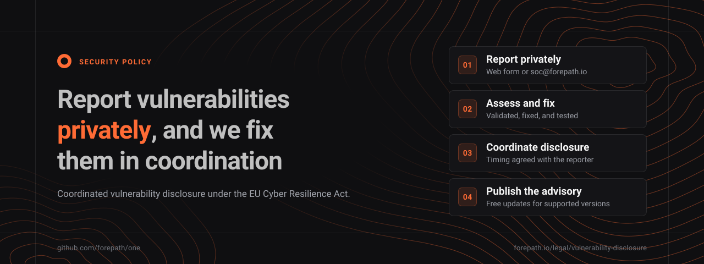

  

  <a href="https://forepath.io/legal/vulnerability-disclosure#report-form"><b>Report form</b></a> ·
  <a href="https://forepath.io/legal/vulnerability-disclosure"><b>Disclosure policy</b></a> ·
  <a href="https://github.com/forepath/one/security/advisories"><b>Advisories</b></a> ·
  <a href="./README.md"><b>README</b></a> ·
  <a href="./CONTRIBUTING.md"><b>Contributing</b></a>

---

# Security Policy

This policy applies to the **ForePath One** monorepo and every product it contains. Product-specific security documentation lives in each product's docs tree. See [Security resources](#security-resources) for detailed registers, SBOM paths, and hardening notes.

> [!IMPORTANT]
> **Please do NOT report security vulnerabilities through public GitHub issues, discussions, or pull requests.** Use the [report form](https://forepath.io/legal/vulnerability-disclosure#report-form) or email **soc@forepath.io** instead.

## Contents

- [Reporting a vulnerability](#reporting-a-vulnerability)
- [Disclosure process](#disclosure-process)
- [Bug bounty and compensation](#bug-bounty-and-compensation)
- [Scope](#scope)
- [Supported versions](#supported-versions)
- [Coordinated vulnerability disclosure policy](#coordinated-vulnerability-disclosure-policy)
- [Security in this repository](#security-in-this-repository)
- [Documented security deviations (accepted risks)](#documented-security-deviations-accepted-risks)
- [Software Bill of Materials (SBOM)](#software-bill-of-materials-sbom)
- [Security best practices](#security-best-practices)
- [Security resources](#security-resources)
- [Contact information](#contact-information)

## Reporting a vulnerability

We take security seriously and appreciate your help in keeping ForePath One and its users safe.

| Channel           | Details                                                                                                                                                                                |
| ----------------- | -------------------------------------------------------------------------------------------------------------------------------------------------------------------------------------- |
| **Web form**      | [Vulnerability Disclosure Policy](https://forepath.io/legal/vulnerability-disclosure#report-form)                                                                                      |
| **Email**         | soc@forepath.io                                                                                                                                                                        |
| **Subject**       | `[SECURITY]` plus the product name when known, for example `[SECURITY] Agenstra Vulnerability Report`                                                                                  |
| **Encryption**    | OpenPGP key for `soc@forepath.io`: [forepath.io/.well-known/pgp-key.txt](https://forepath.io/.well-known/pgp-key.txt), fingerprint `5B20 C75D E760 91CE FE8B 3CA5 2926 E9F2 4F3D 9191` |
| **Response time** | We aim to respond within 48 hours                                                                                                                                                      |

### What to include in your report

1. **Description:** a clear description of the vulnerability
2. **Impact:** potential impact and severity assessment
3. **Steps to reproduce:** detailed steps to reproduce the issue
4. **Affected versions:** which products and versions are affected
5. **Suggested fix:** if you have ideas for how to fix the issue
6. **Contact information:** how we can reach you for follow-up

### If you discover a security issue

1. **Do NOT** create a public issue or discussion.
2. **Do NOT** share details on social media or public forums.
3. **Do** report via the [Vulnerability Disclosure Policy form](https://forepath.io/legal/vulnerability-disclosure#report-form) or email soc@forepath.io immediately.
4. **Do** provide as much detail as possible.
5. **Do** allow us time to investigate and fix the issue.

## Disclosure process

| Step                    | What happens                                 |
| ----------------------- | -------------------------------------------- |
| **1. Initial response** | We acknowledge receipt within 48 hours       |
| **2. Assessment**       | Our security team assesses the vulnerability |
| **3. Investigation**    | We investigate and validate the issue        |
| **4. Fix development**  | We develop and test a fix                    |
| **5. Coordination**     | We coordinate disclosure with you            |
| **6. Release**          | We release the fix and a security advisory   |

### Remediation targets

These are best-effort triage and fix targets after acknowledgment:

| Severity | Initial triage | Fix target  |
| -------- | -------------- | ----------- |
| Critical | 24 hours       | 7 days      |
| High     | 48 hours       | 30 days     |
| Medium   | 1 week         | 90 days     |
| Low      | 2 weeks        | Best effort |

We generally aim for a **90-day** coordinated disclosure window once a fix is available and acknowledged. We may delay public disclosure when the risk of active exploitation or incomplete patch adoption outweighs the benefit of immediate publication. That narrow delay is consistent with Annex I, Part II(4) of the CRA.

### Our response commitment

- **48-hour acknowledgment** of security reports
- **Regular updates** on investigation progress
- **Coordinated disclosure** with security researchers
- **Timely fixes** for confirmed vulnerabilities
- **Public acknowledgment** of security researchers

## Bug bounty and compensation

> [!WARNING]
> **ForePath does not operate an official bug bounty program.** There are no published reward tiers, third-party bounty platforms, or guaranteed payouts for Agenstra, Decabill, or other products in this repository. Do not submit reports expecting a bounty.

We still welcome **valid, responsibly disclosed** vulnerabilities with a clear description, demonstrated impact, and reproducible steps. We may, at our **sole discretion**, offer recognition or compensation for especially valuable findings, but **no reward is promised or owed**, and any past payment does not establish a precedent.

**Automated and low-effort reports are discarded without review.** Mass scanner output, duplicated template submissions, and reports that are clearly **AI-generated** without manual verification and original analysis are rejected immediately. Invest time in one verified finding before contacting us.

### Recognition

We may acknowledge researchers who report **valid, verified** issues:

- **Acknowledgments:** researchers may be credited in security advisories where appropriate.
- **Responsible disclosure:** we coordinate fixes and disclosure timing with reporters of genuine issues.
- **No guaranteed rewards:** compensation is discretionary only. See [Bug bounty and compensation](#bug-bounty-and-compensation).

## Scope

| In scope                                                                                                                                                                                                                                                                                                | Out of scope                                                                                                                                                                                                                  |
| ------------------------------------------------------------------------------------------------------------------------------------------------------------------------------------------------------------------------------------------------------------------------------------------------------- | ----------------------------------------------------------------------------------------------------------------------------------------------------------------------------------------------------------------------------- |
| Agenstra (console, controller, manager, desktop), Decabill (billing manager, console), ForePath website and communication services, and all applications and libraries in this monorepo (including shared auth and MCP infrastructure), plus publicly reachable services we operate for those products. | Third-party SaaS or infrastructure we do not operate. Physical attacks, social engineering, and phishing. Denial-of-service or volumetric testing against production. Already known or duplicate findings without new impact. |

## Supported versions

| Version             | Supported | Support period (manufacturer statement)                         |
| ------------------- | --------- | --------------------------------------------------------------- |
| 2.x.x               | Yes       | Through **May 2031** (5 years from `v2.0.0`, released May 2026) |
| 1.x.x               | No        | Ended                                                           |
| 0.x.x               | No        | Ended                                                           |
| Earlier major lines | No        | Ended                                                           |

Security updates are intended for supported **2.x.x** releases and are provided **free of charge** during the stated support period. Security-update artifacts remain available for at least **10 years** or the support period, whichever is longer.

Full disclosure and CRA-oriented context:

- **Agenstra:** [Supported versions and security updates](./docs/agenstra/security/vulnerability-reporting-and-artifacts.md#supported-versions-and-security-updates)
- **Decabill:** [Supported versions and security updates](./docs/decabill/security/vulnerability-reporting-and-artifacts.md#supported-versions-and-security-updates)

## Coordinated vulnerability disclosure policy

This document, together with the public page at **[https://forepath.io/legal/vulnerability-disclosure](https://forepath.io/legal/vulnerability-disclosure)**, is our **coordinated vulnerability disclosure (CVD) policy** as required by Annex I, Part II(5) of Regulation (EU) 2024/2847 (EU Cyber Resilience Act). The ForePath website page is the **canonical public** version (not GitHub-gated). Product docs trees mirror the same commitments.

### security.txt

Contact files for automated discovery (RFC 9116) are published at:

- https://forepath.io/.well-known/security.txt
- https://agenstra.com/.well-known/security.txt
- https://decabill.com/.well-known/security.txt
- https://loadweaver.com/.well-known/security.txt

Each domain also serves a `/security.txt` fallback. Renew the `Expires:` field at least annually.

### Safe harbor

If you conduct security research in good faith, follow this policy, avoid privacy violations, service disruption, and data destruction, and report findings privately before any public disclosure, we will not pursue legal action against you for that research. This safe harbor does not authorize access beyond what is necessary to demonstrate a vulnerability. It also does not waive claims for conduct outside this policy.

### Third-party and open-source components

When we discover vulnerabilities in third-party or open-source dependencies used in our products, we report them upstream to the responsible maintainers, as required by CRA Article 13(6). We also remediate or mitigate them in our own releases where that is feasible.

### Public disclosure and advisories

Once a fix ships, we publish a public advisory that describes the issue, affected products and versions, impact, severity, and remediation guidance. Advisories typically appear via [GitHub Security Advisories](https://github.com/forepath/one/security/advisories) for this repository. We may delay disclosure when justified by active exploitation risk or incomplete patch adoption.

### Secure and free-of-charge updates

Security updates for supported versions are provided **free of charge** during the support period. Release artifacts are distributed through verified channels. Desktop builds include SHA-256 checksum manifests (see Agenstra release-integrity documentation). Prefer downloading from official product download sites and verifying checksums where they are published.

### Regulatory reporting (EU CRA)

Actively exploited vulnerabilities and severe incidents are escalated internally so we can meet Article 14 reporting to the competent CSIRT for our main establishment (Germany) and to ENISA via the CRA Single Reporting Platform. That includes the 24-hour early warning, 72-hour notification, and final report cadence. Detailed operator procedures are maintained internally and are not published in this repository.

## Security in this repository

### Built-in security

- **Dependency scanning:** automated vulnerability scanning in CI/CD ([Trivy](https://trivy.dev/) on pull requests; see [CI security scanning](./docs/agenstra/security/ci-security-scanning.md))
- **Security headers:** default security headers for web applications
- **Input validation:** built-in input validation and sanitization
- **Authentication patterns:** secure authentication and authorization patterns

### Security tools integration

| Tool                      | Usage                                                                                                                                                         |
| ------------------------- | ------------------------------------------------------------------------------------------------------------------------------------------------------------- |
| **Trivy**                 | Repository, IaC/config, secret, and container image scanning in CI ([`trivy.yaml`](./trivy.yaml); CRITICAL fail gate; SARIF to GitHub Security when enabled)  |
| **npm audit**             | Integrated dependency vulnerability scanning                                                                                                                  |
| **ESLint security rules** | Security-focused linting rules                                                                                                                                |
| **Pre-commit hooks**      | Format, lint, test, build, and **Trivy** filesystem/config scans ([`tools/ci/trivy-pre-commit.sh`](./tools/ci/trivy-pre-commit.sh); requires Trivy on `PATH`) |
| **CI/CD security gates**  | Automated security validation in pull request checks (Trivy); the release workflow publishes SBOMs without re-scanning                                        |

## Documented security deviations (accepted risks)

The products intentionally depart from stricter baselines in a few places. Each item below is **accepted** with compensating measures and a **review cadence**. Expanded register entries live in the product security docs linked below.

###  Agenstra (register AR-001 through AR-005)

Full register: **[docs/agenstra/security/accepted-risks.md](./docs/agenstra/security/accepted-risks.md)**

| ID         | Area                       | Summary                                                                     |
| ---------- | -------------------------- | --------------------------------------------------------------------------- |
| **AR-001** | Desktop app                | No OS-trusted code signing; no in-app auto-update (checksum manifests)      |
| **AR-002** | Web frontends              | CSP allows `unsafe-inline` / `unsafe-eval` for Monaco (report-only default) |
| **AR-003** | Backend auth resolution    | `AUTHENTICATION_METHOD` optional; implicit keycloak when no API key set     |
| **AR-004** | Desktop window open policy | Electron `setWindowOpenHandler` allows new windows                          |
| **AR-005** | Trivy gate                 | Unfixed CVEs do not fail CI (`ignore-unfixed: true`)                        |

###  Decabill (register DR-001 through DR-005)

Full register: **[docs/decabill/security/accepted-risks.md](./docs/decabill/security/accepted-risks.md)**

| ID         | Area                         | Summary                                                             |
| ---------- | ---------------------------- | ------------------------------------------------------------------- |
| **DR-001** | Provisioning SSH             | Cloud-init may enable root SSH with authorized_keys                 |
| **DR-002** | Billing multi-tenant API key | Shared `STATIC_API_KEY` can access all tenants when tenant id unset |
| **DR-003** | Web frontends                | CSP allows `unsafe-inline` / `unsafe-eval` (report-only default)    |
| **DR-004** | Backend auth resolution      | Same implicit auth mode resolution as shared identity stack         |
| **DR-005** | Trivy gate                   | Unfixed CVEs do not fail CI (monorepo-wide `trivy.yaml`)            |

## Software Bill of Materials (SBOM)

We publish CycloneDX SBOM files for each release (Nx service SBOMs and Trivy container image SBOMs). Each product publishes to its own object-store bucket under the same key layout.

- **Path:** `releases/<version>/sboms/`
- **Example:** `releases/2.0.0/sboms/`

| Product  | Downloads                                                 | SBOM documentation                                                                                                 |
| -------- | --------------------------------------------------------- | ------------------------------------------------------------------------------------------------------------------ |
| Agenstra | [downloads.agenstra.com](https://downloads.agenstra.com/) | [Agenstra SBOM](./docs/agenstra/security/vulnerability-reporting-and-artifacts.md#software-bill-of-materials-sbom) |
| Decabill | [downloads.decabill.com](https://downloads.decabill.com/) | [Decabill SBOM](./docs/decabill/security/vulnerability-reporting-and-artifacts.md#software-bill-of-materials-sbom) |

## Security best practices

| For developers                                                                              | For organizations                                                                |
| ------------------------------------------------------------------------------------------- | -------------------------------------------------------------------------------- |
| **Keep dependencies updated:** regularly update all dependencies                            | **Security training:** make sure your team is trained on security best practices |
| **Follow security guidelines:** adhere to the project's code quality and security practices | **Regular updates:** keep ForePath One products and all dependencies up to date  |
| **Use secure coding practices:** follow secure coding principles                            | **Security monitoring:** implement security monitoring and alerting              |
| **Regular security audits:** perform regular security audits of your code                   | **Incident response:** have an incident response plan in place                   |

## Security resources

### Documentation

| Agenstra                                                                                                                                     | Decabill                                                                                          |
| -------------------------------------------------------------------------------------------------------------------------------------------- | ------------------------------------------------------------------------------------------------- |
| [Documentation](./docs/agenstra/README.md): architecture, deployment, and setup                                                              | [Documentation](./docs/decabill/README.md): billing product guides                                |
| [Security documentation](./docs/agenstra/security/README.md): CRA/BSI transparency, accepted risks, hardening, SBOM, disclosure, CI scanning | [Security documentation](./docs/decabill/security/README.md): accepted risks, SBOM, and hardening |

### External resources

- [Vulnerability Disclosure Policy](https://forepath.io/legal/vulnerability-disclosure): canonical public CVD policy and report form
- [GitHub Security Advisories](https://github.com/forepath/one/security/advisories): advisories for this repository
- [OWASP Top 10](https://owasp.org/www-project-top-ten/): common security risks
- [NIST Cybersecurity Framework](https://www.nist.gov/cyberframework): cybersecurity best practices

## Contact information

| Topic                 | Contact                                     |
| --------------------- | ------------------------------------------- |
| **Security issues**   | soc@forepath.io                             |
| **General questions** | hi@forepath.io                              |
| **Emergency contact** | Available 24/7 for critical security issues |

Response times after acknowledgment are listed under [Remediation targets](#remediation-targets).

---

  Thank you for helping keep ForePath One and its users secure. Security is everyone's responsibility. Last updated: October 2026

