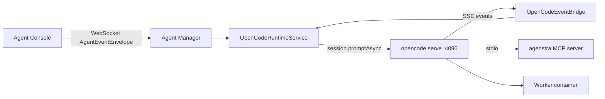

# Agent Runtime (OpenCode)

Agenstra's agent manager talks to coding agents in worker containers through the **OpenCode HTTP server**
(`opencode serve` on port 4096) using `@opencode-ai/sdk`. Chat turns, tool events, permissions and questions all flow
over HTTP plus one shared server-sent events (SSE) stream per container.

## Architecture

Outward APIs (OpenAPI / AsyncAPI chat events) are provider-neutral. Provider capabilities report
`transport: 'opencode-http'` on `GET /api/config` → `agentTypes[].capabilities`, agent response DTOs and the
controller client profile.

## Sessions

OpenCode session ids are stored per agent (`acp_sessions` jsonb column, kept for migration continuity) keyed by
`resumeSessionSuffix`, and reused while the container id matches:

- **Empty suffix** (`''`) — primary user-visible chat session
- **User chats** — `-chat-{uuid}` where `{uuid}` is the chat session id
- **Reserved / hidden** — not listed in agent `chats` / UI: `-prompt-enhance`, `-ticket-body`, `-ticket-auto-*`
  (`-ticket-auto-pre`, `-ticket-auto-loop`, `-ticket-auto-commit-msg`) and `-plan-{planId}`

## Permissions and questions

OpenCode `permission.*` and `question.*` events become `chatEvent` frames of kind `question`; the console answers them
through `POST .../permissions/:id/reply` and `POST .../questions/:id/reply`.

- **Ticket automation** (`-ticket-auto-*`, requires the controller's `unattendedAutomation` trust marker) runs the
  `agenstra-automation` agent with an allow-all session ruleset; residual asks are auto-approved.
- **Chat plan mode** (`-plan-*`) runs the `agenstra-plan` agent: explore tools and the platform context tools are allowed,
  writes are denied (see [Chat plan mode](../features/chat-plan-mode.md)).
- **Context access** prompts from the platform context MCP server use the same permission reply contract
  (ids `ctx_…`, see [Agent Context MCP](./context-mcp.md)).

## Prompt context

Ticket / knowledge context is served on demand by the worker `agenstra` MCP server when available, otherwise inlined
as hidden context. See [Agent Context MCP](./context-mcp.md).

## Notifications

Operator-facing notification events (controller notification bus / webhooks). The `agent.acp.*` names are historic and
kept for compatibility with existing subscribers.

| Event                         | When                                                  |
| ----------------------------- | ----------------------------------------------------- |
| `agent.acp.session_failed`    | Agent session failure (`AGENT_SESSION_FAILED`)        |
| `agent.acp.permission_denied` | Permission request denied (`AGENT_PERMISSION_DENIED`) |
| `agent.chat.failed`           | Generic chat turn failure (`CHAT_ERROR`)              |

Streaming token deltas are not notified.

## Worker image requirements

The [worker image](../../../apps/agenstra/backend-agent-manager/Dockerfile.worker) installs OpenCode and starts
`opencode serve` from its entrypoint, with Basic auth from `OPENCODE_SERVER_PASSWORD`. It also ships the context MCP
server at `/opt/agenstra/mcp/agenstra-context-mcp.cjs`.

## Troubleshooting

- **Agent never becomes healthy** — check `docker logs agenstra-worker-<agentId>` for the `opencode serve` output.
- **Auth errors** — check provider credentials in the layered OpenCode configuration (synced via `auth.set`).
- **Context MCP inactive** — see the fallback conditions in [Agent Context MCP](./context-mcp.md#fallback-unchanged-behaviour).

## Migration note

- Legacy OpenClaw (`openclaw` agent type / AGI image) has been removed. Recreate affected agents as `opencode`.
- Former `cursor` agents were remapped to `opencode`.
- The former Agent Client Protocol (stdio) transport has been removed; `ACP_AUTO_APPROVE` is no longer read.

## Future: external event consumers

`OutboundAgentEventPublisher` maps internal agent events outward (today a no-op sink). An external surface (for example
an ACP or other bus adapter for IDE clients) can implement it without touching the chat path, ChatFilters or context
injection.
