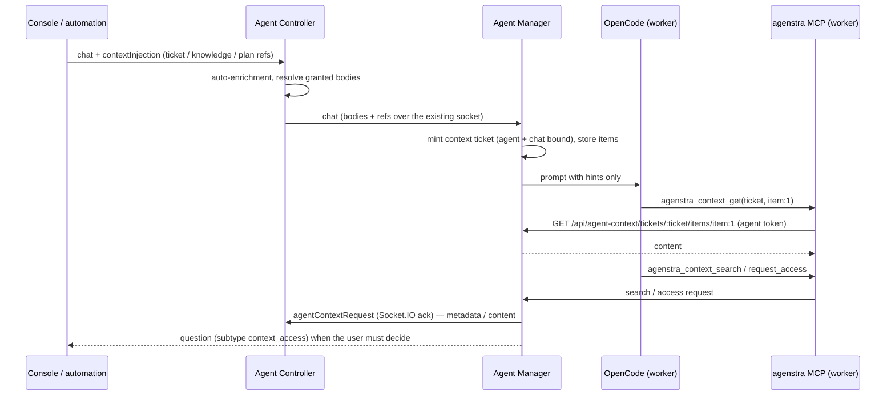

# Agent Context MCP

Chat prompts no longer carry the full text of referenced tickets, knowledge pages and linked chat plans. The agent-manager adds a short
hint (titles, sizes, refs and a **context ticket**) and the agent reads what it needs through the platform-managed
`agenstra` MCP server that ships in the worker image.

## Flow

## Tools

| Tool                              | Purpose                                                                               |
| --------------------------------- | ------------------------------------------------------------------------------------- |
| `agenstra_context_list`           | Items granted for this prompt, attachments, workspace mount and selected environments |
| `agenstra_context_mounts`         | Environments of the workspace and their read-only mounts below `/opt/workspace`       |
| `agenstra_context_search`         | Metadata of workspace tickets / knowledge and of the agent's own plans                |
| `agenstra_context_get`            | Full content of `item:<n>` or a granted `ticket:` / `knowledge:` / `plan:<sha>`       |
| `agenstra_context_request_access` | Ask for refs that are not granted yet (returns `granted`, `denied`, `pending`)        |

Metadata is always searchable; content of elements that were not part of the prompt requires an access request.
`agenstra_context_get` also returns the element's full `sha` and its `revision` (version), which content changes pass
back.

The same server exposes `agenstra_tasks_*` tools so the agent can manage its own recurring tasks (`/api/agent-context/tasks`,
same agent token, forwarded to the controller as `agentTaskRequest`). See [Agent tasks](../features/agent-tasks.md).

`agenstra_handoff_*` tools hand tasks over to other agents of the same workspace (`/api/agent-context/handoffs`,
forwarded as `agentHandoffRequest`). See [Agent handoffs](../features/agent-handoffs.md).

`agenstra_graph_*` tools read environment graphs: the structure (modules, files, symbols, imports, docs, instruction
files), the path tree and the prompt reference history of the own environment and of every environment mounted below
`/opt/workspace` (`/api/agent-context/graphs`, same agent token, answered by the manager itself). See
[Environment graphs](../features/environment-graphs.md).

`agenstra_deployments_*` tools follow, start and propose the CI/CD deployment workflows (GitHub Actions, GitLab CI,
Jenkins) available to the agent's environment (`/api/agent-context/deployments`, same agent token, forwarded as
`agentDeploymentRequest`). See [Deployments](#deployments).

### Deployments

Workspace admins define deployment workflows on top of instance-wide CI/CD connections (console _Pipelines_ page,
connections under _Connections_). A workflow is either available to every environment of the workspace (`global`) or
assigned to selected environments; `agentTriggerEnabled` decides whether those environments may start and cancel runs
or only read them. Environments can also propose workflows for themselves (see
[Workflows an environment manages for itself](#workflows-an-environment-manages-for-itself)).

| Tool                                    | Purpose                                                                                                  |
| --------------------------------------- | -------------------------------------------------------------------------------------------------------- |
| `agenstra_deployments_list_workflows`   | Enabled, approved workflows available to the environment, plus its own proposals (with `approvalStatus`) |
| `agenstra_deployments_get_workflow`     | One of those workflows (refs, defined inputs, `agentTriggerEnabled`, `approvalStatus`)                   |
| `agenstra_deployments_sync`             | Import the provider's latest runs of a usable workflow into the history (once every 30 s per workflow)   |
| `agenstra_deployments_list_runs`        | Recent runs of those workflows, newest first (`workflowId`, `limit` ≤ 100)                               |
| `agenstra_deployments_get_run`          | One run with its jobs (active runs are refreshed from the provider)                                      |
| `agenstra_deployments_get_run_logs`     | Log tail of a run or one job (at most 200 000 bytes, `truncated` when cut)                               |
| `agenstra_deployments_trigger`          | Start a run (`ticket`, `workflowId`; `ref` must be the default ref; `inputs` only defined names)         |
| `agenstra_deployments_cancel_run`       | Cancel an active run (`ticket`, `runId`)                                                                 |
| `agenstra_deployments_action_status`    | Keep waiting on a `pending` trigger / cancel (`ticket`, `requestId`)                                     |
| `agenstra_deployments_list_connections` | Connections the workspace may build workflows on (id, label, provider, status; no repository browsing)   |
| `agenstra_deployments_create_workflow`  | Propose a workflow for the own environment (pending until a workspace admin approves it)                 |
| `agenstra_deployments_update_workflow`  | Change an own workflow (assigned to this environment alone); content changes need approval again         |
| `agenstra_deployments_delete_workflow`  | Delete an own workflow (assigned to this environment alone) with its run history                         |

Routes (manager, agent token) below `/api/agent-context`: `GET deployments/workflows`, `POST deployments/workflows`,
`GET deployments/workflows/:workflowId`, `POST deployments/workflows/:workflowId/sync`,
`PATCH deployments/workflows/:workflowId`, `DELETE deployments/workflows/:workflowId`, `GET deployments/connections`,
`POST deployments/workflows/:workflowId/trigger` (body `{ ticket, ref?, inputs? }`), `GET deployments/runs`,
`GET deployments/runs/:runId`, `GET deployments/runs/:runId/logs?jobId`, `POST deployments/runs/:runId/cancel`
(body `{ ticket }`), `GET deployments/actions/:requestId?ticket=`.

#### Starting and cancelling runs

`agenstra_deployments_trigger` and `agenstra_deployments_cancel_run` take the context ticket of the prompt (like the
content tools) and are decided per session, like [content changes](#content-changes). The result is a decision:
`applied` (with the run), `pending` (call `agenstra_deployments_action_status` with the `requestId`), `denied` or
`failed` (with a message).

| Session                                             | Trigger / cancel                                                                                      |
| --------------------------------------------------- | ----------------------------------------------------------------------------------------------------- |
| Visible chat                                        | Asks you per action (subtype `context_deployment`): _Allow once_, _Allow for this chat_, _Deny_       |
| Recurring task runs (`-task-*`, unattended)         | Only the operations a user approved for the task (`allowedDeploymentOperations`, default none)        |
| Ticket automation (`-ticket-auto-*`, unattended)    | Only the operations allowed for the ticket's automation (`allowedDeploymentOperations`, default none) |
| Chat plan explore / refine (`-plan-*`, read-only)   | Never (the plan ruleset does not allow `agenstra_deployments_*`)                                      |
| Prompt enhancement, ticket body generation (hidden) | Never                                                                                                 |

- **The prompt shows what runs.** Triggers name the workflow, repository (and GitHub workflow file), connection, the
  ref that will be deployed (the workflow default ref) and the inputs the agent overrides; cancellations name the run,
  its status and workflow. _Allow for this chat_ covers further actions of the **same operation on the same workflow**
  in that chat only. Prompts are answered on the permission reply endpoint (ids start with `ctx_dep_`); undecided
  prompts expire after 30 minutes. Actions the controller would refuse anyway (pending or disabled workflow, no
  `agentTriggerEnabled`, other ref, unknown inputs, completed run) are answered right away without a prompt.
- **Unattended runs only do what was allowed for them.** The manager forwards the session's source (`task` with its id,
  or `automation`), never agent input, and only while that hidden session is the only one the agent runs; the
  controller re-reads the task (approved, operation in `allowedDeploymentOperations`) or the ticket automation
  (operation allowed) before it starts or cancels anything. `agentTriggerEnabled` alone no longer lets unattended runs
  start every workflow.
- At most 10 trigger / cancel actions per context ticket (turn).

#### Workflow rules

- **Controller is the authority.** The manager only validates shapes and bounds and forwards the authenticated agent
  id; the controller answers within the workspace bound to the connection and only exposes enabled, approved workflows
  that are global or assigned to the agent (plus the agent's own proposals), runs of those workflows, and
  `trigger` / `cancelRun` only with `agentTriggerEnabled`. Unknown ids and workflows of other environments are reported
  as not found; a connection that is no longer available to the workspace answers 403.
- **Pinned triggers.** Environment triggers always use the workflow default ref and may only override the inputs listed
  in `defaultInputs`; any other ref or input name is refused.
- **No duplicate runs.** Reads try every controller connection of the agent; mutations (trigger, cancel, workflow
  create / update / delete, history sync) are sent to a single connection (60 s acknowledgement timeout, the
  controller calls the provider), so a slow answer can never apply them twice.
- **Recorded as the agent.** Runs started by an environment carry `triggeredBy: agent` and its `agentId`, appear live
  on the console _Pipelines_ page and in the workspace audit log.
- Provider credentials never reach the worker; the tools only see run metadata and logs.

#### Workflows an environment manages for itself

Like recurring tasks, an environment can propose deployment workflows for itself with
`agenstra_deployments_create_workflow` (connection from `agenstra_deployments_list_connections`, repository, GitHub
workflow file, default ref / inputs, optionally `agentTriggerEnabled`). These tools need no context ticket; approval
protects them:

- The workflow is always assigned to the proposing environment only (`scope: environments`, no other environments;
  scope and assignment are not part of the input) and is **pending** until a workspace admin approves it on the console
  _Pipelines_ page. Nobody can start runs of a pending workflow, and other environments do not see it.
- The environment can only change or delete workflows assigned to it alone; anything else answers not found. Changing
  approved content (connection, repository, workflow, default ref / inputs, name, description, `agentTriggerEnabled`)
  or re-enabling makes the workflow pending again; disabling keeps the approval.
- Request `agentTriggerEnabled` only if the environment needs to run the workflow itself; runs still follow the session
  rules above.
- Plan sessions never get these tools (the plan ruleset denies every `agenstra_deployments_*` tool).

### Workspace mounts

Every worker mounts the host's agent directories read-only at `/opt/workspace` (see
[Container image security](../security/container-images.md)): the working directory of each environment appears as
`/opt/workspace/<mount id>`, where the mount id is the host directory name (`/opt/agents/<mount id>`), **not** the
environment id. Context hints always name this mount and the tool that maps it.

`agenstra_context_mounts` (route `GET /api/agent-context/tickets/:ticket/mounts`) lists the calling environment first
(with its writable working directory, e.g. `/app`) and then the other environments of the workspace with environment
id, name, description, repository, mount id and mount path; environments selected as context for the request are
marked `selected`. With `resolve` it looks up a single environment by environment id, mount id, unique name or an
absolute path below a mount (or below the own working directory) and returns the path relative to that environment.
`agenstra_context_list` adds name and mount path to the selected environments.

- **Workspace scope.** Metadata is only returned for environments the controller reports for the workspace bound to
  the connection (the same `agentHandoffRequest` `agents` list handoffs use, without handoff profiles). Directories of
  agents outside the workspace stay anonymous; the manager only reads their mount location locally.
- **No file access.** The tool is a lookup in that list: it never reads, lists or stats files. Files are read with the
  agent's own (permission-checked) file tools; the mount itself is read-only.
- **Degraded mode.** Without a controller connection only the calling environment is listed (with a `note`), and
  `agenstra_context_list` returns plain environment ids.

### Plans as context

Chat plans are a third context kind (`plan:<sha>`, sha1 of the plan id like tickets and knowledge nodes). Plans are
**agent specific**: the console links only plans of the chat's environment ("Select context" → _Plan context_), and the
controller serves search / describe / content only for plans of the requesting agent (the manager sends the
authenticated `agentId` with every request) — plans of other environments are indistinguishable from missing ones.
Plan content states the status and whether execution started (then read-only), the original request and the plan
markdown. Plans are never auto-enriched.

### Initiatives as context

[Initiatives](../features/initiatives.md) are two more context kinds, workspace wide like tickets and knowledge:

- `initiative:<sha>`: the overview (intent, documents with status and version, work items in build order with keys,
  statuses, dependencies, open questions and linked `ticket:` refs, accepted decisions). The revision is the initiative
  version.
- `artifact:<sha>`: one document (current version; the overview marks drafts and accepted versions).

They are searchable and readable like tickets (`agenstra_context_search` kinds `initiative` / `artifact`, access requests
in visible chats). Step runs (`-initiative-*`), ticket automation of a linked story, and plans created from a story get the
initiative overview and its accepted documents **pre-granted** (`initiativeContexts` / `initiativeContextRefs` of the
context injection); nothing beyond that is granted automatically.

## Content changes

`agenstra_content_*` tools create, change, comment on and delete tickets and knowledge pages, and update plans of the
agent's environment that were not executed yet. They take the same
context ticket and are routed `POST /api/agent-context/tickets/:ticket/changes` (manager) → `agentContextRequest`
with `op: 'change'` (controller).

| Tool                                  | Change                                                                                                                             |
| ------------------------------------- | ---------------------------------------------------------------------------------------------------------------------------------- |
| `agenstra_content_ticket_create`      | New ticket, optionally below a readable ticket (`parentRef`)                                                                       |
| `agenstra_content_ticket_update`      | Title, content, priority and / or status (`ref`, `revision`)                                                                       |
| `agenstra_content_ticket_comment`     | Comment on a readable ticket                                                                                                       |
| `agenstra_content_ticket_delete`      | Delete a readable ticket without subtasks (`revision`)                                                                             |
| `agenstra_content_page_create`        | New knowledge page or folder, optionally in a readable folder                                                                      |
| `agenstra_content_page_update`        | Title and / or content of a readable page (`revision`)                                                                             |
| `agenstra_content_page_delete`        | Delete a readable page or empty folder (`revision`)                                                                                |
| `agenstra_content_plan_update`        | Title and / or markdown of a readable, not executed plan                                                                           |
| `agenstra_content_initiative_propose` | Change proposal on a readable initiative (documents, work-item operations, decisions); a person accepts it on the Initiatives page |
| `agenstra_content_initiative_finding` | Finding on a readable initiative or one of its work items (`itemKey`), with evidence                                               |
| `agenstra_content_change_status`      | Keep waiting on a `pending` change (`requestId`)                                                                                   |

The tools deliberately do not share the `agenstra_context_*` prefix: plan sessions allow (and auto-answer) that prefix
as read-only explore tools, so content tools stay denied there.

- **Same gates as reading.** Only elements the ticket may read (granted, or created by a change of the same ticket) are
  changed or receive children; refs are resolved to full SHAs first, like access requests.
- **No blind overwrites.** Updates and deletes carry the `revision` from `agenstra_context_get`; the controller refuses
  the change (`failed`) when the element changed since. Pre-granted prompt content is read again by SHA for that.
- **Recorded as the agent.** Ticket / page activity uses the AI actor with `agentId` and `via` (`chat`, `task`,
  `automation`) in the payload; board updates, notifications, search and embeddings run as for user changes, and a
  change of approval-relevant ticket fields invalidates an automation approval like a user edit.

| Session                                             | Content changes                                                                           |
| --------------------------------------------------- | ----------------------------------------------------------------------------------------- |
| Visible chat                                        | Prompt per change (subtype `context_change`): _Allow once_, _Allow for this chat_, _Deny_ |
| Recurring task runs (`-task-*`, unattended)         | Only the operations a user approved for the task (`allowedContentWrites`, default none)   |
| Ticket automation (`-ticket-auto-*`, unattended)    | Only the operations allowed for the ticket's automation (default none), in its tree       |
| Chat plan explore / refine (`-plan-*`, read-only)   | Never                                                                                     |
| Initiative step runs (`-initiative-*`, read-only)   | Never (the result is the run's status block, accepted by a person)                        |
| Prompt enhancement, ticket body generation (hidden) | Never                                                                                     |

- _Allow for this chat_ covers further changes of the **same operation on the same element** (creates: below the same
  parent) in that chat only.
- Ticket automation may only be allowed `ticket.create` (subtasks within its tree), `ticket.update` (tickets of its
  tree except the automated ticket itself, whose change would void the run's approval) and `ticket.comment`; never
  deletes or knowledge changes. The opt-in is an approval-relevant automation setting.
- For unattended runs the controller is the authority: it re-reads the task (approved, operation allowed, a run
  working) or the automation (exactly one working run of the agent, operation allowed, target in the tree) when it
  applies the change. The manager only forwards the session's source, never agent input.
- At most 50 changes per context ticket (turn).
- **Initiative changes are never applied by the agent.** `initiative.propose` stores an open change proposal (documents,
  work-item operations, decisions) that a person accepts or rejects on the Initiatives page; `initiative.finding` records
  an inert finding. Ticket automation may only be allowed `initiative.finding`, and only on the story its ticket is linked
  to (the controller resolves the running ticket's story; agent input never selects it). Tasks need the explicit opt-in.
- **Plans keep the plans-page rules.** `plan.update` only applies to plans of the agent's own environment that never
  entered execution and are not being drafted (`ready`, `failed`, `cancelled`), conditional on `revision` — the same
  conditional write as a user edit, so an execution always runs exactly the latest saved version and executed plans
  stay read-only. The edit is logged as _Edited_ by the agent in the plan's activity. Tasks need the explicit
  `plan.update` opt-in; ticket automation can never be allowed it.

## Access decisions

| Session                                             | Additional access                                                     |
| --------------------------------------------------- | --------------------------------------------------------------------- |
| Visible chat                                        | Permission-style prompt: _Allow once_, _Allow for this chat_, _Deny_  |
| Ticket automation (`-ticket-auto-*`, unattended)    | Granted without asking within the ticket's tree, otherwise denied     |
| Chat plan explore / refine (`-plan-*`, read-only)   | Only the pre-granted context (the source chat's refs)                 |
| Initiative step runs (`-initiative-*`, read-only)   | Only the pre-granted context (initiative, accepted documents, target) |
| Recurring task runs (`-task-*`, unattended)         | Only the pre-granted context                                          |
| Prompt enhancement, ticket body generation (hidden) | Denied (only the items from the prompt are available)                 |

Replies use the existing permission reply endpoint (`POST .../permissions/:id/reply`, ids start with `ctx_`).

## Security

- **Grants name exact elements.** Access requests are resolved to full SHAs before the user is asked (a short SHA must
  match exactly one element) and only those are granted; content is always fetched by the granted SHA, so a prefix
  shared with another element never unlocks it.
- **Tickets live for one turn.** A context ticket is revoked when the turn it was minted for ends.
- **Auto-approval tickets are bound to the platform's prompt.** Tickets of automation / plan sessions only serve
  requests that match an `agenstra_context_*` tool call (same ticket and arguments) answering the prompt the platform
  sent with that ticket — directly, or in a subagent started by a `task` call of that answer. This is derived from
  the worker's OpenCode event stream (message lineage); prompts or child sessions a background process injects
  through the OpenCode API, and tickets copied into other processes, are useless.
- **Automatic grants are scoped.** Nobody can answer in hidden sessions, so additional context is decided by a scope
  the controller derives from what the platform granted the run (never from agent input): unattended **ticket
  automation** may read tickets of the same ticket tree as its ticket; **plans** and **task runs** get nothing beyond
  their pre-granted context. Everything else is denied.
- **Remaining limitation:** a process with code execution inside the worker (e.g. started through bash in a visible
  chat) can read the OpenCode server password and drive OpenCode sessions, and so obtain what a hidden session may
  read automatically — at most the scope above. Restrict code execution in visible chats (OpenCode permissions,
  sandboxed isolation, egress) where this matters.

- **Context tickets** are random, bound to one agent and chat session, expire after 2 h without use, and are only
  accepted together with the agent's **context token** (`HMAC(AGENT_CONTEXT_TOKEN_SECRET | ENCRYPTION_KEY, agent id +
credential hash)`). Tickets of other agents are indistinguishable from unknown tickets.
- The context API (`/api/agent-context/*`) bypasses user authentication guards and accepts **only** agent tokens.
- The controller answers `agentContextRequest` only within the workspace (client) bound to the connection and never
  forwards the event to browsers.
- The MCP server is root-owned and read-only inside the worker (`/opt/agenstra/mcp`).

## Deployment

- **Repository compose** (`apps/agenstra/backend-agent-manager/docker-compose.yaml`) enables it by default
  (`AGENT_CONTEXT_MCP_MANAGER_URL=http://agent-manager-api:3000/api` on the `agent-manager-network` bridge).
- **Provisioned managers** (controller server provisioning, Decabill cloud-init) set `AGENT_DOCKER_NETWORK`,
  `AGENT_CONTEXT_MCP_MANAGER_URL` and a random per-host `AGENT_CONTEXT_TOKEN_SECRET` automatically for **new** hosts.
- **Existing hosts** keep the inline fallback until those three variables are added to `/opt/agent-manager/docker-compose.yml`
  (`backend-agent-manager.environment`) and the stack is restarted. Agents pick up the MCP server on their next
  OpenCode config sync; workers created before the change join the network when they are next recreated.

## Deployment

- **Repository compose** (`apps/agenstra/backend-agent-manager/docker-compose.yaml`) and **provisioned managers**
  (controller server provisioning on Hetzner / DigitalOcean, Decabill cloud-init) set `AGENT_DOCKER_NETWORK=agent-manager-network`,
  `AGENT_CONTEXT_MCP_MANAGER_URL=http://agent-manager-api:<port>/api` and a per-host random `AGENT_CONTEXT_TOKEN_SECRET`,
  so new workers join the manager bridge and pick up the context MCP on their first config sync.
- **Already provisioned hosts** are not changed (cloud-init runs once). Add the three variables to
  `/opt/agent-manager/docker-compose.yml` and run `docker compose up -d`; existing workers move to the bridge on their next
  recreate. Until then the manager keeps inlining context.

## Fallback (unchanged behaviour)

The manager inlines context exactly as before (`<hidden-context>` block) whenever MCP mode is not fully available:

- `AGENT_CONTEXT_MCP_MANAGER_URL` unset, `AGENT_CONTEXT_MCP_ENABLED=false`, or no token secret;
- the worker image lacks the `io.agenstra.context-mcp=1` label (older images);
- OpenCode does not report the `agenstra` server as `connected` (the server exits on start when the manager is
  unreachable or the token is invalid).

The `agenstra` server is hidden from the MCP status list in the console and cannot be overridden by layered
configuration (it is injected after MCP allow/deny filtering).

See [Environment Configuration](../deployment/environment-configuration.md#agent-context-mcp) and
[Egress Filtering](../features/egress-filtering.md) (platform exception for the context API).
