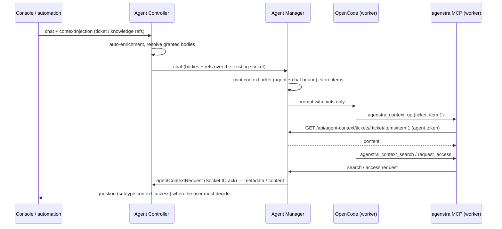

# Agent Context MCP

Chat prompts no longer carry the full text of referenced tickets and knowledge pages. The agent-manager adds a short
hint (titles, sizes, refs and a **context ticket**) and the agent reads what it needs through the platform-managed
`agenstra` MCP server that ships in the worker image.

## Flow

## Tools

| Tool                              | Purpose                                                                        |
| --------------------------------- | ------------------------------------------------------------------------------ |
| `agenstra_context_list`           | Items granted for this prompt, attachments, workspace and environment mounts   |
| `agenstra_context_search`         | Metadata of workspace tickets / knowledge (title, SHA, status, parent, size)   |
| `agenstra_context_get`            | Full content of `item:<n>` or a granted `ticket:<sha>` / `knowledge:<sha>`     |
| `agenstra_context_request_access` | Ask for refs that are not granted yet (returns `granted`, `denied`, `pending`) |

Metadata is always searchable; content of elements that were not part of the prompt requires an access request.

The same server exposes `agenstra_tasks_*` tools so the agent can manage its own recurring tasks (`/api/agent-context/tasks`,
same agent token, forwarded to the controller as `agentTaskRequest`). See [Agent tasks](../features/agent-tasks.md).

## Access decisions

| Session                                             | Additional access                                                    |
| --------------------------------------------------- | -------------------------------------------------------------------- |
| Visible chat                                        | Permission-style prompt: _Allow once_, _Allow for this chat_, _Deny_ |
| Ticket automation (`-ticket-auto-*`, unattended)    | Granted without asking                                               |
| Chat plan explore / refine (`-plan-*`, read-only)   | Granted without asking                                               |
| Prompt enhancement, ticket body generation (hidden) | Denied (only the items from the prompt are available)                |

Replies use the existing permission reply endpoint (`POST .../permissions/:id/reply`, ids start with `ctx_`).

## Security

- **Context tickets** are random, bound to one agent and chat session, expire after 2 h without use, and are only
  accepted together with the agent's **context token** (`HMAC(AGENT_CONTEXT_TOKEN_SECRET | ENCRYPTION_KEY, agent id +
credential hash)`). Tickets of other agents are indistinguishable from unknown tickets.
- The context API (`/api/agent-context/*`) bypasses user authentication guards and accepts **only** agent tokens.
- The controller answers `agentContextRequest` only within the workspace (client) bound to the connection and never
  forwards the event to browsers.
- The MCP server is root-owned and read-only inside the worker (`/opt/agenstra/mcp`).

## Deployment

- **Repository compose** (`apps/agenstra/backend-agent-manager/docker-compose.yaml`) enables it by default
  (`AGENT_CONTEXT_MCP_MANAGER_URL=http://agent-manager-api:3000/api` on the `agent-manager-network` bridge).
- **Provisioned managers** (controller server provisioning, Decabill cloud-init) set `AGENT_DOCKER_NETWORK`,
  `AGENT_CONTEXT_MCP_MANAGER_URL` and a random per-host `AGENT_CONTEXT_TOKEN_SECRET` automatically for **new** hosts.
- **Existing hosts** keep the inline fallback until those three variables are added to `/opt/agent-manager/docker-compose.yml`
  (`backend-agent-manager.environment`) and the stack is restarted. Agents pick up the MCP server on their next
  OpenCode config sync; workers created before the change join the network when they are next recreated.

## Deployment

- **Repository compose** (`apps/agenstra/backend-agent-manager/docker-compose.yaml`) and **provisioned managers**
  (controller server provisioning on Hetzner / DigitalOcean, Decabill cloud-init) set `AGENT_DOCKER_NETWORK=agent-manager-network`,
  `AGENT_CONTEXT_MCP_MANAGER_URL=http://agent-manager-api:<port>/api` and a per-host random `AGENT_CONTEXT_TOKEN_SECRET`,
  so new workers join the manager bridge and pick up the context MCP on their first config sync.
- **Already provisioned hosts** are not changed (cloud-init runs once). Add the three variables to
  `/opt/agent-manager/docker-compose.yml` and run `docker compose up -d`; existing workers move to the bridge on their next
  recreate. Until then the manager keeps inlining context.

## Fallback (unchanged behaviour)

The manager inlines context exactly as before (`<hidden-context>` block) whenever MCP mode is not fully available:

- `AGENT_CONTEXT_MCP_MANAGER_URL` unset, `AGENT_CONTEXT_MCP_ENABLED=false`, or no token secret;
- the worker image lacks the `io.agenstra.context-mcp=1` label (older images);
- OpenCode does not report the `agenstra` server as `connected` (the server exits on start when the manager is
  unreachable or the token is invalid).

The `agenstra` server is hidden from the MCP status list in the console and cannot be overridden by layered
configuration (it is injected after MCP allow/deny filtering).

See [Environment Configuration](../deployment/environment-configuration.md#agent-context-mcp) and
[Egress Filtering](../features/egress-filtering.md) (platform exception for the context API).
