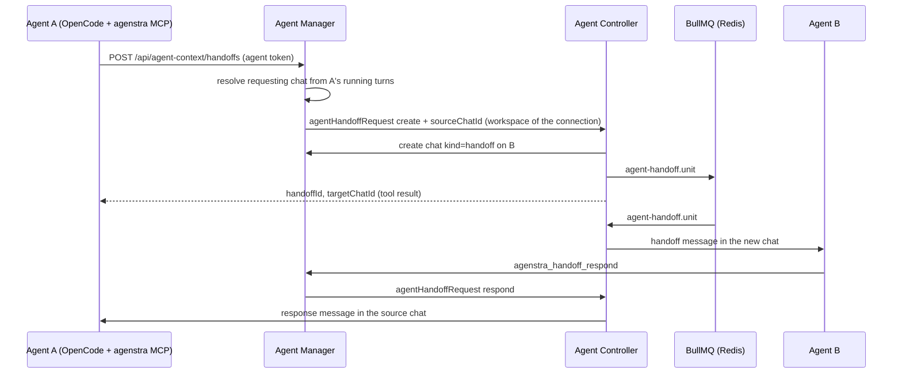

# Agent handoffs

An agent can hand a task over to another agent (environment) of the **same workspace**, for example a backend agent
asking a frontend agent to adapt the UI to a new endpoint. The target agent works on it in a **new chat**, and the
requesting agent always gets a response back in the chat the handoff was made in.

Handoffs run between the main agents of a workspace. They are not the subagents an agent may start through OpenCode.

## Knowing the peers

Agents decide on their own whether to gather information from, or offload work to, another agent. They see:

- **Metadata** of every other agent of the workspace (`agenstra_handoff_agents`): name, description, container type,
  repository, and the **handoff profile**.
- **Handoff profile**: what the environment is responsible for and what it can take over. It is edited in the console
  (**Update Environment** → **Handoff profile**) or by the agent itself (`agenstra_handoff_profile_update`); the
  listing reminds an agent whose own profile is still empty.
- **Missing profiles are generated on request** (`agenstra_handoff_profile_get`): the peer describes itself in a
  hidden, read-only session (`-handoff-profile`, explore tools only) with a fixed platform prompt, and the answer is
  stored as its profile. Nothing of the requesting agent reaches the peer, so the request cannot instruct it.
  Concurrent requests share one generation; a profile written meanwhile wins. If generation takes longer than 150 s
  the tool says so and the profile is stored once it is done.

## Where handoffs are possible

A handoff must always be answered in the context that asked for it. The MCP call itself carries no session, so the
agent-manager attributes it to the agent's **running turns** (tracked by the OpenCode runtime for every prompt):

| Calling context                                             | Result                                           |
| ----------------------------------------------------------- | ------------------------------------------------ |
| One visible chat (primary, user or handoff chat) is working | Accepted; the response goes to exactly that chat |
| Task run, ticket automation, plan or helper session         | Refused: the run ends before a response arrives  |
| Several sessions of the agent are working at the same time  | Refused: the requesting chat is ambiguous        |

Refusals are returned as tool errors, so the agent can decide how to continue (do the work itself, ask the user, retry
later).

## How it looks in the console

- **Outgoing:** the `Hand off task` tool call in the requesting chat shows the target agent, the task and an
  **Open handoff chat** button. This works in any chat, not only the primary one.
- **Incoming:** the target agent gets a regular chat (marked **(handoff)** in the chat switcher). Its first message
  is rendered as a handoff card with the source agent, the task and an **Open requesting chat** button.
- **Response:** the answer arrives in the requesting chat as a handoff response card (status, response, **Open
  handoff chat**) and starts a new turn of the requesting agent, which continues its work with it.

New handoff chats appear in the chat switcher as soon as there is activity in them.

## Flow

## Response guarantee

- The response is a new message in the requesting chat and starts a **turn of the requesting agent**, which continues
  the work that depended on it. The turn uses the model that chat was using. If a turn is still running in that chat,
  the response waits for it (prompts of one session run one after another).

- The target is asked to call `agenstra_handoff_respond` exactly once. If a turn ends without a response, the
  controller sends a repair prompt into the same chat (hidden, like chat plan repair turns), up to two times.
- If the agent still did not respond, the tail of its last answer becomes the response. If it gave no answer at all,
  or its turn failed or timed out, the handoff fails, and the failure is delivered as the response.
- Delivery is retried by BullMQ and by the coordinator (`agent-handoff.coordinator`, every minute). The coordinator
  also fails handoffs whose worker vanished (restart) and re-queues lost units. A response counts as delivered as soon
  as the manager accepted the message, so a long turn of the requesting agent never receives it twice.
- The response only ever goes to the chat the handoff was made in. If the user deleted that chat meanwhile (or every
  delivery attempt failed), the handoff is marked `undeliverable`; `agenstra_handoff_get` reports this with
  `deliveryFailureMessage`. It is never redirected to another chat.
- If the target agent or its handoff chat disappears, the handoff fails with a message saying so, which is delivered
  to the requesting chat. A target that no longer exists when the handoff is created is a tool error right away.

## Agent tools

| Tool                              | Purpose                                                                 |
| --------------------------------- | ----------------------------------------------------------------------- |
| `agenstra_handoff_agents`         | Other agents of the workspace with metadata and profile, plus own entry |
| `agenstra_handoff_profile_get`    | Metadata + profile of one peer; generates a missing profile first       |
| `agenstra_handoff_profile_update` | Set the own handoff profile (empty clears it)                           |
| `agenstra_handoff_create`         | Hand over a task (`targetAgentId`, `title`, `message`, opt. `model`)    |
| `agenstra_handoff_get`            | Status / response of a handoff the agent sent or received               |
| `agenstra_handoff_respond`        | Answer a received handoff (`status` completed/failed, `response`)       |

The message must be self-contained, because the target does not see the requesting chat. The target turn uses the
model the target was last used with in a visible chat (else the requester's), unless `model` is given. Read-only plan
sessions cannot use the tools (and every hidden session is refused, see above). In visible chats they follow the
environment's OpenCode permission configuration.

## Security and limits

- The manager accepts handoff calls only with the agent's context token and forwards them with the **authenticated**
  agent id. The controller resolves the workspace from the manager connection and only accepts targets with stored
  credentials in **that** workspace. A handoff is never possible across workspaces, and foreign handoffs look like
  missing ones.
- Profiles: an agent can only write its own profile; generation only fills an **empty** profile of a peer of the same
  workspace, with that peer's own self-description.
- Only the target can respond, and only once. Users cannot create chats of
  kind `handoff` through the API.
- Open handoffs per workspace (`AGENT_HANDOFFS_MAX_ACTIVE_PER_WORKSPACE`) and chain depth (`AGENT_HANDOFF_MAX_DEPTH`)
  are bounded, so agents cannot hand tasks back and forth forever.
- Usage is recorded as interaction kind `agent_handoff`.

## Configuration

See [Environment configuration](../deployment/environment-configuration.md#agent-handoffs).
