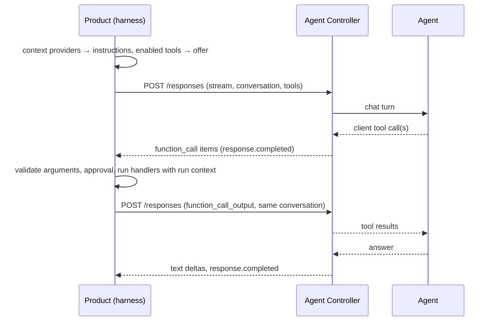

# Agent harness libraries

Shared libraries that embed an Agenstra agent into other products (assistants, helpers and automations) on top of the [OpenAI-compatible API](./openai-compatible-api.md). The product registers **its own function tools** and **turn context**; the agent combines them with its workspace tools and answers in a regular Agenstra chat session.

| Library                                               | Scope            | Purpose                                                                                                     |
| ----------------------------------------------------- | ---------------- | ----------------------------------------------------------------------------------------------------------- |
| `@forepath/shared/shared/util-agent-harness`          | Node and browser | Typed API client, SSE reader, tool registry, context providers, sessions and the client tool loop           |
| `@forepath/shared/backend/feature-agent-harness`      | NestJS           | `AgentHarnessModule`, `@AgentTool()` / `@AgentContext()` discovery, `AgentHarnessService`, SSE relay helper |
| `@forepath/shared/frontend/data-access-agent-harness` | Angular          | NgRx chat state (`agentHarness` feature), facade, relay or direct transport, browser tools                  |

No OpenAI SDK is required; requests use `fetch` (Node 18+ / browsers).

## How a turn runs



The harness uses the Responses API with streaming. One user message is one **turn**; client tool round trips inside it are **rounds** (default limit 32, the controller allows 64 calls per turn). Calls beyond the budget are answered with a `tool_budget_exhausted` error instead of being executed.

## Core usage

```ts
import { AgentHarness, AgentToolError } from '@forepath/shared/shared/util-agent-harness';

interface BillingContext {
  tenantId: string;
  userId: string;
  canBook: boolean;
}

const harness = new AgentHarness<BillingContext>({
  connection: { apiUrl: 'https://agenstra.example.com/api', clientId, agentId, credential: process.env.AGENT_PAT },
  instructions: 'You are the billing assistant of Decabill. Use the tools for every change.',
});

harness.registerTool({
  name: 'book_invoice',
  description: 'Books a draft invoice',
  parameters: { type: 'object', properties: { number: { type: 'string' } }, required: ['number'], additionalProperties: false },
  enabled: (ctx) => ctx.canBook, // not offered to users without the permission
  requiresApproval: true, // asks the user before running
  handler: async ({ number }, { context, signal }) => {
    const invoice = await invoices.findForTenant(context.tenantId, number, { signal });

    if (!invoice) {
      throw new AgentToolError(`Invoice ${number} not found`, 'not_found'); // message is shown to the agent
    }

    return invoices.book(context.userId, invoice.id);
  },
});

harness.registerContextProvider({ name: 'tenant', provide: (ctx) => ({ tenantId: ctx.tenantId }) });

const session = await harness.createSession({ title: 'Billing assistant', context: { tenantId, userId, canBook: true } });

for await (const event of session.stream('Book INV-7', { approve: (request) => askUser(request) })) {
  // turn.started, text.delta, agent.activity, tool.call, tool.result, text.done, turn.completed | turn.failed
}
```

| Concept          | API                                                                                                                                                                                                      |
| ---------------- | -------------------------------------------------------------------------------------------------------------------------------------------------------------------------------------------------------- |
| Conversations    | `createConversation`, `getConversation`, `renameConversation`, `deleteConversation`, `history`; `session(conversationId)`, `createSession()`                                                             |
| Turns            | `run()` (result, throws), `stream()` (events, ends with `turn.failed` instead of throwing), `turn()` (events, throws)                                                                                    |
| Turn options     | `context`, `conversationId` (`primary` = agent's primary session), `model`, `instructions`, `contextSections`, `tools` (`{ names, tags }` or `false`), `toolChoice`, `toolActivity`, `approve`, `signal` |
| Tools            | `name`, `description`, `parameters` (JSON schema), `parse` (e.g. zod), `enabled(ctx)`, `requiresApproval`, `timeoutMs`, `tags`                                                                           |
| Context          | Providers `(ctx) => text \| value`, rendered as `<context name="…">` sections in the turn's `instructions`                                                                                               |
| Low-level client | `AgentHarnessClient`: models, chat completions, responses (JSON / stream), conversations and items                                                                                                       |

Turns of one conversation are serialized inside a harness instance; across callers (other harness instances, replicas, console users) the agent manager runs the turns of one chat session one after another. Give parallel work its own conversation.

## NestJS

```ts
@Module({
  imports: [
    AgentHarnessModule.forRootAsync({
      useFactory: () => agentHarnessOptionsFromEnv('BILLING_AGENT') ?? { connection: { … } },
    }),
  ],
  providers: [InvoiceTools],
})
export class AppModule {}

@Injectable()
export class InvoiceTools {
  @AgentTool({ name: 'get_invoice_total', parameters: { type: 'object', properties: { number: { type: 'string' } }, required: ['number'] } })
  total(args: { number: string }, ctx: AgentToolContext<BillingContext>) {
    return this.invoices.totalFor(ctx.context.tenantId, args.number);
  }

  @AgentContext('billing_rules')
  rules(ctx: BillingContext) {
    return this.settings.rulesFor(ctx.tenantId);
  }
}
```

`agentHarnessOptionsFromEnv(prefix)` reads `<prefix>_API_URL`, `_CLIENT_ID`, `_AGENT_ID`, `_API_KEY`, `_MODEL`, `_INSTRUCTIONS`, `_TOOL_ACTIVITY`, `_MAX_TOOL_ROUNDS` and `_ALLOW_INSECURE_HTTP` (returns `undefined` without `_API_URL`). Only singleton providers are discovered; tool handler errors are logged by `AgentHarnessService`.

### Relaying turns to the product frontend

```ts
@Post('assistant/turns')
async turn(@Body() body: AgentHarnessTurnRequestDto, @Req() req: AuthenticatedRequest, @Res() res: Response) {
  const conversationId = await this.assistantConversations.assertOwnedBy(req.user, body.conversationId);

  await relayAgentHarnessTurn(res, (signal) =>
    this.harness.stream(body.message, { conversationId, context: toBillingContext(req.user), signal }),
  );
}
```

The relay writes harness events as SSE (`event: <type>`, JSON `data`), sends keep-alives, aborts on disconnect and **removes tool arguments and outputs** unless `includeToolPayloads: true`. Internal errors are reported as a generic `turn.failed`.

## Angular

```ts
providers: [provideAgentHarness({ mode: 'relay', relayUrl: `${environment.apiUrl}/assistant` })];
```

`AgentHarnessFacade` exposes `messages$`, `sending$`, `toolCalls$`, `activity$`, `lastTurn$`, `error$` and `createConversation()`, `openConversation()`, `send()`, `cancel()`, `reset()`.

| Mode     | Agenstra credential                                                      | Tools                                                      | Requests                                                                                                                                      |
| -------- | ------------------------------------------------------------------------ | ---------------------------------------------------------- | --------------------------------------------------------------------------------------------------------------------------------------------- |
| `relay`  | Stays on the product backend                                             | Backend tools (authorized server-side)                     | `POST {relayUrl}/turns`, `POST {relayUrl}/conversations`, `GET {relayUrl}/conversations/:id/items` via `HttpClient` (auth interceptors apply) |
| `direct` | User-bound token from `AGENT_HARNESS_CREDENTIAL` (e.g. app access token) | Browser tools from `AgentHarnessToolsService` (UI actions) | Agenstra OpenAI-compatible API via `fetch`; the product origin must be in `CORS_ORIGIN`                                                       |

## Security model

- **Authorization belongs to the tools.** The model chooses which tool to call and with which arguments; it never decides who may do what. Every handler receives the run context (`ctx.context`) and must check the acting user's permissions and tenant like any other request. `enabled(ctx)` additionally hides tools from users who may not use them; calls of tools that were not offered in the turn are refused.
- **Arguments are untrusted input.** They are checked against the tool's JSON schema (type, required, enum, bounds, `additionalProperties: false`) and the optional `parse` hook before the handler runs.
- **Human approval** for state-changing tools: `requiresApproval` asks the turn's `approve` handler; without one the call is denied (fail closed).
- **No internal details reach the transcript.** Only `AgentToolError` messages are shown to the agent; other errors become `internal_error` and go to `onToolError` / the Nest logger. Chat transcripts (including context sections and tool outputs) are visible in the Agenstra console to everyone with access to the workspace, so never put secrets into context or tool output.
- **Credentials.** Use a dedicated PAT with the minimal scopes (`agent_chats:write`, `agent_chats:read`, `agents:read`) of a service user that only has access to the product's workspace, or user-bound app tokens. `http://` is rejected except for loopback hosts unless `allowInsecureHttp` is set; redirects are not followed; ids are validated before they reach a URL.
- **Context is prompt text.** Section delimiters inside context values are neutralized, but user-provided data in context remains untrusted text for the agent.
- **Relays** redact tool payloads by default; the product must check that a requested conversation belongs to the caller before relaying a turn.
- Client tool results are only accepted from the same credential that started the turn (controller rule), so tool calls cannot be answered by other users.

## Limits

128 tools per turn, tool names `^[A-Za-z0-9_-]{1,64}$`, descriptions 4096 characters, 16 KB schema per tool and 128 KB in total, 64 KB arguments per call, tool output truncated at 100 000 characters, context at 32 000 characters, 1 MB request body. Tool handlers time out after 120 s by default (`timeoutMs`); the controller waits up to `OPENAI_CLIENT_TOOL_RESULT_TIMEOUT_MS` for a result.

Aborting a turn (signal, relay disconnect, `cancel()`) stops the harness at once. Client tool calls the agent is waiting for are answered in the background (computed outputs, otherwise a `cancelled` error), and further calls of that turn get the same error (at most 8 rounds / 5 minutes), so the chat session is free again as soon as the agent has answered.

## Related documentation

- **[OpenAI-compatible API](./openai-compatible-api.md)** Endpoints, function calling and limits
- **[Authentication](./authentication.md)** Personal access tokens, apps and scopes
