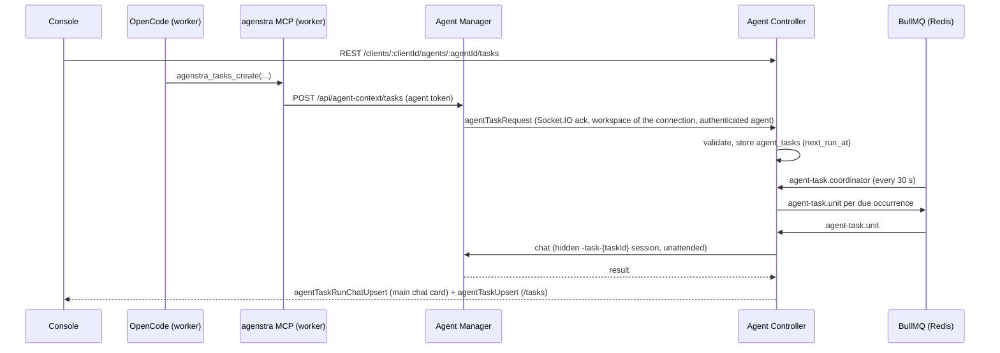

# Agent tasks

Recurring tasks let an environment (agent) do something on a schedule: a daily report, a weekly dependency check,
an hourly health probe. A task is a prompt plus a cron schedule. When it is due, the agent runs it unattended in a
hidden session and the result shows up as a structured card in the agent's **main chat**, like ticket automation runs.

Tasks are managed in two ways:

- **Console** `/tasks/:clientId` (sidebar **Tasks**) with the same workspace picker as tickets and pages.
- **The agent itself** through the platform `agenstra` MCP server (`agenstra_tasks_*` tools). Ask the agent in chat,
  for example "check the open pull requests every weekday at nine and summarize them". An agent can only see and
  change its **own** tasks.

## Prerequisites

- Workspace access (same rule as tickets and chat plans) and the `agents:chats` scope for PATs; tasks are prompts the
  agent runs.
- A model (`provider/model`) per task. Tasks the agent creates without a model use the model of the chat it was asked in.
- For agent-managed tasks: the [agent context MCP](../ai-agents/context-mcp.md) must be active for the environment
  (manager URL, token secret, worker image with the bundled server). Console management works without it.

## Flow

## Scheduling and reliability

- `agent_tasks.next_run_at` is the source of truth. The coordinator locks due rows (`FOR UPDATE SKIP LOCKED`),
  enqueues one unit job per occurrence and advances `next_run_at` in the same transaction; a failed enqueue rolls the
  claim back and is retried on the next tick.
- Each occurrence is identified by `(task_id, scheduled_for)`: the BullMQ job id is stable and `agent_task_runs` has a
  unique constraint, so retries and duplicate coordinator ticks never run the same occurrence twice.
- Occurrences missed while the controller was down collapse into **one** catch-up run.
- A task never runs twice at the same time; due occurrences are skipped while a run is in progress. Runs that outlive
  `AGENT_TASK_RUN_TIMEOUT_MS` (plus a grace period) are marked failed.
- Cron expressions have five fields and are evaluated in the task's IANA time zone (default `UTC`). Occurrences must be
  at least `AGENT_TASK_MIN_INTERVAL_MINUTES` apart; each agent has at most `AGENT_TASKS_MAX_PER_AGENT` tasks.
- **Run now** (console or `agenstra_tasks_run`) queues a manual occurrence; it also works for paused tasks.

## Runs

- Runs use the platform automation agent with the unattended session ruleset (no permission prompts, like ticket
  automation) and the `-task-{taskId}` session. Runs of one task share that session, so the agent sees its earlier runs.
- The run prompt carries the task title, schedule and instructions; instructions must be self-contained because the
  visible chat history is not part of the task session.
- Additional ticket / knowledge context is granted automatically (same as ticket automation).
- Runs are streamed like plan mode and settle on the agent's final answer. Every chat event of the turn (prompt, thinking,
  tool calls, answer; streaming deltas omitted, long strings capped) is stored on the run and shown as the task's
  **session history** on the `/tasks` detail page (**View task** on a chat card jumps to that run). The chat card itself
  only shows status, trigger and schedule. The tail of the final answer (up to 4,000 characters) is kept for
  `agenstra_tasks_get`; usage is recorded as interaction kind `agent_task_run`.
  chat card and the `/tasks` page. Usage is recorded as interaction kind `agent_task_run`.

## Agent tools

| Tool                    | Purpose                                                  |
| ----------------------- | -------------------------------------------------------- |
| `agenstra_tasks_list`   | The agent's tasks with schedule, next / last run, status |
| `agenstra_tasks_get`    | One task with its recent runs and their output           |
| `agenstra_tasks_create` | Create a task (`title`, `prompt`, `cronExpression`, …)   |
| `agenstra_tasks_update` | Change fields of a task, e.g. pause it (`enabled=false`) |
| `agenstra_tasks_delete` | Delete a task and its run history                        |
| `agenstra_tasks_run`    | Queue an immediate run                                   |

In visible chats the tools follow the environment's OpenCode permission configuration, so a configuration that asks
before MCP tool calls lets the user confirm every change. Read-only plan sessions cannot use them.

## Security

- The manager accepts task calls only with the agent's context token and forwards them with the **authenticated**
  agent id; the controller scopes every lookup to the workspace bound to the manager connection and that agent. Tasks
  of other agents or workspaces are indistinguishable from missing ones.
- The controller answers `agentTaskRequest` only on its own manager connections and never forwards it to browsers.
- Console routes require workspace access; deleting a workspace deletes its tasks and runs.

## REST API (controller)

| Method   | Route                                                   | Purpose                                         |
| -------- | ------------------------------------------------------- | ----------------------------------------------- |
| `GET`    | `/clients/:clientId/agent-tasks?agentId=`               | Tasks of the workspace / an agent               |
| `POST`   | `/clients/:clientId/agents/:agentId/tasks`              | Create                                          |
| `GET`    | `/clients/:clientId/agents/:agentId/tasks/:taskId`      | Task with recent runs                           |
| `PATCH`  | `/clients/:clientId/agents/:agentId/tasks/:taskId`      | Update                                          |
| `DELETE` | `/clients/:clientId/agents/:agentId/tasks/:taskId`      | Delete                                          |
| `GET`    | `/clients/:clientId/agents/:agentId/tasks/:taskId/runs` | Run history (`limit` ≤ 50, `includeTranscript`) |
| `POST`   | `/clients/:clientId/agents/:agentId/tasks/:taskId/runs` | Run now (`202`, `queued`)                       |

## Configuration

See [Environment configuration](../deployment/environment-configuration.md#agent-tasks).
