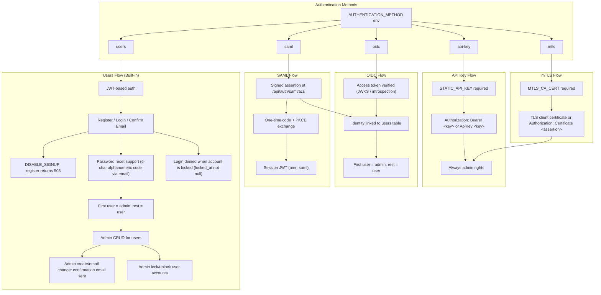
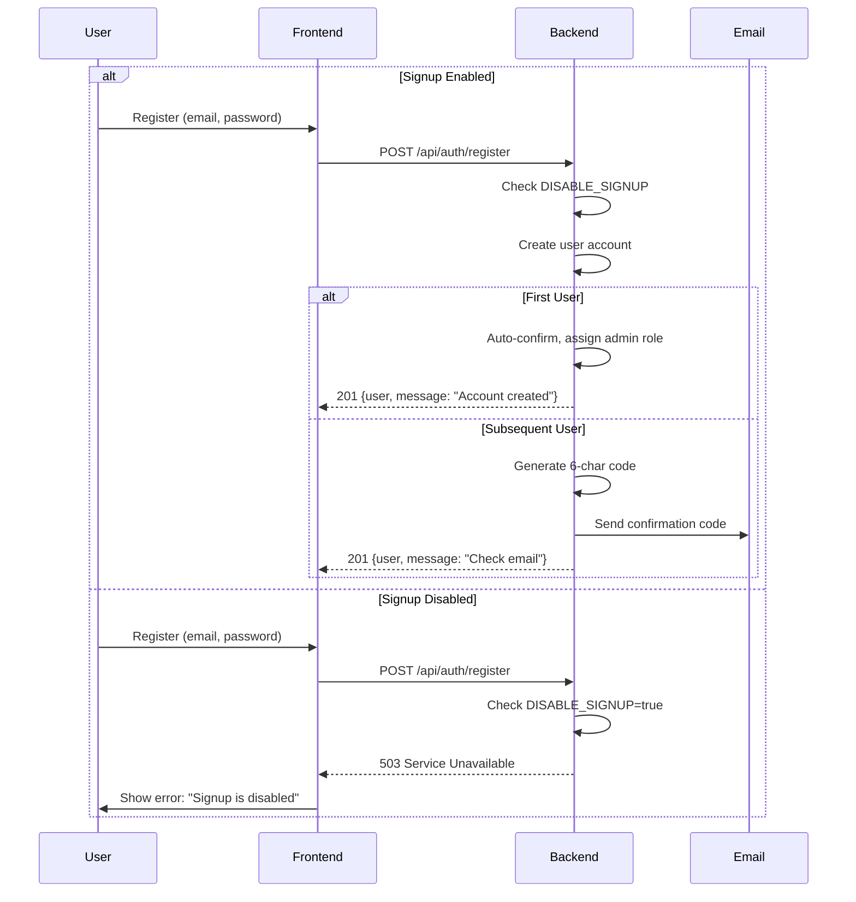

# Authentication

Authentication system supporting multiple authentication methods with configurable user registration.

## Overview

Agenstra supports five authentication methods:

- **API Key Authentication** Static API key for simple authentication
- **mTLS Authentication** Client certificates of a CA you control; full access like the API key
- **OIDC Authentication** Any OpenID Connect provider (for example Keycloak)
- **SAML Authentication** SAML 2.0 single sign-on (controller only)
- **Users Authentication** Built-in user registration with JWT

Each method has different use cases and can be configured via environment variables.

## Authentication Methods

### API Key Authentication

Simple authentication using a static API key. Suitable for development and single-user deployments.

**Configuration**:

```bash
AUTHENTICATION_METHOD=api-key
STATIC_API_KEY=your-secure-api-key-here
```

**Features**:

- All requests require `Authorization: Bearer <key>` or `Authorization: ApiKey <key>` header
- API key authentication always grants admin rights
- No user management required
- Simple setup for development environments

### mTLS (Client Certificate) Authentication

Like API key authentication, but the credential is an X.509 client certificate issued by a CA you control instead of a shared secret. A trusted certificate grants **full admin access to every endpoint and websocket**, exactly like `STATIC_API_KEY`: there are no user accounts, roles, personal access tokens or apps. Use it when certificates are already your credential of choice (PKI, smart cards, short-lived CI certificates) or when a leaked bearer secret is an unacceptable risk.

**Configuration**:

```bash
AUTHENTICATION_METHOD=mtls
# PEM bundle of the CA(s) that issue API client certificates (inline with \n escapes, or a file)
MTLS_CA_CERT_FILE=/run/secrets/api-client-ca.pem
# Optional: native TLS listener that requests client certificates (see "Presenting the certificate")
MTLS_SERVER_CERT_FILE=/run/secrets/server.crt
MTLS_SERVER_KEY_FILE=/run/secrets/server.key
```

| Variable                                            | Required | Description                                                                                                                                         |
| --------------------------------------------------- | -------- | --------------------------------------------------------------------------------------------------------------------------------------------------- |
| `MTLS_CA_CERT` / `MTLS_CA_CERT_FILE`                | yes      | Trusted client CA bundle (PEM). A self-signed client certificate without the CA flag can be listed to pin exactly that certificate.                 |
| `MTLS_ALLOWED_FINGERPRINTS`                         | no       | Comma-separated SHA-256 fingerprints (hex, colons optional). When this or `MTLS_ALLOWED_SUBJECTS` is set, a certificate must match one of the lists |
| `MTLS_ALLOWED_SUBJECTS`                             | no       | Comma-separated subject common names (`CN`)                                                                                                         |
| `MTLS_REVOKED_FINGERPRINTS`                         | no       | Comma-separated SHA-256 fingerprints that are always rejected (revocation without a CRL)                                                            |
| `MTLS_ASSERTION_MAX_LIFETIME`                       | no       | Maximum lifetime of a certificate assertion in seconds (default `300`, max `3600`)                                                                  |
| `MTLS_ASSERTION_AUDIENCE`                           | no       | When set, certificate assertions must carry this `aud`                                                                                              |
| `MTLS_SERVER_CERT[_FILE]`, `MTLS_SERVER_KEY[_FILE]` | no       | Serve HTTPS and request client certificates in the TLS handshake. Unset: plain HTTP (TLS terminated by a reverse proxy)                             |

The API refuses to start when `MTLS_CA_CERT` is missing or invalid. `mtls` is never inferred: it must be selected explicitly.

**Certificate requirements** (checked for both ways of presenting a certificate):

- currently valid (`notBefore` / `notAfter`), not a CA certificate, chains to a trusted CA through valid CA intermediates (signatures verified; at most 5 certificates)
- `clientAuth` extended key usage when the certificate restricts extended key usage
- RSA ≥ 2048 bits, ECDSA P-256 / P-384 / P-521, or Ed25519
- not listed in `MTLS_REVOKED_FINGERPRINTS`, and matching the allowlists when configured

**Presenting the certificate**: the API accepts either of the following; both prove possession of the private key.

1. **TLS handshake (native mTLS)**: with `MTLS_SERVER_CERT` / `MTLS_SERVER_KEY` set the API serves HTTPS and requests a client certificate. Unknown or missing certificates do not abort the handshake (health checks and assertion clients must still connect); every protected route then rejects the request. Best for CLIs and services that reach the API directly:

   ```bash
   curl --cacert server-ca.pem --cert client.pem --key client.key https://api.example.com/api/clients
   ```

2. **Certificate assertion** (`Authorization: Certificate <assertion>`): a short-lived JWS signed with the certificate's private key that carries the certificate chain (`x5c`). Use it when TLS is terminated by a reverse proxy, or from browsers (the consoles do this automatically). Format:
   - header `{ "alg": "ES256" | "ES384" | "ES512" | "RS256" | "EdDSA", "typ": "cert-assertion+jwt", "x5c": ["<leaf DER, base64>", "<intermediate>", …] }`; `alg` must match the certificate key
   - payload `{ "iat", "exp", "jti", "aud"? }` with `exp - iat ≤ MTLS_ASSERTION_MAX_LIFETIME` (30 s clock skew tolerated)

   Node clients can use the shared helper:

   ```ts
   import { createMtlsAssertion } from '@forepath/identity/backend';

   const assertion = createMtlsAssertion({ certificateChain: certificatePem, privateKey: privateKeyPem, lifetimeSeconds: 120 });
   await fetch(`${apiUrl}/clients`, { headers: { Authorization: `Certificate ${assertion}` } });
   ```

**Console login**: with `authentication: { type: 'mtls' }` in the console's runtime configuration, the login page asks for a **certificate file** instead of an API key: a PEM file with the client certificate (and intermediates), plus the PKCS#8 private key in the same file or in a second, optional file. The console imports the key as a **non-extractable** WebCrypto key into IndexedDB (scripts can sign with it but never read it back), then signs a fresh assertion every ~90 seconds (lifetime 120 s, `assertionLifetimeSeconds` / `audience` configurable). HTTP requests and Socket.IO handshakes carry it like any other credential. Logout, an expired certificate or a 401 removes the stored key. Encrypted keys and PKCS#12 files are not read directly; convert them first:

```bash
openssl pkcs12 -in client.p12 -nodes -out client.pem          # PKCS#12 → PEM (certificate + key)
openssl pkcs8 -topk8 -nocrypt -in client.key -out client.pk8   # PKCS#1 / SEC1 / encrypted → PKCS#8
```

**Issuing client certificates** (example with a dedicated CA):

```bash
openssl req -x509 -newkey ec -pkeyopt ec_paramgen_curve:P-256 -nodes -days 3650 \
  -subj "/CN=API Client CA" -keyout ca.key -out ca.pem \
  -addext basicConstraints=critical,CA:TRUE -addext keyUsage=critical,keyCertSign,cRLSign
openssl req -newkey ec -pkeyopt ec_paramgen_curve:P-256 -nodes -subj "/CN=ci-runner" -keyout client.key -out client.csr
openssl x509 -req -in client.csr -CA ca.pem -CAkey ca.key -CAcreateserial -days 90 -out client.pem \
  -extfile <(printf "basicConstraints=critical,CA:FALSE\nkeyUsage=critical,digitalSignature\nextendedKeyUsage=clientAuth")
```

**WebSockets**: every Socket.IO namespace accepts the same credentials as HTTP (TLS client certificate of the handshake connection, or `Certificate <assertion>` in the `Authorization` header / `auth.Authorization`) and grants the same full access as the API key. Like API-key and interactive sockets, the certificate is checked at the handshake; reconnects present a fresh assertion.

#### Controller → agent-manager over mTLS

Agent-managers can run `AUTHENTICATION_METHOD=mtls` as well. The controller then authenticates with a **client certificate per client**:

1. Issue a client certificate for the controller from a CA the manager trusts (see _Issuing client certificates_ above) and configure the manager with `AUTHENTICATION_METHOD=mtls` and `MTLS_CA_CERT[_FILE]` (optionally `MTLS_ALLOWED_FINGERPRINTS` to pin exactly the controller's certificate, and `MTLS_SERVER_CERT` / `MTLS_SERVER_KEY` for a native TLS listener).
2. In the console, add (or edit) the client with authentication type **mTLS (client certificate)** and select the certificate (PEM, leaf first) and its unencrypted private key (PEM). Via the API: `authenticationType: "mtls"`, `mtlsCertificate`, `mtlsPrivateKey`.

The controller validates the pair (matching key, accepted key type, not expired), stores the key AES-256-GCM encrypted (`ENCRYPTION_KEY`) and never returns it (responses only include the certificate's fingerprint, CN and expiry). Every proxied HTTP request and every websocket (re)connect to the manager carries a **fresh** certificate assertion (`Authorization: Certificate …`, lifetime 60 s) whose `aud` is the manager endpoint's origin, so a manager can bind assertions to itself with `MTLS_ASSERTION_AUDIENCE=<its external origin>`. Rotate by uploading a new certificate and key together; switching the client to another authentication type deletes them. Provisioned servers keep using API key or OIDC (an mTLS manager needs an operator CA).

**Security notes**:

- Use a CA **dedicated to API clients**: every certificate it issues is an administrator. Restrict shared CAs with `MTLS_ALLOWED_FINGERPRINTS` / `MTLS_ALLOWED_SUBJECTS`.
- Revocation is not fetched (no CRL / OCSP): prefer short-lived certificates, and list compromised ones in `MTLS_REVOKED_FINGERPRINTS`.
- Never give a reverse proxy an upstream client certificate issued by the trusted CA: with the native listener every request forwarded over that connection would be authenticated as the proxy.
- A certificate assertion is a bearer credential for its short lifetime (≤ `MTLS_ASSERTION_MAX_LIFETIME`); set `MTLS_ASSERTION_AUDIENCE` when several APIs trust the same CA. Unlike a static API key, it expires on its own and the private key never leaves the client.
- Rejections answer `401 Missing client certificate` / `401 Invalid client certificate`; the reason (expired, untrusted, revoked, …) is only logged.

### OIDC Authentication

Provider-agnostic OpenID Connect (any compliant IdP, for example Keycloak, Entra ID, Okta, Auth0, Authentik). The API acts as an OAuth 2.0 resource server and validates access tokens; the agent console signs in with Authorization Code + PKCE.

**Configuration**:

```bash
AUTHENTICATION_METHOD=oidc
OIDC_ISSUER=https://idp.example.com/realms/agenstra
OIDC_CLIENT_ID=api-client            # confidential client of the API (introspection)
OIDC_CLIENT_SECRET=your-client-secret
OIDC_TOKEN_VALIDATION=ONLINE         # ONLINE (default): signature + RFC 7662 introspection; OFFLINE: JWKS only
OIDC_AUDIENCE=                       # optional, comma-separated; token `aud` must contain one
OIDC_AUTHORIZED_PARTIES=             # comma-separated `azp` allowlist (client ids); this or OIDC_AUDIENCE required in production
JWT_SECRET=your-jwt-secret-key       # signs PAT / app access JWTs
```

| Variable                           | Default                                     | Purpose                                                                                      |
| ---------------------------------- | ------------------------------------------- | -------------------------------------------------------------------------------------------- |
| `OIDC_ISSUER`                      | required                                    | Exact `iss`; discovery at `<issuer>/.well-known/openid-configuration`                        |
| `OIDC_CLIENT_ID` / `_SECRET`       | required for `ONLINE`                       | Client credentials used for token introspection                                              |
| `OIDC_TOKEN_VALIDATION`            | `ONLINE`                                    | `ONLINE` also requires `active: true` at the introspection endpoint                          |
| `OIDC_AUDIENCE`                    | unset                                       | Restrict accepted tokens to this API (recommended where the IdP supports it)                 |
| `OIDC_AUTHORIZED_PARTIES`          | unset                                       | Restrict accepted tokens to these `azp` client ids                                           |
| `OIDC_DISCOVERY_URL`               | `<issuer>/.well-known/openid-configuration` | Override when the API reaches the IdP under another URL (issuer must still match)            |
| `OIDC_ALLOWED_ALGORITHMS`          | RS/PS/ES 256–512                            | Asymmetric algorithms only; `HS*` and `none` are always rejected                             |
| `OIDC_EMAIL_CLAIM`                 | `email`                                     | Claim used as the local account email                                                        |
| `OIDC_CLOCK_TOLERANCE_SECONDS`     | `0`                                         | Allowed clock skew (max 300)                                                                 |
| `OIDC_ALLOW_INSECURE_HTTP`         | `false`                                     | Production only accepts https provider URLs (issuer, JWKS, endpoints) unless `true`          |
| `OIDC_ALLOW_UNRESTRICTED_AUDIENCE` | `false`                                     | Production requires `OIDC_AUDIENCE` or `OIDC_AUTHORIZED_PARTIES` unless `true`               |
| `OIDC_TRUST_EMAIL`                 | `false`                                     | Treat emails without an `email_verified` claim as verified (only if the IdP controls emails) |

Agent console runtime config (public SPA client, Authorization Code + PKCE):

```json
{ "authentication": { "config": { "type": "oidc", "issuer": "https://idp.example.com/realms/agenstra", "clientId": "console", "scope": "openid profile email" } } }
```

`postLogoutRedirectUri` is optional.

**Features**:

- Tokens are verified locally (JWKS signature, exact issuer, expiry, optional audience / `azp`); tokens carrying a `typ` claim other than `Bearer` (ID / refresh tokens) are rejected
- OIDC identities are mapped to the local `users` table (`external_provider = oidc`, `external_subject = sub`)
- First user per tenant gets admin role; **roles always come from the local user**, IdP role claims are not used
- An existing local account is linked by email only when the email is trusted — `email_verified: true`, or no claim at all and `OIDC_TRUST_EMAIL=true` / `SAML_TRUST_EMAIL=true` (only set this when the IdP controls the addresses) — and the account is not linked to another identity yet. Untrusted emails are neither linked nor stored: the account gets a non-routable `…@external.invalid` placeholder, so nobody can claim an address (for example to be added to a workspace by email).
- In production `OIDC_AUDIENCE` or `OIDC_AUTHORIZED_PARTIES` is required (boot fails otherwise; `OIDC_ALLOW_UNRESTRICTED_AUDIENCE=true` opts out) and provider URLs must use https (`OIDC_ALLOW_INSECURE_HTTP=true` opts out). ID tokens are rejected as bearer tokens (`typ`, `at_hash` / `c_hash`).
- Provisioned OIDC consoles need a dedicated public console client (`oidc.frontendClientId`, different from `oidc.clientId`) or an `oidc.audience`, so the console API never accepts tokens of the API's own service client. Provisioned managers validate OFFLINE against the controller's client and never receive its secret.
- New accounts are created on first sign-in in every tenant by default. With several tenants behind one IdP, set `EXTERNAL_AUTH_AUTO_PROVISION_TENANTS` (comma-separated tenant ids, or `none`) so IdP users cannot claim an empty tenant; elsewhere only existing or linkable accounts can sign in. The first user of a tenant becomes admin atomically (concurrent first sign-ins cannot both become admin).
- SAML single logout (SLO) is not implemented: signing out at the IdP does not end an existing console session; use `POST /auth/logout` (or invalidate all sessions of the user).
- Console sessions are bound to the method that issued them: after switching between `users` and `saml`, existing sessions of the other method are rejected.
- Locked users are rejected; per-user `tenant_id` enforced
- OIDC token scopes are not enforced (unchanged); PAT scopes are

### SAML Authentication

SAML 2.0 single sign-on. The API is the SAML service provider; after a validated assertion it issues the same session JWT as users mode (`amr: ["saml"]`).

**Configuration**:

```bash
AUTHENTICATION_METHOD=saml
SAML_IDP_SSO_URL=https://idp.example.com/sso          # HTTP-Redirect binding
SAML_IDP_CERT="-----BEGIN CERTIFICATE-----..."        # PEM or bare base64; several allowed
SAML_IDP_ISSUER=https://idp.example.com/entity        # recommended: pin the IdP entity id
SAML_SP_ENTITY_ID=https://console.example.com         # default: origin of SAML_SP_ACS_URL
SAML_SP_ACS_URL=https://console.example.com/api/auth/saml/acs
SAML_FRONTEND_CALLBACK_URL=https://console.example.com/login/saml/callback
JWT_SECRET=your-jwt-secret-key
```

Optional: `SAML_NAMEID_FORMAT` (default `urn:oasis:names:tc:SAML:2.0:nameid-format:persistent`; `unspecified` omits it; transient NameIDs are rejected), `SAML_EMAIL_ATTRIBUTE` (default: `email`, `mail`, `urn:oid:0.9.2342.19200300.100.1.3`, the emailaddress claim, or an email-format NameID), `SAML_WANT_ASSERTIONS_SIGNED` / `SAML_WANT_RESPONSE_SIGNED` (default `true`; not both `false`), `SAML_SP_PRIVATE_KEY` (sign AuthnRequests), `SAML_SP_DECRYPTION_PRIVATE_KEY` (encrypted assertions), `SAML_CLOCK_SKEW_MS` (default `0`).

Agent console runtime config: `{ "authentication": { "config": { "type": "saml" } } }`.

**Flow**:

1. The console creates a PKCE verifier and opens `GET /api/auth/saml/login?code_challenge=…&redirect=/path`.
2. The IdP posts the response to `POST /api/auth/saml/acs`; the API validates signature, audience (SP entity id), `InResponseTo` (consumed once; unsolicited / IdP-initiated responses are rejected) and assertion replay.
3. The API redirects to `SAML_FRONTEND_CALLBACK_URL?code=…` with a single-use code (60 s).
4. The console redeems it at `POST /api/auth/saml/token` with `{ "code", "codeVerifier" }` and receives the session JWT.

Multi-tenant APIs: the browser redirect to `GET /api/auth/saml/login` cannot carry `X-Tenant`, so the console passes `tenant=<id>` (validated against `TENANTS` like the header). The tenant is bound to the single-use relay state and restored at the ACS; the code exchange then requires the same tenant (`X-Tenant`).

`GET /api/auth/saml/metadata` serves SP metadata for IdP configuration. Logout uses `POST /auth/logout` as in users mode. Password login, registration and local 2FA endpoints are not available. Identity mapping, roles, locking and tenants work as in OIDC mode (`external_provider = saml`, `external_subject` = NameID).

The agent-manager accepts `api-key`, `oidc` or `mtls` (it has no console; see [Controller → agent-manager over mTLS](#controller--agent-manager-over-mtls)). With `oidc` it only validates tokens (no user mapping); the controller authenticates against it with client credentials (see [Client Management](./client-management.md)). Provisioned managers additionally set `OIDC_AUTHORIZED_PARTIES=<clientId>` so only the controller's client can call them.

Provisioned managers validate tokens OFFLINE (JWKS) with `OIDC_AUTHORIZED_PARTIES=<controller client id>` and never receive the client secret, so a compromised manager host cannot mint tokens other managers or the controller would accept. Use one OIDC client per manager when you configure managers manually. The manager websocket (`/socket/agents`) requires the same service credentials on the handshake (static API key or OIDC access token); unauthenticated sockets are refused before they connect.

### Users Authentication

Built-in user registration and authentication with JWT tokens. Suitable for standalone deployments without external identity providers.

**Configuration**:

```bash
AUTHENTICATION_METHOD=users
JWT_SECRET=your-jwt-secret-key
DISABLE_SIGNUP=false  # Set to true to disable self-registration
DISABLE_FORCE_LOGIN_2FA=false  # Default: force email OTP (or TOTP if enrolled) on every login
PRODUCT_NAME=Agenstra  # Issuer label on TOTP QR / authenticator entries (default: Forepath)
```

**Features**:

- User registration with email/password
- Email confirmation with 6-character alphanumeric codes (consumed atomically; single-use under concurrency)
- Password reset functionality (reset codes consumed atomically; single-use under concurrency)
- JWT-based authentication
- **Login 2FA** (forced by default): email OTP on every login unless an authenticator is enrolled; set `DISABLE_FORCE_LOGIN_2FA=true` to make 2FA opt-in only. Email OTP codes are consumed atomically (single-use under concurrency).
- Self-service authenticator (TOTP) and optional email 2FA under Security settings
- Self-service password change under Security settings (current password, new password, confirmation; own account only)
- TOTP QR / authenticator account name uses `PRODUCT_NAME` (falls back to `Forepath`) plus the user email
- Admin can remove a user's authenticator (falls back to email OTP when force is on)
- First registered user gets admin role
- Admin user management (CRUD operations)
- Optional signup disable for controlled onboarding
- **Personal access tokens (PATs)** for machine/API automation (see below)

### Personal access tokens (users, oidc and saml modes)

User-bound tokens for scripts and CI. They are **not** a console login password. **Not available** when `AUTHENTICATION_METHOD=api-key` or `mtls`.

| Concern                  | Behavior                                                                                                                           |
| ------------------------ | ---------------------------------------------------------------------------------------------------------------------------------- |
| Create / update / revoke | Console **Personal Access Tokens** page (`/settings/tokens`); interactive console session only (password, OIDC or SAML session)    |
| Exchange                 | `POST /auth/token` with `{ "token": "fp_pat_…" }` only (no email) → JWT with `amr: ["pat"]` and `scopes`                           |
| Console                  | Login rejects `fp_pat_` secrets; SPA rejects JWTs whose `amr` includes `pat`                                                       |
| WebSockets               | Only with the socket's `websocket:<socket>:read` scope; every event is capped by its domain scopes (see [WebSockets](#websockets)) |
| OIDC / SAML              | Local `users` row is linked on first sign-in (`external_subject`); PAT CRUD and exchange require `JWT_SECRET`                      |
| Scopes                   | `AGENSTRA_PAT_SCOPES` (see [Scope model](#scope-model)); each enforced via `@RequireScopes`                                        |

Compared to `STATIC_API_KEY`, PATs are per-user, scoped, rotatable, and do not grant cross-tenant admin by default.

Updating a token changes **name** and **scopes** only; the secret is never rotated by update. Exchanged PAT JWTs embed `patId`; each request re-checks the PAT row so **revoke**, **expiry**, and **scope updates** take effect immediately. **Role demotion** also takes effect immediately: request roles come from the live DB user (not the JWT claim), admin-only scopes are stripped from the effective grant set, and changing a user’s role bumps `tokenVersion` so outstanding JWTs are rejected.

#### Scope model

Scopes follow `<resource>:<level>` with three hierarchical levels per resource (similar to GitHub token permissions):

| Level   | Grants                                                                           | Implies            |
| ------- | -------------------------------------------------------------------------------- | ------------------ |
| `read`  | Read operations in non-admin scope                                               | —                  |
| `write` | All other non-admin operations on the resource                                   | `read`             |
| `admin` | Operations reserved to admins and their console / API (admin role also required) | `write` and `read` |

`:admin` scopes are only grantable to admins and are stripped from the effective grant set when the user is not an admin. Routes without `@RequireScopes` reject PATs (fail-closed). Each operation's required scope is listed in the OpenAPI spec as the role name on its `bearerAuth` security requirement.

| Resource                | Levels               | Covers                                                                                                                                                                                                                                                                     |
| ----------------------- | -------------------- | -------------------------------------------------------------------------------------------------------------------------------------------------------------------------------------------------------------------------------------------------------------------------- |
| `clients`               | read / write / admin | Workspaces, members, provisioning, isolation, egress, configuration overrides, workspace + agent OpenCode config, provider/MCP catalogs; admin: instance OpenCode config (`/admin/opencode/config`)                                                                        |
| `agents`                | read / write         | Agent CRUD, models, permission/question replies, autonomy, start/stop/restart                                                                                                                                                                                              |
| `agent_files`           | read / write         | Agent workspace files and workspace search (write: edit files, reindex)                                                                                                                                                                                                    |
| `agent_environment`     | read / write         | Agent environment variables                                                                                                                                                                                                                                                |
| `agent_chats`           | read / write         | Chat sessions and messages, chat plans, scheduled agent tasks                                                                                                                                                                                                              |
| `agent_vcs`             | read / write         | Git status/branches/diff; write: stage, commit, push, pull, rebase, branches, automation command checks                                                                                                                                                                    |
| `agent_deployments`     | read / write         | CI/CD configuration, repositories, workflows, runs and logs; write: configure, trigger, cancel                                                                                                                                                                             |
| `agent_vnc`             | write                | Remote desktop session tickets (machine tokens also need `websocket:vnc:write`)                                                                                                                                                                                            |
| `tickets`               | read / write         | Tickets, comments, activity, ticket automation                                                                                                                                                                                                                             |
| `knowledge`             | read / write         | Knowledge tree, pages, relations                                                                                                                                                                                                                                           |
| `initiatives`           | read / write         | Initiatives: documents, work items, guided step runs, proposals, findings, decisions. Side effects also need their domain scope (`tickets:write` for transfer / release / proposal accept, `agent_chats:write` for runs and story plans, `knowledge:write` for publishing) |
| `attachments`           | read / write         | Ticket, knowledge and chat attachments                                                                                                                                                                                                                                     |
| `statistics`            | read                 | Workspace and aggregate statistics                                                                                                                                                                                                                                         |
| `websocket:clients`     | read / write         | `socket/clients` (chat, agent relay, plans); write: send chat / enhance / ticket body / file updates, plan actions                                                                                                                                                         |
| `websocket:status`      | read / write         | `socket/status` (environment status); write: mark environments / chats read, set the active environment (auto-marks it read)                                                                                                                                               |
| `websocket:tickets`     | read                 | `socket/tickets` (ticket board events)                                                                                                                                                                                                                                     |
| `websocket:pages`       | read                 | `socket/pages` (knowledge board events)                                                                                                                                                                                                                                    |
| `websocket:initiatives` | read                 | `socket/initiatives` (Initiatives board events)                                                                                                                                                                                                                            |
| `websocket:vnc`         | write                | Remote desktop websocket (required to mint a VNC ticket with a machine token)                                                                                                                                                                                              |
| `imports`               | admin                | Atlassian context import                                                                                                                                                                                                                                                   |
| `users`                 | admin                | User management                                                                                                                                                                                                                                                            |
| `webhooks`              | admin                | Webhook endpoints                                                                                                                                                                                                                                                          |
| `updates`               | admin                | Application update checks                                                                                                                                                                                                                                                  |

Stored tokens were migrated to this model (`RefactorPersonalAccessTokenScopes1793600000000`); legacy scopes that could only be mapped by granting additional writes were dropped, so affected tokens must be re-issued.

#### WebSockets

PAT JWTs and app access tokens (machine tokens) may use the Socket.IO namespaces like console sessions, within the same constraints as the REST API. Interactive sessions and `STATIC_API_KEY` are unaffected.

| Concern          | Behavior                                                                                                                                                                                                                                                                                                             |
| ---------------- | -------------------------------------------------------------------------------------------------------------------------------------------------------------------------------------------------------------------------------------------------------------------------------------------------------------------- |
| Connect          | `Authorization: Bearer <JWT>` (header or `auth.Authorization`) plus `websocket:<socket>:read` for that namespace; otherwise the handshake is rejected                                                                                                                                                                |
| Inbound events   | Each event needs its socket scope (`:write` for state-changing events) **and** the domain scopes of its REST equivalent (e.g. `chat` → `websocket:clients:write` + `agent_chats:write`). Unlisted events are rejected (`error`)                                                                                      |
| Outbound events  | Each event needs the domain scopes of its REST equivalent (e.g. `fileUpdateNotification` → `agent_files:read`); events the token may not read are never delivered, unknown events are dropped                                                                                                                        |
| User limitations | Workspace membership applies as on REST; admin users' tokens get no console-admin bypass. The status socket only sends a token its own snapshot / patches                                                                                                                                                            |
| Context          | Ticket, knowledge and attachment context in chat / plan payloads (explicit or auto-enriched) is dropped unless the token has `tickets:read`, `knowledge:read` or `attachments:read`                                                                                                                                  |
| Never allowed    | Agent terminal events (`createTerminal`, `terminalInput`, …): shell access stays interactive-only                                                                                                                                                                                                                    |
| Live checks      | Every inbound event re-validates the token like a REST request (revoke, scope change, lock, demotion, app authorization); listen-only sockets are re-checked every `SOCKET_MACHINE_SESSION_REVALIDATE_MS` (default 60 s). The socket is closed when the check fails or the JWT expires; reconnect with a fresh token |

The per-event scope maps live in `agenstra-websocket.scopes.ts` (product) on top of the shared helpers in `@forepath/identity/backend` (`websocketScope`, `socketRoomsForUser`, `attachMachineSocketSession`).

### Apps (third-party authorization; users, oidc and saml modes)

Admins can register **apps**: external applications that act on behalf of users after the user authorizes them (similar to GitHub OAuth apps). Apps reuse the [PAT scope catalog](#scope-model). **Not available** when `AUTHENTICATION_METHOD=api-key` or `mtls`.

| Concern        | Behavior                                                                                                                                                                                                                                                   |
| -------------- | ---------------------------------------------------------------------------------------------------------------------------------------------------------------------------------------------------------------------------------------------------------- |
| Management     | Console **Apps** page (`/apps`, admin, interactive session only): name, description, return URL, scopes. The app id is the row UUID; the app secret (`fp_aps_…`) is shown once and stored as a bcrypt hash only                                            |
| Return URL     | Absolute `https` URL (`http` only for `localhost` / `127.0.0.1`), no credentials, no fragment. Redirects only ever go to the registered URL (no caller-supplied redirect URI)                                                                              |
| Grant page     | `/authorize?app_id=<uuid>&state=<opaque>[&code_challenge=<S256>&code_challenge_method=S256]`; shows the login mask first when needed, then app name, description and scopes                                                                                |
| Scope cap      | A user only grants the requested scopes their own role may grant (`:admin` scopes only for admins); the rest is shown as "not granted". The cap is re-applied on every request                                                                             |
| Second factor  | Approving a new (or changed) authorization requires the user's 2FA: authenticator code, or an emailed code when email 2FA is enabled or forced. OIDC / SAML accounts rely on the IdP's MFA                                                                 |
| Skip consent   | An existing, up-to-date authorization redirects back immediately with a new code (no consent, no 2FA)                                                                                                                                                      |
| Redirect       | Approved: `status=approved&app_id&code&state`. Denied: `status=denied&error=access_denied&error_description&state`. No grantable scope: `status=error&error=invalid_scope`                                                                                 |
| Token exchange | `POST /auth/apps/token` (public, rate-limited, server-to-server) with `app_id`, `app_secret` and either the `code` (+ `code_verifier`) or a `refresh_token`; returns an access JWT (1 h) and a refresh token                                               |
| Lifetime       | Authorizations never expire. Codes are single-use (10 min); refresh tokens rotate on every use. Replaying a code or an old refresh token revokes the affected session                                                                                      |
| Access tokens  | JWT with `amr: ["pat", "app"]`, `scopes`, `appId`, `appSessionId`. Treated exactly like PAT JWTs: fail-closed `@RequireScopes`, no interactive-only routes (token/app management, 2FA, password), [WebSockets](#websockets) only with `websocket:*` scopes |
| Live checks    | Every request re-checks session, authorization, app, user (locked, unconfirmed, tenant, token version) and the effective scopes; any drift rejects the token so the app refreshes                                                                          |
| Re-auth        | When the app gains a scope (or the user can now grant more), tokens keep the previously consented scopes and the token response sets `reauthorization_required: true`; the grant page asks again                                                           |
| Revocation     | Admins revoke one or all authorizations of an app; users revoke their own under **Authorized apps** (`/settings/apps`). Revoking ends all sessions and forces the full consent flow next time                                                              |

Effective scopes of an app token = consented scopes ∩ current app scopes ∩ scopes the user's current role may grant. Removing a scope from the app or demoting the user takes effect immediately; adding a scope requires re-authorization.

Example token exchange:

```bash
curl -X POST https://<host>/api/auth/apps/token \
  -H 'Content-Type: application/json' \
  -d '{"grant_type":"authorization_code","app_id":"<app id>","app_secret":"fp_aps_…","code":"fp_apc_…"}'
# → { "access_token": "…", "token_type": "Bearer", "expires_in": 3600, "refresh_token": "fp_apr_…",
#     "scope": "tickets:read", "scopes": ["tickets:read"], "reauthorization_required": false, "user": { … } }
```

## Users Authentication Flow

### Registration

1. User registers with email and password
2. System checks if signup is enabled (`DISABLE_SIGNUP` environment variable)
3. If signup is disabled, registration returns 503 Service Unavailable
4. If enabled, user account is created:
   - First user: Auto-confirmed and assigned admin role
   - Subsequent users: Receive 6-character alphanumeric confirmation code via email (queued; see [Email notifications](./email-notifications.md))

### Email Confirmation

1. User receives confirmation code via email (6-character alphanumeric: uppercase letters and numbers)
2. User enters email and code on confirmation page
3. System validates the code and consumes it atomically (only one concurrent confirmation can succeed)
4. User can now log in

If the confirmation page was closed before the code was entered, the confirmation email explains how to continue: sign in again with the same email address (the app returns to the confirmation page), or open `/confirm-email` and enter the email address with the code manually.

### Login

1. User enters email and password
2. System validates credentials
3. System checks if email is confirmed
4. System checks if the account is locked (`locked_at` must be null)
5. If valid, JWT token is issued
6. Token is stored in localStorage and included in subsequent requests

When credentials are valid but the email is not confirmed yet, login returns `401` with code `EMAIL_NOT_CONFIRMED` and the frontend redirects to `/confirm-email` with the email pre-filled.

### Password Reset

1. User requests password reset with email
2. System sends 6-character alphanumeric reset code via email
3. User enters email, code, and new password
4. System validates the code and consumes it atomically while updating the password (only one concurrent reset can succeed)
5. User can log in with new password

## Disabling Signup

When `DISABLE_SIGNUP=true` is set:

### Backend Behavior

- `POST /api/auth/register` endpoint returns `503 Service Unavailable` with message "Signup is disabled"
- Self-registration is completely disabled
- Admin user creation via `POST /api/users` remains available for onboarding

### Frontend Behavior

- "Create an account" link is hidden on the login page
- Direct navigation to `/register` redirects to `/login`
- Users must be created by administrators

### Configuration

**Backend**:

```bash
DISABLE_SIGNUP=true
```

**Frontend** (via CONFIG JSON):

```json
{
  "authentication": {
    "type": "users",
    "disableSignup": true
  }
}
```

The frontend configuration should match the backend `DISABLE_SIGNUP` setting to ensure consistent behavior.

## User Roles

### Admin Role

- Full access to all features
- User management (create, read, update, delete users)
- Can lock and unlock user accounts
- Can create users via `POST /api/users`
- First user in the system automatically gets admin role

### User Role

- Standard user access
- Cannot manage other users
- Can change own password
- Can update own profile

## Admin User Management

Admins can manage users via the user management interface or API:

### Create User

- Admin creates user via `POST /api/users`
- Non-first users receive confirmation email
- User must confirm email before logging in

### Update User

- Admin can update user details
- Email changes require confirmation
- Password changes take effect immediately

### Delete User

- Admin can delete users
- Deletion removes all user data

### Lock / Unlock User

- Admin can lock users via `POST /api/users/:id/lock`
- Admin can unlock users via `POST /api/users/:id/unlock`
- Locked users cannot log in while `locked_at` has a timestamp value
- Existing JWTs stop working on the next API call once a user is locked (or deleted): the server reloads the user row and rejects locked or missing accounts
- In **oidc** and **saml** mode, the same `users` row is consulted after a valid token / assertion is accepted: HTTP requests fail with 401 if the linked user is locked, and WebSocket auth denies connections when the linked row is locked
- Admins cannot lock or unlock themselves

## Security Features

### Password Security

- Passwords are hashed using bcrypt
- Minimum password length enforced
- Password confirmation required on registration

### Token Security

- JWT tokens expire after 7 days
- Tokens are stored securely in localStorage
- Tokens include user ID, email, role, and a token version (`tv`) claim
- Each authenticated request in **users** mode verifies the user still exists, is not locked (`locked_at` null), and that the JWT token version matches the user's `token_version` in the database
- **Logout** (`POST /api/auth/logout`) revokes the current JWT session by default; optional `invalidateAllSessions: true` bumps `token_version` and ends every session
- **Password change** increments `token_version` and returns a new JWT for the current browser; all other sessions are invalidated on their next request
- **Password reset** and **admin password updates** increment `token_version`; affected users must log in again
- In **oidc** mode, session lifecycle is managed by the IdP (the app backend does not issue console JWTs); with `OIDC_TOKEN_VALIDATION=ONLINE` revoked IdP sessions stop working immediately
- In **saml** mode, the backend issues the same session JWT as users mode (`amr: ["saml"]`), so logout, token version and revocation apply
- Each authenticated request in **oidc** / **saml** mode applies the same lock check against the local user row
- The SPA registers an HTTP interceptor (`getUsersSessionInvalidationInterceptor`) that, in **users**, **saml** or **oidc** mode, dispatches logout on 401 with session-ending messages (locked account, invalid/expired token, etc.). In users / saml mode it also clears the stored JWT; in oidc mode existing logout effects end the IdP session and return the UI to the login flow

### Email Confirmation

- 6-character alphanumeric confirmation codes
- Codes expire after use
- Prevents unauthorized account creation

### Rate Limiting

- All endpoints are rate-limited
- Prevents brute force attacks
- Configurable limits per endpoint

## API Endpoints

### Authentication Endpoints (Public)

- `POST /api/auth/login` - Login with email/password (console; PATs rejected)
- `POST /api/auth/token` - Exchange personal access token for machine JWT (`amr: pat`)
- `POST /api/auth/register` - Register new user (returns 503 when `DISABLE_SIGNUP=true`)
- `POST /api/auth/confirm-email` - Confirm email with 6-character code
- `POST /api/auth/request-password-reset` - Request password reset
- `POST /api/auth/reset-password` - Reset password with code
- `POST /api/auth/change-password` - Change password (authenticated; returns new JWT)
- `POST /api/auth/logout` - Log out and invalidate all JWT sessions (users and saml auth)

### SAML Endpoints (Public, saml mode only)

- `GET /api/auth/saml/login` - Start sign-in (`code_challenge`, `redirect`); redirects to the IdP
- `POST /api/auth/saml/acs` - Assertion Consumer Service; redirects to the console callback with a one-time code
- `POST /api/auth/saml/token` - Redeem `{ code, codeVerifier }` for a session JWT
- `GET /api/auth/saml/metadata` - SP metadata XML

### Personal Access Token Endpoints (Password session)

- `GET /api/auth/token-scopes` - Grantable scopes for the current user
- `GET /api/auth/tokens` - List own tokens
- `POST /api/auth/tokens` - Create token (plaintext returned once)
- `PATCH /api/auth/tokens/:id` - Update own token name and scopes (secret unchanged)
- `DELETE /api/auth/tokens/:id` - Revoke own token
- `GET /api/users/:userId/tokens` - List tokens for a user (admin)
- `DELETE /api/users/:userId/tokens/:tokenId` - Revoke a user's token (admin)

### App Endpoints

| Method   | Path                         | Auth                        | Purpose                                        |
| -------- | ---------------------------- | --------------------------- | ---------------------------------------------- |
| `POST`   | `/auth/apps/token`           | Public (app id + secret)    | Exchange code / refresh token for access token |
| `GET`    | `/auth/apps/authorize`       | Interactive session         | Grant page data                                |
| `POST`   | `/auth/apps/authorize`       | Interactive session (+ 2FA) | Approve or deny; returns redirect to the app   |
| `GET`    | `/auth/apps/grants`          | Interactive session         | Own authorized apps                            |
| `DELETE` | `/auth/apps/grants/:grantId` | Interactive session         | Revoke own authorization                       |
| `GET`    | `/apps`                      | Admin, interactive session  | List apps                                      |
| `POST`   | `/apps`                      | Admin, interactive session  | Create app (secret returned once)              |
| `PATCH`  | `/apps/:id`                  | Admin, interactive session  | Update app                                     |
| `DELETE` | `/apps/:id`                  | Admin, interactive session  | Delete app with all authorizations             |
| `POST`   | `/apps/:id/secret`           | Admin, interactive session  | Regenerate secret (returned once)              |
| `GET`    | `/apps/:id/grants`           | Admin, interactive session  | List user authorizations                       |
| `DELETE` | `/apps/:id/grants`           | Admin, interactive session  | Revoke all authorizations                      |
| `DELETE` | `/apps/:id/grants/:grantId`  | Admin, interactive session  | Revoke one authorization                       |

### User Management Endpoints (Admin Only)

- `GET /api/users` - List users
- `POST /api/users` - Create user
- `GET /api/users/:id` - Get user
- `POST /api/users/:id` - Update user
- `DELETE /api/users/:id` - Delete user
- `POST /api/users/:id/lock` - Lock user account
- `POST /api/users/:id/unlock` - Unlock user account

## Authentication Flow Diagram



## Registration Sequence Diagram



## Per-Client Permissions

When using **users**, **oidc** or **saml** authentication, access to clients is controlled by per-client permissions. Users can be assigned to clients with roles (admin/user). In **api-key** and **mtls** mode, users do not play a role and all permission checks are bypassed.

See **[Client Management](./client-management.md#per-client-permissions)** for details on access control rules and managing client users.

## Migrating from `keycloak`

The `keycloak` method was replaced by the provider-agnostic `oidc` method (Keycloak remains a supported OIDC and SAML identity provider). `AUTHENTICATION_METHOD=keycloak` now fails at boot.

| Before                                                         | After                                                              |
| -------------------------------------------------------------- | ------------------------------------------------------------------ |
| `AUTHENTICATION_METHOD=keycloak`                               | `AUTHENTICATION_METHOD=oidc`                                       |
| `KEYCLOAK_AUTH_SERVER_URL` + `KEYCLOAK_REALM`                  | `OIDC_ISSUER=<KEYCLOAK_AUTH_SERVER_URL>/realms/<realm>`            |
| `KEYCLOAK_CLIENT_ID` / `KEYCLOAK_CLIENT_SECRET`                | `OIDC_CLIENT_ID` / `OIDC_CLIENT_SECRET`                            |
| `KEYCLOAK_TOKEN_VALIDATION`                                    | `OIDC_TOKEN_VALIDATION` (`ONLINE` / `OFFLINE`; `NONE` was removed) |
| `KEYCLOAK_SERVER_URL`                                          | removed (use `OIDC_DISCOVERY_URL` if the API needs another URL)    |
| Console `{ type: 'keycloak', authServerUrl, realm, clientId }` | `{ type: 'oidc', issuer, clientId }`                               |

Database migrations rename `users.keycloak_sub` to `external_subject` with `external_provider = 'oidc'`, so linked users keep their accounts (the Keycloak `sub` is unchanged).

Controller → agent-manager clients: authentication type `keycloak` becomes `oidc`, `keycloak_client_id` / `keycloak_client_secret` become `oidc_client_id` / `oidc_client_secret`, and the per-client realm is folded into `oidc_issuer` (`<KEYCLOAK_AUTH_SERVER_URL>/realms/<realm>`) only when `KEYCLOAK_AUTH_SERVER_URL` is still set while the migration runs; otherwise `oidc_issuer` stays empty and the controller's `OIDC_ISSUER` applies. Agent-managers previously running implicit keycloak mode need `OIDC_ISSUER`, `OIDC_CLIENT_ID`, `OIDC_CLIENT_SECRET` (and ideally `OIDC_AUTHORIZED_PARTIES`). Migrated issuers equal to `OIDC_ISSUER` (when set while migrating) are stored as NULL and follow `OIDC_ISSUER`; other internal issuer URLs must be listed in `OIDC_TRUSTED_CLIENT_ISSUERS`, otherwise the client-endpoint SSRF policy (public addresses, allowlist, https in production) applies to them.

## Related documentation

- **[Environment Configuration](../deployment/environment-configuration.md)** Environment variable reference
- **[Security (Accepted risks)](../security/accepted-risks.md)** **AR-003** (implicit authentication method resolution when `AUTHENTICATION_METHOD` is unset)
- **[Security (Operational hardening)](../security/operational-hardening.md)** Backend authentication resolution behavior
- **[Client Management](./client-management.md)** Per-client permissions and user management
- **[Backend Agent Controller Application](../applications/backend-agent-controller.md)** Backend authentication implementation
- **[Frontend Agent Console Application](../applications/frontend-agent-console.md)** Frontend authentication UI

---

_For detailed API specifications, see the application and API reference docs linked below._
