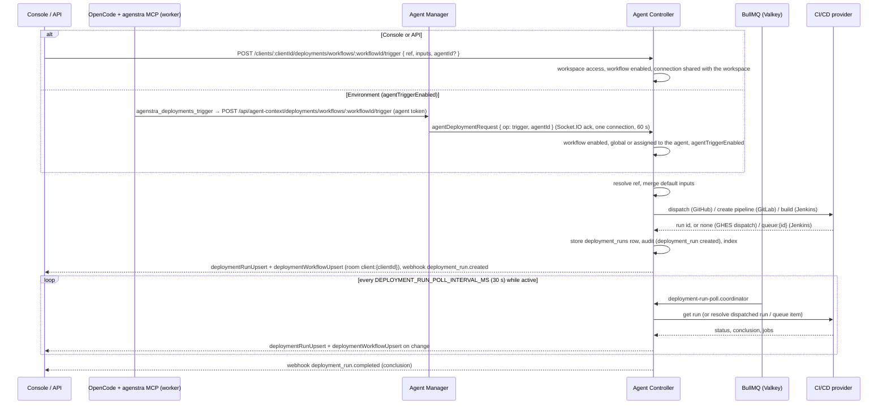

# Deployments

Workspace deployments let a workspace run its CI/CD pipelines from Agenstra: GitHub Actions workflows, GitLab CI
pipelines and Jenkins jobs. The agent-controller keeps the definitions, the run history and the live status; the
CI/CD provider still does the actual work.

Three building blocks:

- **Connections** (instance admins, console **Connections → CI/CD**, `/connections/deployments`): credentials
  for one GitHub, GitLab or Jenkins account, shared with all workspaces or with selected ones.
- **Workflows** (workspace admins, console **Pipelines** page / sidebar **Pipelines**, where they are called
  **pipelines**, `/pipelines/:clientId`): "what to run" on top of a
  connection: repository, provider workflow, default ref and inputs. A workflow is available to every environment of
  the workspace (`global`) or assigned to selected environments.
- **Runs**: every trigger from the console, the API or an environment, plus runs started directly on the provider
  (imported as `external`). Their status is polled until they complete and pushed live to the console.

Environments (agents) see the workflows available to them through the platform `agenstra` MCP server
(`agenstra_deployments_*` tools) and may start and cancel runs when the workflow allows it.

## Prerequisites

- **Connections**: a global administrator (or API key authentication). PATs need `connections:admin` on top of the
  admin role.
- **Workflows and connection browsing**: workspace management access (workspace admin or creator, global admin
  session, API key). PATs need `deployments:write`.
- **Runs** (history, trigger, cancel, sync, logs): workspace access (any member). PATs need `deployments:read` to
  read and `deployments:write` to trigger, cancel or sync.
- **Agent access**: the [agent context MCP](../ai-agents/context-mcp.md#deployments) must be active for the
  environment. Console and API use work without it.
- `ENCRYPTION_KEY` on the controller (connection credentials are stored AES-256-GCM encrypted).
- Network access from the controller to the provider API (`https://api.github.com`, `https://gitlab.com` or your
  self-hosted instance, the Jenkins URL). Environments never talk to the provider for deployments.

| Scope               | Covers                                                                                                  |
| ------------------- | ------------------------------------------------------------------------------------------------------- |
| `connections:admin` | `/connections/deployments/*` (and `/connections/atlassian/*`); admin role required as well              |
| `deployments:read`  | List / get workflows and runs, run jobs and logs; live socket events `deployment*`                      |
| `deployments:write` | Trigger, cancel, sync; workflow create / update / delete and connection browsing (with workspace admin) |

## Concepts

### Connections

A connection holds the provider, an optional base URL, the auth variant and the credentials:

| Provider | `provider` | Auth variants (`authType`, first = default)                          | Base URL default                                      |
| -------- | ---------- | -------------------------------------------------------------------- | ----------------------------------------------------- |
| GitHub   | `github`   | `app` (GitHub App: `appId`, `installationId`, `privateKey`), `token` | `https://api.github.com` (GHE: `https://host/api/v3`) |
| GitLab   | `gitlab`   | `token` (personal, group or project access token)                    | `https://gitlab.com` (API at `{base}/api/v4`)         |
| Jenkins  | `jenkins`  | `token` (`username` + API token)                                     | none, `baseUrl` is required                           |

- Secrets (`token`, `privateKey`) are **write-only**: they are never returned, logged, indexed or put into error
  messages. Responses carry only non-secret identifiers (`appId`, `installationId`, `username`).
- Updating a connection without secrets keeps the stored ones. Switching `authType` requires the secrets of the new
  variant. The provider cannot be changed.
- Base URLs must be absolute `http(s)` URLs without credentials, query or fragment.
- **Workspace access**: `workspaceAccess: all` (default) shares the connection with every workspace;
  `selected` restricts it to `allowedClientIds` (at least one, at most 500). Removing a workspace later makes its
  workflows on that connection unusable: trigger, cancel, logs and browsing answer `403 Connection not available for
this workspace`, and polling skips them.
- **Test**: `POST /connections/deployments/:id/test` calls the provider (GitHub App: installation repositories; GitHub
  PAT: `/user`; GitLab: `/user`; Jenkins: `/me/api/json`) and stores `lastTestStatus` (`ok`, `failed`, `untested`),
  a sanitized `lastTestMessage` (at most 512 characters) and `lastTestedAt`, so the admin list shows whether a
  connection works.
- A connection used by workflows cannot be deleted (`409 Connection is used by N deployment workflows`).

### Workflows

| Field                 | Meaning                                                                                                            |
| --------------------- | ------------------------------------------------------------------------------------------------------------------ |
| `connectionId`        | Connection usable by the workspace                                                                                 |
| `name`, `description` | Display name (≤ 200) and description (≤ 2,000)                                                                     |
| `repository`          | GitHub `owner/repo`, GitLab project id or path, Jenkins job full name (`folder/job`)                               |
| `workflow`            | GitHub workflow file name or id (required for GitHub); `null` for GitLab and Jenkins                               |
| `defaultRef`          | Branch or tag used when a trigger names none; otherwise the repository default branch                              |
| `defaultInputs`       | GitHub `workflow_dispatch` inputs, GitLab pipeline variables, Jenkins build parameters (≤ 25, overridable per run) |
| `scope`               | `global` (every environment of the workspace) or `environments` (only `agentIds`, 1 to 100 environments)           |
| `agentTriggerEnabled` | Whether available environments may **trigger and cancel** runs through MCP (default `false`: read only)            |
| `enabled`             | Disabled workflows cannot be triggered (`409`) and are hidden from environments                                    |

Read-only fields: `approvalStatus` (`approved` / `pending`), `approvedAt`, `createdBy` / `updatedBy` (`user` or
`agent`) and `createdByAgentId` (the environment that proposed the workflow); see
[Environment actions and approvals](#environment-actions-and-approvals).

`agentIds` must be environments of the workspace. The workflow list is filterable by `agentId`, which returns the
workflows available to that environment (global ones plus those assigned to it). Workflows also carry the status of
their last run (`lastRunStatus`, `lastRunConclusion`, `lastRunAt`). Deleting a workflow deletes its runs; deleting a
workspace deletes its workflows.

### Global vs environment assignment

- **Global** workflows are offered to every environment of the workspace, for example a shared staging deployment.
- **Environment** workflows are offered only to the assigned environments, for example the deployment of the service
  an environment works on.
- Console users with workspace access can trigger any enabled workflow regardless of scope. A trigger that names an
  `agentId` records the run for that environment and is only accepted when the workflow is global or assigned to it
  (`403 This workflow is not available to the environment`).

### Agent trigger permission

Environments always get read access to the enabled, approved workflows available to them and their runs (status,
jobs, logs). They may start and cancel runs only when `agentTriggerEnabled` is on (`403 This workflow does not allow
environments to trigger or cancel runs` otherwise) **and** the action itself is approved: by the user in a visible chat,
or by an explicit opt-in of the task / ticket automation for unattended runs (see
[Environment actions and approvals](#environment-actions-and-approvals)).

Environment triggers are pinned to what the workspace configured: they always run the workflow's default ref
(`defaultRef`, or the repository default branch when none is set) and may only override inputs the workflow defines in
`defaultInputs`. Any other ref or input name is refused with 403. Environments can push branches, so a free ref would
let them run a modified workflow file or pipeline with the deployment's secrets; free inputs would allow arbitrary
pipeline variables. Console users (workspace members with `deployments:write`) may still pick any ref and inputs.

## Environment actions and approvals

Environments (the `agenstra` MCP server of a worker) can do two kinds of things with deployments: request **run
actions** (`deployment.trigger`, `deployment.cancel`) on workflows they may use, and **manage workflows for
themselves**, the same way they manage their own [tasks](./agent-tasks.md). Both are bound by approvals of workspace
users.

### Run actions: who approves

| Session                                | `deployment.trigger` / `deployment.cancel`                                                                                                                                                                                                    |
| -------------------------------------- | --------------------------------------------------------------------------------------------------------------------------------------------------------------------------------------------------------------------------------------------- |
| Visible chat                           | The user decides each action in a permission-style prompt (workflow name, repository, ref; for cancel the run). "Allow for this chat" covers further actions of the same operation on the same workflow; the tool answers `pending` meanwhile |
| Recurring task run (unattended)        | Only the operations a user approved for the task (`allowedDeploymentOperations`, default none, approved content of the task)                                                                                                                  |
| Ticket automation run (unattended)     | Only the operations allowed in the ticket's automation settings (`allowedDeploymentOperations`, default none, approval-relevant like the other settings)                                                                                      |
| Plans and other hidden helper sessions | Never (`denied`)                                                                                                                                                                                                                              |

The manager decides from the context ticket of the prompt (never from agent input) and forwards the action with its
`source` (`chat`, `task` + `taskId`, `automation`). The controller checks the source again against its own records:

- `chat`: decided by the user;
- `task`: the task (id, workspace, environment) must be approved, list the operation in `allowedDeploymentOperations`
  and have a working run (`403` otherwise, with a hint to propose the operation through `agenstra_tasks_update`);
- `automation`: the environment must have exactly one working automation run whose ticket allows the operation.

A missing source is rejected with `400`, an unknown one with `403`. The workflow rules apply on top in every case:
enabled and approved, available to the environment, `agentTriggerEnabled`, default ref only, defined inputs only.

### Workflows an environment manages for itself

Through `agenstra_deployments_list_connections`, `_create_workflow`, `_update_workflow` and `_delete_workflow` an
environment proposes and maintains workflows for its own use:

- **Forced assignment.** A created workflow is always `scope: environments` with only the creating environment in
  `agentIds` (`createdBy: agent`, `createdByAgentId`); `scope` / `agentIds` are not accepted as input. An environment
  can propose at most 25 workflows per workspace.
- **Same validation as the console editor** (bounds, GitHub needs `workflow`, inputs); the connection must be usable by
  the workspace (other connections answer `404`). Connection options show `id`, `label`, `provider` and test status
  only; environments cannot browse repositories.
- **Ownership.** An environment updates and deletes only workflows assigned exclusively to itself (`scope:
environments` with `agentIds == [its id]`, also ones a user created that way); anything else answers `404`.
- **Pending until approved.** Creating a workflow, changing approved content (connection, name, description, repository,
  workflow, default ref, default inputs, `agentTriggerEnabled`) or switching it on again makes it `pending`; disabling
  keeps the approval, as do updates that resubmit unchanged values. `updatedBy` records who changed it last.

### Pending workflows

- Nobody can start runs (`409 This deployment workflow waits for approval by a workspace admin ...`), sync it or read
  logs; the run poller and the history sync skip it, and cancelling its runs answers `409` (its repository may have
  changed since the runs were recorded). Run details show the stored data without provider calls.
- Environments see their own pending (and disabled) workflows in `agenstra_deployments_list_workflows` with
  `approvalStatus`, never pending workflows of other environments; they cannot read runs of pending workflows.
- The console shows pending workflows to every workspace member with their state.

### Approving

Workspace admins (`deployments:write` + workspace management) approve a pending workflow:

- explicitly: `POST workflows/:workflowId/approval` with `{ "updatedAt": "<updatedAt of the reviewed summary>" }`.
  The check runs under a row lock; a workflow changed since the reviewed version answers `409` and is not approved.
  Approving an approved workflow is a no-op;
- implicitly by saving the complete editor form: a `PUT` that carries all content fields (`connectionId`, `name`,
  `description`, `repository`, `workflow`, `defaultRef`, `defaultInputs`, `scope`, `agentIds`, `agentTriggerEnabled`;
  `null` counts as submitted). Partial updates such as the enable switch never approve.

Workflows created by workspace users are approved on create; workflows that existed before this feature were migrated
as approved.

### Runs

| Field                         | Meaning                                                                                                |
| ----------------------------- | ------------------------------------------------------------------------------------------------------ |
| `status`                      | `queued`, `in_progress`, `completed` (normalized across providers)                                     |
| `conclusion`                  | Once completed: `success`, `failure`, `cancelled`, `skipped`, `timed_out`, `neutral`                   |
| `triggeredBy`                 | `user` (console / API, with `triggeredByUserId`), `agent` (MCP, with `agentId`), `external` (provider) |
| `providerRunId`               | GitHub run id, GitLab pipeline id, Jenkins build number (`queue:{id}` while the build is still queued) |
| `ref`, `sha`, `url`, `inputs` | Ref the run uses, commit, link to the provider run, effective inputs (defaults merged with overrides)  |

- **Trigger** resolves the ref (trigger `ref` → workflow `defaultRef` → repository default branch; `400` if none),
  merges the inputs and calls the provider. The run is recorded immediately, emitted live and audited.
- **History**: `GET runs` lists runs newest first by start time (`startedAt`, or the record time for runs that did not
  start yet; runs imported from the provider sort by their provider start, not by the sync time), `limit` default 25,
  max 100, with filters for workflow, environment, status and free-text search; `{ items, total }`. Run detail lists
  the jobs newest first by start time (jobs that did not start yet last).
- **Sync**: `POST workflows/:workflowId/sync` imports the latest 20 provider runs as `external` runs and refreshes the
  active ones; the scheduler does the same for all enabled workflows every 5 minutes. A provider run already recorded
  by Agenstra is never imported twice; an `external` copy imported before a dispatched run was matched is merged into
  the recorded run.
- **Live**: active runs are polled every 30 s by the controller queue and refreshed whenever their detail is opened.
  Every change emits `deploymentRunUpsert`, updates the workflow's last-run fields and emits
  `deploymentWorkflowUpsert`.
- **Unresolved runs**: a dispatched run the provider never reports (no `providerRunId` could be matched) is closed as
  `completed` / `neutral` after **1 hour** instead of being polled forever.
- **Cancel** needs an active run that already has a provider run id (`409 The run has not started on the provider yet;
try again shortly` otherwise; `409 Deployment run is not active` for completed runs).
- **Logs** return the tail of the run or of one job (`jobId`): at most 1,000,000 bytes for console / API and 200,000
  bytes for environments, `truncated: true` when cut.

### Provider behaviour

- **GitHub Actions**: triggers use `workflow_dispatch` (`POST /repos/{repo}/actions/workflows/{workflow}/dispatches`
  with `ref` and `inputs`), so the workflow must declare `on: workflow_dispatch` with matching inputs. On github.com
  the request asks for `return_run_details` and gets the created run id back directly. GitHub Enterprise Server
  versions without that option return no run: Agenstra then looks for the dispatched run (same workflow and ref,
  created after the dispatch, not claimed by another run) a few times right away and on every poll afterwards. Run
  logs are the concatenated plain-text logs of the jobs (GitHub only offers zip archives for whole runs). Cancel calls
  `POST /actions/runs/{id}/cancel`.
- **GitLab CI**: triggers create a pipeline (`POST /projects/:id/pipeline` with `ref` and the inputs as `env_var`
  variables), which returns the pipeline id. There is one pipeline definition per project (`.gitlab-ci.yml`), so
  workflows have no `workflow` field. Run logs concatenate the job traces; cancel calls `.../pipelines/:id/cancel`.
- **Jenkins**: triggers call `build` or, for parameterized jobs, `buildWithParameters` (inputs as form parameters;
  inputs for jobs without parameters are rejected). Jenkins answers with a **queue item**, recorded as
  `providerRunId: queue:{id}`; the poller replaces it with the build number once the item has an executable (and
  marks the run cancelled when the queue item was cancelled). Multibranch projects run the branch job named by the
  ref (required). Cancel removes a queued item (`/queue/cancelItem`) or stops the build (`/stop`). API tokens are
  CSRF-crumb exempt, so no crumb is requested.
- All provider requests time out after 30 s; provider error messages are sanitized and shortened before they reach
  the console.

## Flow

Runs without a provider run id that stay unresolved for one hour are closed as `completed` / `neutral`.

## Provider setup

### GitHub App (recommended)

1. Create a GitHub App (organization or user **Settings → Developer settings → GitHub Apps → New GitHub App**). No
   webhook and no callback URL are needed.
2. **Repository permissions**:
   - **Actions**: Read and write (list workflows and runs, dispatch, cancel, job logs)
   - **Contents**: Read-only (branches, default branch)
   - **Metadata**: Read-only (mandatory, repository listing)
3. Generate a **private key** (PEM) and note the **App ID**.
4. **Install** the app on the organization or account and grant it the repositories to deploy. The **installation
   id** is the number at the end of the installation URL (`https://github.com/organizations/<org>/settings/installations/<id>`
   or `https://github.com/settings/installations/<id>`).
5. In **Connections → CI/CD** create a connection with provider GitHub, auth **GitHub App**, App ID,
   installation id and the private key (PEM, RSA). For GitHub Enterprise Server set the base URL to
   `https://<host>/api/v3`.

The controller signs a short-lived RS256 JWT with the private key, exchanges it for an installation access token
(`POST /app/installations/{id}/access_tokens`) and caches the token in memory until about a minute before it expires
(the cache is dropped when the connection changes). Repository pickers list the installation's repositories.

### GitHub personal access token

Use a **fine-grained** token restricted to the repositories to deploy with the same repository permissions
(Actions read and write, Contents read, Metadata read). A classic token needs `repo` and `workflow`. Create the
connection with auth **Token**. Repository pickers list the repositories of the token user (owner, collaborator,
organization member).

### GitLab access token

Create a personal, group or project access token with scope **`api`** (`read_api` cannot create or cancel
pipelines) and a role that may run pipelines on the protected refs you deploy (at least Developer). Create the
connection with provider GitLab; set the base URL for self-managed instances (`https://gitlab.example.com`, the API is
`{base}/api/v4`). GitLab has no app-installation or client-credentials flow, so `token` is the only variant.

### Jenkins user + API token

Create (or use) a Jenkins user with **Overall/Read**, **Job/Read**, **Job/Build** and **Job/Cancel** on the jobs to
deploy, and generate an **API token** under the user's **Security** settings. Create the connection with provider
Jenkins, the Jenkins base URL, the username and the API token (HTTP Basic). In workflows, `repository` is the job full
name (`folder/job`); for multibranch projects the ref selects the branch job.

## Console

### `/connections/deployments` (instance admins)

Page **CI/CD connections**: sidebar admin menu **Connections** (`/connections` redirects here), rail tab **CI/CD**,
next to **Atlassian** (`/connections/atlassian`).
Lists connections with provider, auth variant, workspace access and last test result; create, edit, test and delete
them. Secrets are write-only: leave them empty when editing to keep the stored ones.

### `/pipelines/:clientId` (workspace)

Page **Pipelines**, sidebar **Pipelines** (play icon `bi-play-circle`, tooltip "CI/CD pipelines", after **Tasks**) with
the same workspace picker as tickets and tasks (`/pipelines` opens the active workspace). The console calls deployment
workflows **pipelines** (the API, scopes and MCP tools keep `deployments` / `workflow`); **GitHub workflow** is the
GitHub Actions workflow file a pipeline dispatches. Shows the workspace's pipelines with their last run and the run
history with live status, jobs and log tails. Members can run (**Run pipeline**, ref and input overrides), cancel and
sync; workspace admins create (**New pipeline**), edit, enable / disable and delete pipelines, picking connection,
repository, branch and GitHub workflow from the provider. Audit entries are labelled **Pipeline** / **Pipeline run**;
the task and ticket automation opt-in is **Allowed CI actions** (**Start pipeline runs**, **Cancel pipeline runs**).
Query parameters `workflowId`, `runId` and `agentId` (environment filter) deep-link into the page.

## REST API (controller)

All routes are below `/api`.

### Admin connections

| Method   | Route                               | Purpose                                                                                                        |
| -------- | ----------------------------------- | -------------------------------------------------------------------------------------------------------------- |
| `GET`    | `/connections/deployments`          | List (`limit` default 10, `offset`, `search`, `provider`)                                                      |
| `GET`    | `/connections/deployments/:id`      | One connection                                                                                                 |
| `POST`   | `/connections/deployments`          | Create (`201`): `label`, `provider`, `baseUrl?`, `authType?`, secrets, `workspaceAccess?`, `allowedClientIds?` |
| `PUT`    | `/connections/deployments/:id`      | Update (all optional, provider immutable, omitted secrets kept)                                                |
| `DELETE` | `/connections/deployments/:id`      | Delete (`204`; `409` while workflows use it)                                                                   |
| `POST`   | `/connections/deployments/:id/test` | Test the credentials and persist the result                                                                    |

Scope `connections:admin` plus the admin role (or API key authentication).

### Workspace

Base `/clients/:clientId/deployments`.

| Method   | Route                                    | Access         | Purpose                                                                                       |
| -------- | ---------------------------------------- | -------------- | --------------------------------------------------------------------------------------------- |
| `GET`    | `connections`                            | write + manage | Connections usable by the workspace (`id`, `label`, `provider`, test status)                  |
| `GET`    | `connections/:connectionId/repositories` | write + manage | Provider repositories (`search`)                                                              |
| `GET`    | `connections/:connectionId/branches`     | write + manage | Branches (`repository`)                                                                       |
| `GET`    | `connections/:connectionId/workflows`    | write + manage | Provider workflows (`repository`)                                                             |
| `GET`    | `workflows`                              | read + member  | List (`agentId`, `approvalStatus` = `pending` / `approved`, `search`, `limit`, `offset`)      |
| `GET`    | `workflows/:workflowId`                  | read + member  | One workflow                                                                                  |
| `POST`   | `workflows`                              | write + manage | Create (`201`)                                                                                |
| `PUT`    | `workflows/:workflowId`                  | write + manage | Update (all optional; the complete editor content approves a pending workflow)                |
| `POST`   | `workflows/:workflowId/approval`         | write + manage | Approve a pending workflow: `{ updatedAt }` of the reviewed version (`409` when changed)      |
| `DELETE` | `workflows/:workflowId`                  | write + manage | Delete with its runs (`204`)                                                                  |
| `POST`   | `workflows/:workflowId/trigger`          | write + member | Trigger (`201`): `{ ref?, inputs?, agentId? }` → run                                          |
| `POST`   | `workflows/:workflowId/sync`             | write + member | Import / refresh provider runs → `{ synced }`                                                 |
| `GET`    | `runs`                                   | read + member  | History (`workflowId`, `agentId`, `status`, `search`, `limit`, `offset`) → `{ items, total }` |
| `GET`    | `runs/:runId`                            | read + member  | Run with jobs (active runs refreshed first)                                                   |
| `GET`    | `runs/:runId/logs`                       | read + member  | Log tail of the run or one job (`jobId`)                                                      |
| `POST`   | `runs/:runId/cancel`                     | write + member | Cancel an active run                                                                          |

`read` / `write` = `deployments:read` / `deployments:write` for PATs; `member` = workspace access; `manage` =
workspace management access. Schemas: `spec/openapi.yaml` of the controller library and the shared contract
`deployment-platform.ts` (`@forepath/agenstra/shared/util-opencode-config`).

## Agent tools

| Tool                                    | Purpose                                                                          |
| --------------------------------------- | -------------------------------------------------------------------------------- |
| `agenstra_deployments_list_workflows`   | Enabled workflows available to the environment (with `agentTriggerEnabled`)      |
| `agenstra_deployments_get_workflow`     | One of those workflows (or an own proposal) with refs and defined inputs         |
| `agenstra_deployments_sync`             | Import the provider's latest runs of a usable workflow (30 s throttle, else 409) |
| `agenstra_deployments_list_runs`        | Runs of those workflows, newest first (`workflowId`, `limit` default 25, ≤ 100)  |
| `agenstra_deployments_get_run`          | One run with its jobs (active runs refreshed from the provider)                  |
| `agenstra_deployments_get_run_logs`     | Log tail of a run or one job (≤ 200,000 bytes)                                   |
| `agenstra_deployments_trigger`          | Start a run (`workflowId`, `ref?`, `inputs?`); needs `agentTriggerEnabled`       |
| `agenstra_deployments_cancel_run`       | Cancel an active run; needs `agentTriggerEnabled`                                |
| `agenstra_deployments_action_status`    | Decision of a trigger / cancel waiting for the user in a visible chat            |
| `agenstra_deployments_list_connections` | Connections usable by the workspace (`id`, `label`, `provider`, test status)     |
| `agenstra_deployments_create_workflow`  | Propose a workflow for the environment itself (pending until approved)           |
| `agenstra_deployments_update_workflow`  | Change an own workflow (content changes / re-enabling: pending again)            |
| `agenstra_deployments_delete_workflow`  | Delete an own workflow with its runs                                             |

The MCP server calls the manager (`/api/agent-context/deployments/*`, agent token), which forwards each call as
`agentDeploymentRequest` (Socket.IO ack) to the controller. Reads try every controller connection of the agent;
trigger, cancel and sync go to a single connection so a slow answer never starts a run (or a provider sync)
twice. Read-only chat plan sessions
never get these tools. Details: [Agent Context MCP — Deployments](../ai-agents/context-mcp.md#deployments).

## Security

- **Admin-only connections.** `/connections/**` requires the admin role (checked in code, API key allowed) and, for
  PATs, `connections:admin`. Workspace admins only see a connection's id, label, provider and test status.
- **Credentials stay on the controller.** They are encrypted at rest (`ENCRYPTION_KEY`), write-only in the API, never
  logged, indexed, sent to managers or workers, or included in error messages; GitHub installation tokens live only in
  controller memory.
- **Workspace isolation.** Every workflow and run lookup is scoped by `clientId` (ids of other workspaces answer
  `404`). A connection is usable only with `workspaceAccess: all` or the workspace in `allowedClientIds`, checked on
  every provider call. `agentIds` / `agentId` must be environments of the workspace.
- **Environment authority on the controller.** `clientId` is the workspace bound to the manager connection and
  `agentId` the agent the manager authenticated; the controller exposes only enabled, approved workflows that are
  global or assigned to that agent and their runs (plus its own pending workflows), and allows trigger / cancel only
  with `agentTriggerEnabled` and an allowed action source. Other workflows are indistinguishable from missing ones. An
  environment can never widen a workflow's scope, assign other environments, use connections not usable by the
  workspace or start anything pending. `agentDeploymentRequest` is answered only on manager connections and never
  forwarded to browsers.
- **Input bounds.** Ids are validated as UUIDv4, all strings are bounded (`DEPLOYMENT_LIMITS`: ref ≤ 255, repository
  and workflow ≤ 512, ≤ 25 inputs with keys ≤ 100 and values ≤ 1,000 characters, tokens ≤ 8 KiB, private keys
  ≤ 16 KiB), provider path segments are encoded, and base URLs must be plain `http(s)` URLs.

## Audit, search, webhooks and live updates

### Audit

Entity events on the audit page (`/statistics/entity-events`, workspace-filtered):

- `deployment_workflow`: created, updated, deleted, by a user or by an environment managing its own workflows (no
  user; metadata `agentId`, `actor: agent`). Approvals are recorded as `updated` with `action: approved` and the
  approving user.
- `deployment_run`: created (triggered by a user or an environment), updated (cancelled). The actor is the user when
  present; runs of an environment also reference the environment.

Connections are instance configuration and not recorded as workspace entity events.

### Search

OpenSearch entity types `deployment-connections` (instance-scoped, admin list), `deployment-workflows` and
`deployment-runs` (workspace-scoped) back the `search` parameters of the list endpoints, with `ILIKE` fallback when
OpenSearch is unavailable. Secrets, default inputs, run inputs and logs are never indexed. See
[Search indexes](./search-indexes.md).

### Webhooks

`deployment_workflow.created`, `deployment_workflow.updated`, `deployment_workflow.deleted`,
`deployment_run.created` (triggered through Agenstra) and `deployment_run.completed` (a tracked run reached
`completed`). See [Webhooks](./webhooks.md#deployments).

### Live updates

On the `socket/clients` namespace, room `client:{clientId}` (joined with `setClient`; machine tokens need
`deployments:read`):

| Event                       | Payload                     |
| --------------------------- | --------------------------- |
| `deploymentWorkflowUpsert`  | `DeploymentWorkflowSummary` |
| `deploymentWorkflowRemoved` | `{ clientId, workflowId }`  |
| `deploymentRunUpsert`       | `DeploymentRunSummary`      |

## Configuration

| Variable                                | Description                                                                                                                               | Default  |
| --------------------------------------- | ----------------------------------------------------------------------------------------------------------------------------------------- | -------- |
| `DEPLOYMENT_RUN_POLL_INTERVAL_MS`       | `deployment-run-poll.coordinator` interval (active runs; `0` disables)                                                                    | `30000`  |
| `DEPLOYMENT_RUN_POLL_BATCH`             | Active runs per poll and enabled workflows per history sync                                                                               | `50`     |
| `DEPLOYMENT_HISTORY_SYNC_INTERVAL_MS`   | `deployment-history-sync.coordinator` interval (`external` runs; `0` disables)                                                            | `300000` |
| `DEPLOYMENT_REALTIME_RELAY_INTERVAL_MS` | API process: interval that relays run / workflow changes of the queue worker (poller, history sync) to the console sockets (`0` disables) | `5000`   |
| `ENCRYPTION_KEY`                        | Base64 32-byte key for encrypted columns, including connection credentials                                                                | none     |

See [Environment configuration](../deployment/environment-configuration.md#workspace-deployments) and
[Background jobs](../deployment/background-jobs.md).

## Related documentation

- **[Agent Context MCP](../ai-agents/context-mcp.md#deployments)** `agenstra_deployments_*` tools
- **[Atlassian connections](./atlassian-import.md)** The other admin connection type
- **[Authentication](./authentication.md)** PAT scopes
- **[Webhooks](./webhooks.md)** Event payloads
- **[Backend Agent Controller](../applications/backend-agent-controller.md)** Controller endpoints
