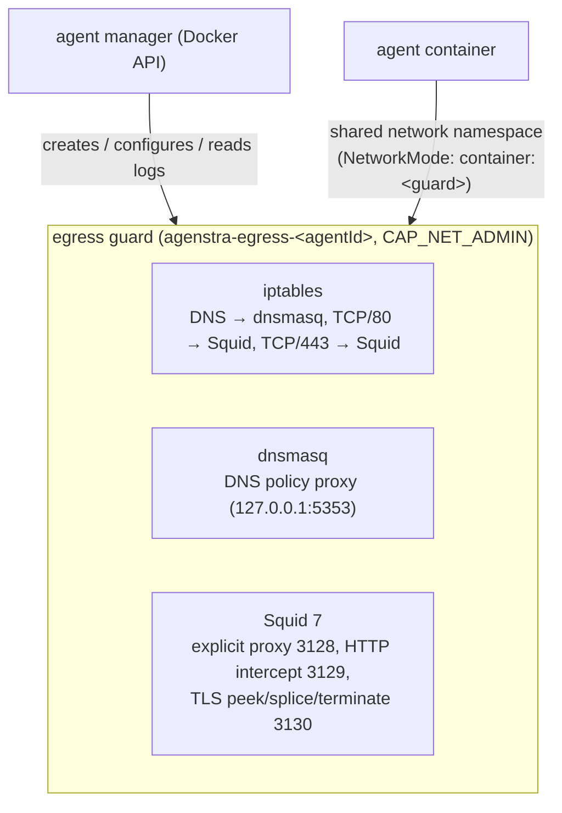

# Egress Filtering (Web Traffic)

Agenstra can filter the **outbound network traffic of every agent environment**. Each environment gets a small **egress guard** sidecar container that owns the agent's network namespace. All egress is forced through the guard, evaluated against the layered **Web traffic** policy from the [agent configuration](./agent-configuration.md), and recorded as audit events.

## Architecture



- **Sidecar** One guard container per agent (`agenstra-egress-<agentId>`, labels `io.agenstra.egress-guard=1` and `io.agenstra.agent-id`; the agent's worker is `agenstra-worker-<agentId>`). The name is final from creation on: the agent id is assigned before the guard is provisioned. Only the guard holds `CAP_NET_ADMIN`; the agent has none and cannot change the rules.
- **Network namespace sharing** The agent container joins the guard's namespace with `NetworkMode: container:<guard>`. The agent's published ports (OpenCode serve `4096`, VNC websockify `6080`) are therefore published on the guard.
- **Components** `iptables` redirects traffic; **Squid 7** makes web decisions; **dnsmasq** enforces DNS policy. Squid runs as UID `10901` and marks its upstream connections (`tcp_outgoing_mark`, which needs `CAP_NET_ADMIN`); netfilter exempts only **marked** traffic, so a process that merely switches to Squid's UID gains nothing. Squid resolves names through dnsmasq. dnsmasq runs as UID `10902` and may only reach the upstream resolvers from the guard's `resolv.conf` on port 53.
- **No TLS decryption** HTTPS is handled with Squid `peek` / `splice` / `terminate`. The guard reads the TLS SNI, never decrypts, and no CA has to be trusted by the agent.

### Port layout (loopback, inside the shared namespace)

| Port | Purpose                                                          |
| ---- | ---------------------------------------------------------------- |
| 3128 | Explicit forward proxy (`HTTP_PROXY` / `HTTPS_PROXY` point here) |
| 3129 | Transparent plaintext HTTP interception                          |
| 3130 | Transparent TLS peek / splice / terminate listener               |
| 5353 | DNS policy proxy (dnsmasq)                                       |

While a guard enforces, the manager injects `HTTP_PROXY`, `HTTPS_PROXY` and `NO_PROXY` (`localhost,127.0.0.1,::1`) into the agent environment. Transparent interception still applies to clients that ignore proxy variables.

## Modes

| Mode      | Behavior                                                                                                      |
| --------- | ------------------------------------------------------------------------------------------------------------- |
| `off`     | No guard enforcement (default). Agents without a guard keep their legacy network.                             |
| `monitor` | Everything is allowed; would-be blocks are recorded as `observed` so a policy can be tested before enforcing. |
| `enforce` | Allow and deny lists apply. **Deny wins** over allow; an **empty allowlist means unrestricted**.              |
| `offline` | All egress is blocked (`network_allow` exceptions are ignored). Loopback and inbound manager traffic work.    |

Platform exception: when the [agent context MCP](../ai-agents/context-mcp.md) is enabled, the guard always allows TCP to the
manager's context API (`AGENT_CONTEXT_MCP_MANAGER_URL`, resolved to IP literals) in every mode, including `offline`. The
exception bypasses the web intercept and is not counted as a policy decision.

## Policy fields

Stored under the `egress` root of a layer overlay (**Security -> Web traffic** in the editor).

| Field                    | Kind   | Description                                                                                                          |
| ------------------------ | ------ | -------------------------------------------------------------------------------------------------------------------- |
| `mode`                   | scalar | `off`, `monitor`, `enforce`, `offline`                                                                               |
| `block_private_networks` | scalar | Block RFC 1918 / loopback / link-local style destinations (default `true`)                                           |
| `block_ip_literals`      | scalar | Block requests addressed to raw IPs instead of hostnames (default `false`)                                           |
| `log_allowed`            | scalar | Also record allowed requests (default `true`)                                                                        |
| `allow_hosts`            | list   | Hostnames (`example.com` matches itself and subdomains; `*.example.com` accepted), IPs or CIDRs                      |
| `deny_hosts`             | list   | Same format; always wins                                                                                             |
| `deny_url_patterns`      | list   | POSIX extended regexes matched against **plain HTTP** URLs only (HTTPS URLs are not visible)                         |
| `network_allow`          | list   | Non-web L3/L4 exceptions: `{ protocol: tcp\|udp, ports: "22" or "1000-2000", destinations: [IP/CIDR], description }` |

Limits: 5000 host entries, 500 URL patterns (512 characters each), 100 network rules with up to 64 destinations each. Explicit allow entries lift the private-network and IP-literal blocks for the matching destination.

Evaluation order: offline -> deny list -> private networks -> IP literals -> URL patterns (plain HTTP) -> allowlist.

URL patterns use the guard's **POSIX extended** regex engine: lookarounds, backreferences, `(?:…)` / named groups, lazy quantifiers (`*?`), JavaScript escape classes (`\d`, `\w`, `\s`, …) and a leading `#` are rejected, as are patterns at risk of catastrophic backtracking (nested quantifiers such as `(a+)+` or overlapping repeated alternatives such as `(a|aa)+`). Use bracket expressions (`[0-9]`, `[[:alnum:]]`) instead.

### Heredity and locks

Layers are **global -> workspace -> environment**.

- **Scalars** (`mode`, `block_private_networks`, `block_ip_literals`, `log_allowed`) are **lock-on-presence**: the highest layer that sets a scalar wins and locks it for lower layers.
- **Lists** (`allow_hosts`, `deny_hosts`, `deny_url_patterns`, `network_allow`) are **additive**: lower layers may append but never remove inherited entries.
- **Allow lists are bounded by higher layers.** Once a higher layer declares `allow_hosts`, a lower layer's allow entries only take effect if a higher-layer entry covers them (e.g. `api.github.com` under `github.com`, `10.1.0.0/16` under `10.0.0.0/8`); uncovered entries are ignored. The same applies to `network_allow` (same protocol, port range and destinations within an inherited rule). Lower layers can therefore narrow, but never widen, an inherited allowlist. Without a higher-layer allowlist, lower layers may introduce one (which restricts traffic). To stop lower layers from declaring any exceptions at all, lock the tab.
- The whole tab can be locked with the explicit lock `/tabs/egress` on the global or workspace layer.

The **Evaluate** call (`POST /api/clients/{id}/agents/{agentId}/egress/evaluate`) tests a hostname or URL against an environment's effective policy without sending traffic. It and `GET /api/clients/{id}/agents/{agentId}/egress` expose policy details, so they require `clients:read` plus workspace management access (same as the agent configuration endpoints).

## What is and is not inspected

| Traffic             | Visibility                                             |
| ------------------- | ------------------------------------------------------ |
| Plain HTTP (TCP/80) | Full URL, method and status; `deny_url_patterns` apply |
| HTTPS (TCP/443)     | Hostname from TLS **SNI** only; no path, no content    |
| DNS                 | Queries are filtered and logged by dnsmasq             |
| Other TCP/UDP       | Denied unless covered by `network_allow`               |

## How blocked connections look to clients

Blocked traffic is dropped; the guard never substitutes content (no Squid error pages):

| Traffic                                    | Client sees                                                                                            |
| ------------------------------------------ | ------------------------------------------------------------------------------------------------------ |
| Plain HTTP (explicit proxy or intercepted) | TCP reset (`deny_info TCP_RESET`), e.g. Chrome `ERR_CONNECTION_RESET`, curl `Connection reset by peer` |
| HTTPS via the explicit proxy (`CONNECT`)   | Bare `403` on the tunnel request, e.g. Chrome `ERR_TUNNEL_CONNECTION_FAILED`                           |
| Intercepted HTTPS                          | Connection closed during the TLS handshake                                                             |
| DNS                                        | `NXDOMAIN`                                                                                             |
| Other protocols                            | ICMP port unreachable / TCP reset                                                                      |

A reset carries no reason, so clients cannot tell a policy block from a network fault. Tools that retry on connection resets (some package managers, browsers on reused keep-alive connections) may retry a few times before failing, and each attempt is recorded as a separate blocked decision. Use the audit log or the **Evaluate** call to see why a destination was blocked.

## Protocol denials

- **QUIC / HTTP/3** (UDP/443) is denied so clients fall back to TCP, where SNI is inspectable.
- **DNS over TLS** (TCP/853) is denied to prevent bypassing the DNS policy.
- **Undeclared protocols** (anything not web, DNS, Git over SSH or `network_allow`) are denied.

## Git over SSH

Cloning and pushing over SSH (TCP/22) must work behind the guard, so `enforce` policies always allow it to curated Git hosting providers: GitHub, GitLab, Bitbucket, Azure DevOps (`ssh.dev.azure.com`, `vs-ssh.visualstudio.com`), Codeberg, Gitea, sourcehut (`git.sr.ht`), Gitee, Framagit, Salsa (Debian), GNOME / freedesktop.org GitLab, KDE Invent, Launchpad, SourceForge and Google Cloud Source Repositories (subdomains included, e.g. `ssh.github.com`).

- **Resolve, then allow** The guard's DNS proxy (dnsmasq) adds the addresses it resolves for these host names to kernel ipsets (`agenstra_git_ssh4` / `agenstra_git_ssh6`, entries expire after an hour and are refreshed by every lookup); netfilter accepts TCP/22 only to addresses in those sets. The agent can therefore reach port 22 exclusively on addresses the guard itself resolved for a Git host — never an arbitrary IP, a host it resolved elsewhere, or another SSH server.
- **Policy precedence** A Git host on the policy's **deny list** is excluded (subdomain denies are enforced by DNS). Under an allowlist, Git hosts still resolve so SSH works; HTTPS access to them is still decided by the allowlist. `offline` stays offline; `monitor` and `off` do not restrict SSH anyway.
- **Self-hosted servers** Add host names with `AGENT_EGRESS_GIT_SSH_HOSTS` on the agent manager (or use `network_allow` with IP ranges). `AGENT_EGRESS_GIT_SSH_ENABLED=false` disables the allowance.
- **Audit** Accepted connections are counted and reported as `allowed` network events (`tcp/22`).
- **Requirements** The guard uses `ipset` (kernel `ip_set` / `xt_set`, standard on Linux distributions) and therefore holds `CAP_NET_RAW` next to `CAP_NET_ADMIN` (iptables queries ipsets through a raw socket; agents in the namespace still lose both). Without kernel ipset support the guard drops the allowance from the bundle instead of failing (TCP/22 stays denied) and reports `"gitSsh":"unavailable"` in `agenstra-egress status`.

## Fail-closed behavior

- The guard installs **lockdown** netfilter rules before anything else: no policy means no egress (loopback and established inbound connections excepted).
- At agent creation the manager provisions the guard and applies the policy **before** the agent container exists; on failure the guard is removed and creation fails.
- Policy bundles are staged, validated (`squid -k parse`, `dnsmasq --test`, `iptables-restore --test`) and only then activated. An **invalid bundle never replaces the last known good one**, and the failure is reported (`egress.policy_failed`).
- Squid and dnsmasq are supervised and restarted if they exit; after a restart the last applied bundle is re-activated.
- If the guard container disappears, the agent loses its interfaces and has no connectivity until it is restarted to join a new guard.
- If a policy that requires a guard (`monitor`, `enforce`, `offline`) cannot be provisioned for an agent that is **not** inside a guard namespace yet (e.g. switching an existing agent from `off` to `enforce` while the guard image is unavailable), the manager **stops the agent** and refuses to start it until the guard exists. The next successful sync recreates and starts it inside the guard namespace. Agents already inside a guard keep running under the last known good bundle.
- Setting `AGENT_EGRESS_GUARD_ENABLED=false` on a manager makes provisioning of enforcing policies fail rather than silently skipping them.

## Upstream proxy chaining

If the layered **Network** secrets define `HTTPS_PROXY` / `HTTP_PROXY` (and optionally `NO_PROXY`), the guard's Squid uses it as a **parent proxy** (plain `http://` proxies only; credentials in the URL are forwarded when Squid can represent them). The agent itself is pointed at the guard, not at the corporate proxy.

## Audit events and notifications

The manager's events collector polls each guard's counters and logs and stores **aggregated** decisions per agent (`allowed`, `blocked`, `observed`, `error`; kinds `web`, `dns`, `network`, `guard`; rules `offline`, `deny_host`, `private_network`, `ip_literal`, `deny_url`, `not_allowlisted`, `quic`, `dns_over_tls`, `undeclared_protocol`, `guard`).

The controller ingests them with the BullMQ job **`egress-events-ingest`** (coordinator + per-workspace unit job) which calls the manager's `GET /api/egress/events?afterSeq=` feed with a monotonic cursor and writes `statistics_egress_events`.

- **Console** The **Audit** page (`/audit`) shows web traffic charts and a table next to filter drops.
- **API** `GET /api/clients/{id}/statistics/egress-events` (and the global `/api/statistics/egress-events`) with filters `agentId`, `kind`, `decision`, `from`, `to`, `search`, `limit`, `offset`; `GET /api/clients/{id}/agents/{agentId}/egress` for status, policy and recent events.
- **Notifications / webhooks** `egress.blocked`, `egress.observed`, `egress.guard_failed`, `egress.policy_applied`, `egress.policy_failed` (see [Webhooks](./webhooks.md)). Blocked / observed notifications are summarized per ingestion run to avoid floods.

## Configuration

### Agent manager

| Variable                                | Default                                                 | Description                                                        |
| --------------------------------------- | ------------------------------------------------------- | ------------------------------------------------------------------ |
| `AGENT_EGRESS_GUARD_ENABLED`            | `true`                                                  | Allow guard provisioning on this manager                           |
| `AGENT_EGRESS_GUARD_IMAGE`              | `ghcr.io/forepath/agenstra-manager-egress-guard:latest` | Guard image                                                        |
| `AGENT_EGRESS_GUARD_MEMORY_MB`          | `256`                                                   | Memory limit per guard                                             |
| `AGENT_EGRESS_EVENTS_COLLECTOR_ENABLED` | `true`                                                  | Collect guard events                                               |
| `AGENT_EGRESS_EVENTS_POLL_INTERVAL_MS`  | `15000`                                                 | Collector poll interval                                            |
| `AGENT_EGRESS_EVENTS_RETENTION_HOURS`   | `72`                                                    | Retention of events on the manager (the controller keeps its copy) |
| `AGENT_EGRESS_GIT_SSH_ENABLED`          | `true`                                                  | Allow Git over SSH (TCP/22) to curated Git hosts                   |
| `AGENT_EGRESS_GIT_SSH_HOSTS`            | _(empty)_                                               | Additional Git SSH host names (comma separated, e.g. self-hosted)  |

The manager needs access to the Docker socket (as for agent containers) and the ability to grant `CAP_NET_ADMIN` and `CAP_NET_RAW` to the guard.

### Agent controller

| Variable                           | Default | Description                                   |
| ---------------------------------- | ------- | --------------------------------------------- |
| `EGRESS_EVENTS_INGEST_INTERVAL_MS` | `30000` | Coordinator interval (`0` disables ingestion) |
| `EGRESS_EVENTS_INGEST_BATCH_SIZE`  | `10`    | Workspaces polled per coordinator run         |

See [Background Jobs](../deployment/background-jobs.md).

## On Loadweaver (`AGENT_RUNTIME=loadweaver`)

When the agent manager runs its environments on a Loadweaver cluster there is no guard sidecar: the same effective policy is compiled into Loadweaver policies of the environment and enforced by Loadweaver's node proxies (Envoy), with identical semantics for modes, allow / deny hosts (domains and IPs / CIDRs), URL deny patterns, `network_allow`, private-network and IP-literal blocks and explicit-allow exceptions. Policy changes are applied as Loadweaver plans; decisions come back from Loadweaver's logs into the same egress events, so the audit and the console views stay the same. Details and the few differences (for example, a `block_private_networks: false` can't loosen a stricter cluster setting) are in [Agenstra on Loadweaver](../../loadweaver/guides/agenstra-on-loadweaver.md#egress).

## Building the guard image

```bash
npx nx run agenstra-backend-agent-manager:egress-guard-container-image            # test tag, loaded locally
npx nx run agenstra-backend-agent-manager:egress-guard-container-image:release    # push ghcr.io/forepath/agenstra-manager-egress-guard
```

The image is built from `apps/agenstra/backend-agent-manager/Dockerfile.egress-guard` (Alpine, Squid 7, dnsmasq, iptables-nft). `start-containers` builds the test image automatically.

## Limitations

- **Hostname filtering of HTTPS relies on SNI / Host.** Squid runs with `host_verify_strict on`, so a client cannot connect to an IP different from what DNS resolves for the requested name. **Domain fronting on shared CDNs is not prevented**: a client can present an allowed SNI while the encrypted `Host` header targets another site on the same CDN. Use `block_ip_literals`, narrow allowlists and `offline` mode where this matters.
- Encrypted ClientHello (ECH) hides the SNI; such connections cannot be matched by name.
- **DNS policy bypass for root agents.** dnsmasq's upstream queries are identified by its UID, which a process running as root inside the agent container can assume. Such a process can query the upstream resolvers directly (bypassing the DNS allow/deny lists and enabling DNS tunnelling), but **not** reach web or other destinations: those are only exempted for Squid's marked connections. Run agent workloads as a non-root user where DNS exfiltration matters.
- HTTPS paths and content are never inspected; `deny_url_patterns` only apply to plain HTTP.
- Only IPv4/IPv6 TCP and UDP are handled; the guard is not a full IDS.
- Changing the mode of an agent that ran on a legacy network recreates the agent container once so it can join the guard namespace.

## Troubleshooting

| Symptom                                     | Check                                                                                                                      |
| ------------------------------------------- | -------------------------------------------------------------------------------------------------------------------------- |
| No connectivity after enabling              | `GET /clients/{id}/agents/{agentId}/egress` for `status` / last error; run `docker logs agenstra-egress-<agentId>`         |
| Environment fails to create                 | Guard image missing (`AGENT_EGRESS_GUARD_IMAGE`) or guard not ready within 30 s; fix and retry                             |
| Policy not applied (`egress.policy_failed`) | The last known good bundle stays active; inspect the error and correct the rule that Squid or dnsmasq rejected             |
| Legitimate host blocked                     | Use **Evaluate**; remember deny wins and private networks are blocked by default                                           |
| Nothing in the Audit page                   | Check `AGENT_EGRESS_EVENTS_COLLECTOR_ENABLED`, `EGRESS_EVENTS_INGEST_INTERVAL_MS`, and the manager's `/egress/events` feed |
| Agent offline after guard removal           | Restart the environment so it joins a fresh guard                                                                          |

## Related documentation

- **[Agent Configuration](./agent-configuration.md)** Layers, tabs and locks
- **[Message Filters](./message-filters.md)** Chat message policy in the same Security section
- **[Usage Statistics](./usage-statistics.md)** Egress statistics
- **[Webhooks](./webhooks.md)** Egress notifications
- **[Backend Agent Manager](../applications/backend-agent-manager.md)** `/egress/events`, `/agents/{id}/egress`

---

_Diagram: `libs/domains/agenstra/backend/feature-agent-manager/docs/egress-guard.mmd`._
