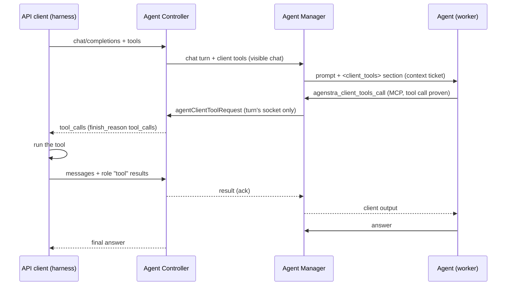

# OpenAI-compatible API

Call Agenstra agents from any tool that speaks the OpenAI API (official SDKs, LangChain, LlamaIndex, Open WebUI, CLIs, …). Each agent gets an OpenAI-compatible base URL; every request runs as a regular chat turn in one of the agent's chat sessions, with the same permissions, message filters, statistics and webhooks as a turn sent from the console.

## Base URL

```text
https://<controller-host>/api/clients/{clientId}/agents/{agentId}/openai/v1
```

The base URL selects **which agent** runs the request (`clientId` = workspace, `agentId` = environment). The agent must belong to the workspace and the caller must have access to the workspace, exactly like the REST chat routes.

| Endpoint                               | Method              | OpenAI API         | Agenstra equivalent                         | PAT / app scope                          |
| -------------------------------------- | ------------------- | ------------------ | ------------------------------------------- | ---------------------------------------- |
| `/models`, `/models/{model}`           | GET                 | Models             | Agent models (`default` + `provider/model`) | `agents:read`                            |
| `/chat/completions`                    | POST                | Chat Completions   | One chat turn (JSON or SSE stream)          | `agent_chats:write`                      |
| `/responses`                           | POST                | Responses          | One chat turn (JSON or SSE event stream)    | `agent_chats:write`                      |
| `/conversations`                       | POST                | Conversations      | Create chat session                         | `agent_chats:write`                      |
| `/conversations/{id}`                  | GET / POST / DELETE | Conversations      | Get / rename / delete chat session          | `agent_chats:read` / `agent_chats:write` |
| `/conversations/{id}/items[/{itemId}]` | GET                 | Conversation items | Chat session messages                       | `agent_chats:read`                       |

Every other path under the base URL (embeddings, images, audio, files, stored responses, assistants, …) answers `404` with code `unsupported_endpoint`.

## Authentication

The OpenAI-compatible routes use the controller's normal authentication; pass the credential as the SDK's `api_key` (sent as `Authorization: Bearer …`).

| `AUTHENTICATION_METHOD` | Credential                                                                                                    |
| ----------------------- | ------------------------------------------------------------------------------------------------------------- |
| `users`, `oidc`, `saml` | **Personal access token** (`fp_pat_…`, recommended), app access token, or an interactive session / OIDC token |
| `api-key`               | `STATIC_API_KEY` (full access)                                                                                |
| `mtls`                  | Client certificate in the TLS handshake, or `Authorization: Certificate <assertion>` as a default header      |

**Raw personal access tokens** are accepted directly as bearer on these routes only (OpenAI SDKs cannot exchange tokens). The controller exchanges the token in-process exactly like `POST /api/auth/token`, so all PAT rules apply unchanged: scopes (`@RequireScopes`), revocation, expiry, scope updates, role demotion and account locks take effect immediately. Exchanges are cached for 60 seconds by token hash; repeated invalid tokens from one address are rejected with `429` for a minute. Everywhere else raw PATs stay rejected.

**Apps** obtain access tokens with the regular [app flow](./authentication.md#apps-third-party-authorization-users-oidc-and-saml-modes) and use them as `api_key` (refresh before expiry). Grant `agent_chats:write` (plus `agents:read` for `/models`, `agent_chats:read` for reading conversations).

## Models

`model` selects the LLM of the agent for the turn:

- `default` (or `agenstra`): the agent's default model
- an OpenCode model id of the agent (`provider/model`, as listed by `GET /models`)

Unknown models answer `404 model_not_found`.

## Chat sessions

Agenstra chat sessions are stateful: the agent keeps the transcript. A turn runs in a **visible chat session** of the agent and appears in the console like any other message (including live updates for viewers).

| Selector                                  | API                | Value                                                             |
| ----------------------------------------- | ------------------ | ----------------------------------------------------------------- |
| `X-Agenstra-Chat-Id` header               | all turn endpoints | Chat session UUID or `conv_…` id                                  |
| `chat_id` body field (Agenstra extension) | all turn endpoints | Chat session UUID or `conv_…` id                                  |
| `conversation`                            | Responses          | `conv_…` id (from `/conversations`) or `{ "id": … }`              |
| `previous_response_id`                    | Responses          | Id of an earlier response (response ids embed their chat session) |
| _none_                                    | all                | The agent's **primary** session                                   |

Conflicting selectors are rejected. Sessions of other agents answer `404`. Every turn response carries the session in the `X-Agenstra-Chat-Id` header. Conversation ids are `conv_<chat session id without dashes>`; bare UUIDs are accepted too.

### Message history

OpenAI clients resend the whole history with every Chat Completions request. Because the agent already has the transcript, only the **new turn** is sent: all messages after the last `assistant` message (`system`, `developer` and `user` text, joined in order). The request must contain at least one new `user` message. On Responses, `instructions` are prepended to the turn.

Only text content is supported: image, audio and file parts are rejected (`unsupported_parameter`). `n` must be `1`. Parameters without an Agenstra equivalent (`temperature`, `top_p`, `max_tokens`, `response_format`, `seed`, `user`, …) are accepted and ignored.

### Function calling (client tools)

The agent always works with **its own tools in its own workspace** (files, shell, MCP servers, Agenstra context tools). In addition, a client can pass **function tools** that the agent may call during the turn: standard OpenAI function calling, so harnesses (for example an application with its own domain tools) can combine the agent with their tools.



| Concern              | Behavior                                                                                                                                                                                                                                                                                                                                                                                    |
| -------------------- | ------------------------------------------------------------------------------------------------------------------------------------------------------------------------------------------------------------------------------------------------------------------------------------------------------------------------------------------------------------------------------------------- |
| Chat Completions     | `tools` (`type: "function"`), `tool_choice` (`auto`, `none`, `required`, `{ type: "function", function: { name } }`, `allowed_tools`), `parallel_tool_calls`; replies with `message.tool_calls` and `finish_reason: "tool_calls"` (streamed as `delta.tool_calls` chunks); results as `role: "tool"` messages with `tool_call_id`                                                           |
| Deprecated functions | `functions` / `function_call`; replies with `message.function_call` and `finish_reason: "function_call"` (one call at a time); results as `role: "function"` messages, matched by name within the chat                                                                                                                                                                                      |
| Responses            | function tools (`{ type: "function", name, parameters }`), the same `tool_choice` / `parallel_tool_calls`; replies with `function_call` output items (`call_id`); results as `function_call_output` input items, with `previous_response_id`, `conversation` or the chat selectors. Streams `response.function_call_arguments.delta` / `.done`                                              |
| Choice               | `required` / a named function is passed to the agent as an instruction (the agent decides when to call); `none` offers no tools                                                                                                                                                                                                                                                             |
| Parallel calls       | Calls the agent makes together are returned together; `parallel_tool_calls: false` asks the agent for one call at a time                                                                                                                                                                                                                                                                    |
| Waiting              | The agent waits for the client's results; each wait answers `pending` after at most 40 s so the agent keeps waiting. A call without result fails for the agent after `OPENAI_CLIENT_TOOL_RESULT_TIMEOUT_MS` (default 10 minutes)                                                                                                                                                            |
| Continuation         | Results must come from the **same credential** (same static key / certificate principal, or the same user through the same personal access token, app session or interactive session), for the same workspace and agent (and chat, when the request names one). Other callers get `404 tool_call_not_found`. Results of earlier, finished turns next to a new user message start a new turn |
| Replicas             | The turn runs on the API replica that started it; continuations reaching another replica are handed over through Valkey / Redis (`CACHE_CLIENT`, key prefix `REDIS_KEY_PREFIX`). With `CACHE_ENABLED=false`, continuations must reach the same replica                                                                                                                                      |
| Limits               | 128 tools, names `^[a-zA-Z0-9_-]{1,64}$`, descriptions 4096 characters, 16 KB schema per tool / 128 KB in total, 64 KB arguments per call, 64 calls per turn, client output truncated at 100 000 characters                                                                                                                                                                                 |
| Requirements         | The agent's worker serves the platform `agenstra` MCP server and announces client tool support (`x-agenstra-mcp-features`, current worker images); otherwise turns with tools answer `503 CLIENT_TOOLS_UNAVAILABLE` (restart or recreate the environment to update its worker). Visible chat sessions only                                                                                  |

Security notes:

- Tool definitions and results are client input to the agent, like the prompt: the caller already has `agent_chats:write` on this agent.
- The agent reaches client tools only through `agenstra_client_tools_call`. The agent-manager accepts a call only when it matches a tool call of the agent answering the platform's prompt for this turn, so a process inside the worker cannot trigger client tools by itself.
- Calls are handed to the controller connection that started the turn, never to console viewers or other connections; the browser console cannot pass client tools.
- Calls are bound to the turn's context ticket: they end with the turn.

Hosted tool types (`web_search`, `file_search`, `code_interpreter`, custom tools, …) have no client-side equivalent and are ignored; forcing one is rejected (`unsupported_parameter`). Client tool results and other non-message items of earlier history are ignored (the agent keeps its own transcript). The agent works on its own workspace copy, not on files of the client's machine.

### Agent tool activity (read-only)

Opt in with the `X-Agenstra-Tool-Activity: true` header or the `"tool_activity": true` body field to see what the agent did:

| API              | Representation                                                                                                                                                                    |
| ---------------- | --------------------------------------------------------------------------------------------------------------------------------------------------------------------------------- |
| Chat Completions | `reasoning_content` on the message / stream deltas: one line per tool, e.g. `[agent tool] bash {"command":"npm test"} → done` (rendered as "thinking" by many UIs)                |
| Responses        | `mcp_call` output items (`server_label: "agenstra"`, `name`, `arguments`, `output`, `error`, `status`) before or between the answer, with the `response.mcp_call.*` stream events |

`mcp_call` is OpenAI's representation of a tool the server executed: clients display it and never run it. Arguments and outputs are truncated to 4000 characters each. Tool activity is subject to the same message filter rule as text: it is streamed live only when no rewriting outgoing filter applies; otherwise it is taken from the filtered final agent response and delivered with the answer. Reading it requires nothing beyond the turn's `agent_chats:write` (the same activity is visible in the chat history).

## Streaming

`stream: true` returns `text/event-stream`:

- **Chat Completions**: `chat.completion.chunk` frames (first chunk carries the `assistant` role), a final chunk with `finish_reason`, an optional usage chunk (`stream_options.include_usage`), then `data: [DONE]`.
- **Responses**: `response.created`, `response.in_progress`, `response.output_item.added`, `response.content_part.added`, `response.output_text.delta`…, `response.output_text.done`, `response.content_part.done`, `response.output_item.done` and `response.completed` (or `response.incomplete` / `error` + `response.failed`), each with a `sequence_number`.

Comment frames (`: keep-alive`) are sent every 15 seconds while the agent works. Closing the connection stops the wait; the turn itself completes in the chat session.

### Message filters

[Message filters](./message-filters.md) apply exactly as in the console. Live text deltas are produced by the agent before outgoing filters run, so they are streamed **only when no enabled outgoing (or bidirectional) `drop` / `replace` rule** applies to the agent; otherwise the stream delivers the filtered final answer in one chunk. When the filter policy cannot be resolved, the API falls back to the filtered final answer (fail closed). A dropped message ends the turn with `finish_reason: "content_filter"` (Chat Completions) or `status: "incomplete"` with `incomplete_details.reason: "content_filter"` (Responses).

## Side effects

An API turn is a user turn: it records chat [usage statistics](./usage-statistics.md) for the calling user (including token usage), publishes `chat_message.created` (incoming and outgoing), `message_filter.triggered` and `agent.chat_failed` [webhooks / notifications](./webhooks.md), and updates the console's unread / activity status. Console viewers of the agent receive the turn live; as for every chat turn, each connected console socket additionally reports the relayed agent message.

## Usage

`usage` maps the agent's token accounting: `prompt_tokens` include cache reads and writes (`prompt_tokens_details.cached_tokens`), `completion_tokens` include reasoning tokens (`completion_tokens_details.reasoning_tokens`). Unknown usage is reported as `0`.

## Errors

Errors use the OpenAI envelope `{ "error": { "message", "type", "param", "code" } }`:

| Status          | `type`                  | Typical `code`                                                                                                                         |
| --------------- | ----------------------- | -------------------------------------------------------------------------------------------------------------------------------------- |
| 400             | `invalid_request_error` | `unsupported_parameter`, `missing_required_parameter`                                                                                  |
| 401             | `invalid_request_error` | `invalid_api_key`                                                                                                                      |
| 403             | `permission_error`      | `insufficient_permissions` (missing scope or workspace access)                                                                         |
| 404             | `invalid_request_error` | `model_not_found`, `conversation_not_found`, `previous_response_not_found`, `tool_call_not_found`, `unsupported_endpoint`, `not_found` |
| 429             | `rate_limit_error`      | `rate_limit_exceeded`                                                                                                                  |
| 502 / 503 / 504 | `server_error`          | agent error, agent-manager unreachable, `timeout` (`REMOTE_AGENT_CHAT_TIMEOUT_MS`)                                                     |

## Examples

Python:

```python
from openai import OpenAI

client = OpenAI(
    base_url="https://agenstra.example.com/api/clients/<clientId>/agents/<agentId>/openai/v1",
    api_key="fp_pat_…",
)

# Primary chat session, agent default model
reply = client.chat.completions.create(model="default", messages=[{"role": "user", "content": "Summarize the open TODOs"}])
print(reply.choices[0].message.content)

# Dedicated session via the Conversations + Responses APIs
conversation = client.conversations.create(metadata={"title": "Nightly report"})
response = client.responses.create(model="default", conversation=conversation.id, input="Run the test suite and report failures")
print(response.output_text)
```

TypeScript (streaming, explicit chat session):

```ts
import OpenAI from 'openai';

const client = new OpenAI({ baseURL: `${host}/api/clients/${clientId}/agents/${agentId}/openai/v1`, apiKey: process.env.AGENSTRA_PAT });
const stream = await client.chat.completions.create({ model: 'default', stream: true, messages: [{ role: 'user', content: 'Hello' }] }, { headers: { 'X-Agenstra-Chat-Id': chatId } });

for await (const chunk of stream) {
  process.stdout.write(chunk.choices[0]?.delta?.content ?? '');
}
```

curl:

```bash
curl https://agenstra.example.com/api/clients/$CLIENT/agents/$AGENT/openai/v1/chat/completions \
  -H "Authorization: Bearer $AGENSTRA_PAT" -H 'Content-Type: application/json' \
  -d '{"model":"default","messages":[{"role":"user","content":"Hello"}]}'
```

Function calling (Python):

```python
tools = [{"type": "function", "function": {"name": "get_invoice_total",
          "parameters": {"type": "object", "properties": {"invoice": {"type": "string"}}, "required": ["invoice"]}}}]
messages = [{"role": "user", "content": "What is the total of invoice INV-7?"}]

while True:
    reply = client.chat.completions.create(model="default", messages=messages, tools=tools)
    message = reply.choices[0].message
    messages.append(message)

    if reply.choices[0].finish_reason != "tool_calls":
        print(message.content)
        break

    for call in message.tool_calls:
        messages.append({"role": "tool", "tool_call_id": call.id, "content": run_tool(call.function.name, call.function.arguments)})
```

## Configuration

| Variable                               | Default  | Description                                                             |
| -------------------------------------- | -------- | ----------------------------------------------------------------------- |
| `OPENAI_COMPATIBLE_API_ENABLED`        | `true`   | `false` disables the routes (`404` after authentication)                |
| `REMOTE_AGENT_CHAT_TIMEOUT_MS`         | `600000` | Inactivity limit of a turn (restarts with every client tool round trip) |
| `OPENAI_CLIENT_TOOL_RESULT_TIMEOUT_MS` | `600000` | How long the agent waits for a client tool result (10 s – 1 h)          |

JSON bodies on these routes may be up to 1 MB (100 kB elsewhere). Browser clients need the console origin in `CORS_ORIGIN`; `X-Agenstra-Chat-Id` is allowed and exposed.

## Related documentation

- **[Authentication](./authentication.md)** Personal access tokens, apps and scopes
- **[Chat Interface](./chat-interface.md)** Chat sessions
- **[Message Filters](./message-filters.md)** Filter rules and outcomes
- **[Webhooks](./webhooks.md)** Chat and filter events

## API references

- [Agent Controller OpenAPI](/spec/agent-controller/openapi.yaml) `/clients/{id}/agents/{agentId}/openai/v1/*`
