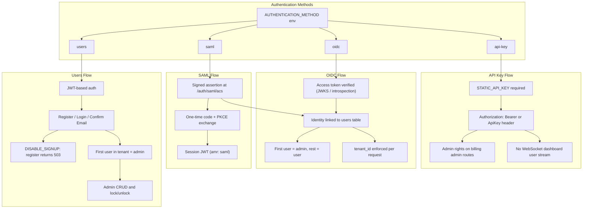

# Authentication

Authentication system supporting multiple methods with configurable user registration for the billing console and billing manager API.

## Overview

Decabill supports four authentication methods:

- **API Key Authentication** Static API key for automation and operator scripts
- **OIDC Authentication** Any OpenID Connect provider (for example Keycloak)
- **SAML Authentication** SAML 2.0 single sign-on
- **Users Authentication** Built-in user registration with JWT

Each method is configured via environment variables on the billing manager. The billing console runtime config must match the backend method.

## Authentication Methods

### API Key Authentication

Simple authentication using a static API key. Suitable for automation, CI, and single-operator deployments.

**Configuration**:

```bash
AUTHENTICATION_METHOD=api-key
STATIC_API_KEY=your-secure-api-key-here
```

When `STATIC_API_KEY` is set and `AUTHENTICATION_METHOD` is unset, the backend may infer api-key mode. See [Security - Operational hardening](../security/operational-hardening.md) for resolution behavior.

**Features**:

- All requests require `Authorization: Bearer <key>` or `Authorization: ApiKey <key>` header
- API key authentication grants admin rights on billing admin routes
- No interactive user identity; WebSocket dashboard status is rejected (see [Real-time Status](./real-time-status.md))
- Combine with [Multi-tenancy](./multi-tenancy.md) and optional `STATIC_API_KEY_TENANT_ID`

### OIDC Authentication

Provider-agnostic OpenID Connect (any compliant IdP, for example Keycloak, Entra ID, Okta, Auth0, Authentik). The API acts as an OAuth 2.0 resource server and validates access tokens; the billing console signs in with Authorization Code + PKCE.

**Configuration**:

```bash
AUTHENTICATION_METHOD=oidc
OIDC_ISSUER=https://idp.example.com/realms/decabill
OIDC_CLIENT_ID=api-client            # confidential client of the API (introspection)
OIDC_CLIENT_SECRET=your-client-secret
OIDC_TOKEN_VALIDATION=ONLINE         # ONLINE (default): signature + RFC 7662 introspection; OFFLINE: JWKS only
OIDC_AUDIENCE=                       # optional, comma-separated; token `aud` must contain one
OIDC_AUTHORIZED_PARTIES=             # comma-separated `azp` allowlist (client ids); this or OIDC_AUDIENCE required in production
JWT_SECRET=your-jwt-secret-key       # signs PAT / app access JWTs
```

| Variable                           | Default                                     | Purpose                                                                                      |
| ---------------------------------- | ------------------------------------------- | -------------------------------------------------------------------------------------------- |
| `OIDC_ISSUER`                      | required                                    | Exact `iss`; discovery at `<issuer>/.well-known/openid-configuration`                        |
| `OIDC_CLIENT_ID` / `_SECRET`       | required for `ONLINE`                       | Client credentials used for token introspection                                              |
| `OIDC_TOKEN_VALIDATION`            | `ONLINE`                                    | `ONLINE` also requires `active: true` at the introspection endpoint                          |
| `OIDC_AUDIENCE`                    | unset                                       | Restrict accepted tokens to this API (recommended where the IdP supports it)                 |
| `OIDC_AUTHORIZED_PARTIES`          | unset                                       | Restrict accepted tokens to these `azp` client ids                                           |
| `OIDC_DISCOVERY_URL`               | `<issuer>/.well-known/openid-configuration` | Override when the API reaches the IdP under another URL (issuer must still match)            |
| `OIDC_ALLOWED_ALGORITHMS`          | RS/PS/ES 256–512                            | Asymmetric algorithms only; `HS*` and `none` are always rejected                             |
| `OIDC_EMAIL_CLAIM`                 | `email`                                     | Claim used as the local account email                                                        |
| `OIDC_CLOCK_TOLERANCE_SECONDS`     | `0`                                         | Allowed clock skew (max 300)                                                                 |
| `OIDC_ALLOW_INSECURE_HTTP`         | `false`                                     | Production only accepts https provider URLs (issuer, JWKS, endpoints) unless `true`          |
| `OIDC_ALLOW_UNRESTRICTED_AUDIENCE` | `false`                                     | Production requires `OIDC_AUDIENCE` or `OIDC_AUTHORIZED_PARTIES` unless `true`               |
| `OIDC_TRUST_EMAIL`                 | `false`                                     | Treat emails without an `email_verified` claim as verified (only if the IdP controls emails) |

Billing console runtime config (public SPA client, Authorization Code + PKCE):

```json
{ "authentication": { "config": { "type": "oidc", "issuer": "https://idp.example.com/realms/decabill", "clientId": "console", "scope": "openid profile email" } } }
```

`postLogoutRedirectUri` is optional.

**Features**:

- Tokens are verified locally (JWKS signature, exact issuer, expiry, optional audience / `azp`); tokens carrying a `typ` claim other than `Bearer` (ID / refresh tokens) are rejected
- OIDC identities are mapped to the local `users` table (`external_provider = oidc`, `external_subject = sub`)
- First user per tenant gets admin role; **roles always come from the local user**, IdP role claims are not used
- An existing local account is linked by email only when the email is trusted — `email_verified: true`, or no claim at all and `OIDC_TRUST_EMAIL=true` / `SAML_TRUST_EMAIL=true` (only set this when the IdP controls the addresses) — and the account is not linked to another identity yet. Untrusted emails are neither linked nor stored: the account gets a non-routable `…@external.invalid` placeholder, so nobody can claim an address (for example to be added to a workspace by email).
- In production `OIDC_AUDIENCE` or `OIDC_AUTHORIZED_PARTIES` is required (boot fails otherwise; `OIDC_ALLOW_UNRESTRICTED_AUDIENCE=true` opts out) and provider URLs must use https (`OIDC_ALLOW_INSECURE_HTTP=true` opts out). ID tokens are rejected as bearer tokens (`typ`, `at_hash` / `c_hash`).
- Provisioned OIDC consoles need a dedicated public console client (`oidc.frontendClientId`, different from `oidc.clientId`) or an `oidc.audience`, so the console API never accepts tokens of the API's own service client. Provisioned managers validate OFFLINE against the controller's client and never receive its secret.
- New accounts are created on first sign-in in every tenant by default. With several tenants behind one IdP, set `EXTERNAL_AUTH_AUTO_PROVISION_TENANTS` (comma-separated tenant ids, or `none`) so IdP users cannot claim an empty tenant; elsewhere only existing or linkable accounts can sign in. The first user of a tenant becomes admin atomically (concurrent first sign-ins cannot both become admin).
- SAML single logout (SLO) is not implemented: signing out at the IdP does not end an existing console session; use `POST /auth/logout` (or invalidate all sessions of the user).
- Console sessions are bound to the method that issued them: after switching between `users` and `saml`, existing sessions of the other method are rejected.
- Locked users are rejected; per-user `tenant_id` enforced
- OIDC token scopes are not enforced (unchanged); PAT scopes are

### SAML Authentication

SAML 2.0 single sign-on. The API is the SAML service provider; after a validated assertion it issues the same session JWT as users mode (`amr: ["saml"]`).

**Configuration**:

```bash
AUTHENTICATION_METHOD=saml
SAML_IDP_SSO_URL=https://idp.example.com/sso          # HTTP-Redirect binding
SAML_IDP_CERT="-----BEGIN CERTIFICATE-----..."        # PEM or bare base64; several allowed
SAML_IDP_ISSUER=https://idp.example.com/entity        # recommended: pin the IdP entity id
SAML_SP_ENTITY_ID=https://console.example.com         # default: origin of SAML_SP_ACS_URL
SAML_SP_ACS_URL=https://console.example.com/api/auth/saml/acs
SAML_FRONTEND_CALLBACK_URL=https://console.example.com/login/saml/callback
JWT_SECRET=your-jwt-secret-key
```

Optional: `SAML_NAMEID_FORMAT` (default `urn:oasis:names:tc:SAML:2.0:nameid-format:persistent`; `unspecified` omits it; transient NameIDs are rejected), `SAML_EMAIL_ATTRIBUTE` (default: `email`, `mail`, `urn:oid:0.9.2342.19200300.100.1.3`, the emailaddress claim, or an email-format NameID), `SAML_WANT_ASSERTIONS_SIGNED` / `SAML_WANT_RESPONSE_SIGNED` (default `true`; not both `false`), `SAML_SP_PRIVATE_KEY` (sign AuthnRequests), `SAML_SP_DECRYPTION_PRIVATE_KEY` (encrypted assertions), `SAML_CLOCK_SKEW_MS` (default `0`).

Billing console runtime config: `{ "authentication": { "config": { "type": "saml" } } }`.

**Flow**:

1. The console creates a PKCE verifier and opens `GET /api/auth/saml/login?code_challenge=…&redirect=/path`.
2. The IdP posts the response to `POST /api/auth/saml/acs`; the API validates signature, audience (SP entity id), `InResponseTo` (consumed once; unsolicited / IdP-initiated responses are rejected) and assertion replay.
3. The API redirects to `SAML_FRONTEND_CALLBACK_URL?code=…` with a single-use code (60 s).
4. The console redeems it at `POST /api/auth/saml/token` with `{ "code", "codeVerifier" }` and receives the session JWT.

Multi-tenant APIs: the browser redirect to `GET /api/auth/saml/login` cannot carry `X-Tenant`, so the console passes `tenant=<id>` (validated against `TENANTS` like the header). The tenant is bound to the single-use relay state and restored at the ACS; the code exchange then requires the same tenant (`X-Tenant`).

`GET /api/auth/saml/metadata` serves SP metadata for IdP configuration. Logout uses `POST /auth/logout` as in users mode. Password login, registration and local 2FA endpoints are not available. Identity mapping, roles, locking and tenants work as in OIDC mode (`external_provider = saml`, `external_subject` = NameID).

### Users Authentication

Built-in user registration and authentication with JWT tokens.

**Configuration**:

```bash
AUTHENTICATION_METHOD=users
JWT_SECRET=your-jwt-secret-key
DISABLE_SIGNUP=false
DISABLE_FORCE_LOGIN_2FA=false
PRODUCT_NAME=Decabill  # Issuer label on TOTP QR / authenticator entries (default: Forepath)
```

**Features**:

- User registration with email and password
- Email confirmation with 6-character alphanumeric codes (consumed atomically; single-use under concurrency)
- Password reset functionality (reset codes consumed atomically; single-use under concurrency)
- JWT-based authentication (7-day expiry)
- **Login 2FA** (forced by default): email OTP unless authenticator enrolled; set `DISABLE_FORCE_LOGIN_2FA=true` for opt-in only. Email OTP codes are consumed atomically (single-use under concurrency).
- Self-service authenticator / email 2FA; admins can remove authenticator enrollment
- Self-service password change under Security settings (current password, new password, confirmation; own account only)
- TOTP QR / authenticator account name uses `PRODUCT_NAME` (falls back to `Forepath`) plus the user email
- First registered user gets admin role
- Admin user management (CRUD, lock, unlock)
- Optional signup disable for controlled onboarding
- **Personal access tokens (PATs)** for machine/API automation (see below)

### Personal access tokens (users, oidc and saml modes)

User-bound tokens for scripts and CI (for example usage recording). They are **not** a billing-console login password. **Not available** when `AUTHENTICATION_METHOD=api-key`.

| Concern                  | Behavior                                                                                                                           |
| ------------------------ | ---------------------------------------------------------------------------------------------------------------------------------- |
| Create / update / revoke | Console **Personal Access Tokens** page (`/settings/tokens`); interactive console session only (password, OIDC or SAML session)    |
| Exchange                 | `POST /auth/token` with `{ "token": "fp_pat_…" }` only (no email) → JWT with `amr: ["pat"]` and `scopes`                           |
| Console                  | Login rejects `fp_pat_` secrets; SPA rejects JWTs whose `amr` includes `pat`                                                       |
| WebSockets               | Only with the socket's `websocket:<socket>:read` scope; every event is capped by its domain scopes (see [WebSockets](#websockets)) |
| OIDC / SAML              | Local `users` row is linked on first sign-in (`external_subject`); PAT CRUD and exchange require `JWT_SECRET`                      |
| Scopes                   | `BILLING_PAT_SCOPES` (see [Scope model](#scope-model)); each enforced via `@RequireScopes`                                         |

Prefer PATs over a shared `STATIC_API_KEY` for multi-tenant automation (see accepted risk DR-002).

Updating a token changes **name** and **scopes** only; the secret is never rotated by update. Exchanged PAT JWTs embed `patId`; each request re-checks the PAT row so **revoke**, **expiry**, and **scope updates** take effect immediately. **Role demotion** also takes effect immediately: request roles come from the live DB user (not the JWT claim), admin-only scopes are stripped from the effective grant set, and changing a user’s role bumps `tokenVersion` so outstanding JWTs are rejected.

#### Scope model

Scopes follow `<resource>:<level>` with three hierarchical levels per resource (similar to GitHub token permissions):

| Level   | Grants                                                                           | Implies            |
| ------- | -------------------------------------------------------------------------------- | ------------------ |
| `read`  | Read operations in non-admin scope                                               | —                  |
| `write` | All other non-admin operations on the resource                                   | `read`             |
| `admin` | Operations reserved to admins and their console / API (admin role also required) | `write` and `read` |

`:admin` scopes are only grantable to admins and are stripped from the effective grant set when the user is not an admin. Routes without `@RequireScopes` reject PATs (fail-closed). Each operation's required scope is listed in the OpenAPI spec as the role name on its `bearerAuth` security requirement.

**Other users' records:** customer routes that also let admins act on records they do not own (backorder retry/cancel, invoice PDFs/create/void by subscription, project tickets, comments, attachments, milestones, time entries, project detail/summary) require the resource's `:admin` scope for PATs on the cross-owner path (e.g. `invoices:admin`, `subscriptions:admin`, `tickets:admin`, `projects:admin`). The route-level scope only covers the caller's own records; interactive admin sessions are unaffected.

| Resource             | Levels               | Covers                                                                                                                                                |
| -------------------- | -------------------- | ----------------------------------------------------------------------------------------------------------------------------------------------------- |
| `catalog`            | read / admin         | Service plans/types, order options, plan addons/meters, pricing preview; admin: catalog management (plans, types, addons, meters, cloud-init configs) |
| `subscriptions`      | read / write / admin | Subscriptions, items, servers, containers, backorders, availability, config changes; admin: all subscriptions and items                               |
| `invoices`           | read / write / admin | Invoices and PDFs; write: pay; admin: manual invoices, issue, void, mark paid                                                                         |
| `customer_profile`   | read / write / admin | Own customer profile and auto-billing; admin: all customer profiles                                                                                   |
| `supplier_profile`   | admin                | Supplier profiles and contracts                                                                                                                       |
| `supplier_invoices`  | admin                | Supplier (expense) invoices                                                                                                                           |
| `usage`              | read / admin         | Usage summaries; admin: record usage, subscription meters and meter entries                                                                           |
| `promotions`         | read / write / admin | Validate and list promotions; write: redeem; admin: manage promotions                                                                                 |
| `offers`             | read / write / admin | Offers; write: accept/decline; admin: manage offers                                                                                                   |
| `projects`           | read / admin         | Projects and summaries; admin: project management, time reports, billing time                                                                         |
| `milestones`         | read / admin         | Project milestones; admin: create, update, lock, delete                                                                                               |
| `time_entries`       | read / admin         | Project time entries; admin: create, update, delete                                                                                                   |
| `tickets`            | read / write / admin | Project tickets and activity; write: comments; admin: create, update, delete                                                                          |
| `attachments`        | read / admin         | Project ticket attachments; admin: upload, delete                                                                                                     |
| `billing`            | admin                | Billing summary, capabilities, tax preview, bill-now, statistics                                                                                      |
| `files`              | admin                | Managed storage file explorer                                                                                                                         |
| `datev`              | admin                | DATEV exports                                                                                                                                         |
| `websocket:billing`  | read                 | `socket/billing` (dashboard status, subscription meters)                                                                                              |
| `websocket:projects` | read                 | `socket/projects` (project board events)                                                                                                              |
| `users`              | admin                | User management                                                                                                                                       |
| `webhooks`           | admin                | Webhook endpoints                                                                                                                                     |
| `updates`            | admin                | Application update checks                                                                                                                             |

Stored tokens were migrated to this model (`RefactorPersonalAccessTokenScopes1793600000000`); legacy scopes that could only be mapped by granting additional writes were dropped, so affected tokens must be re-issued.

#### WebSockets

PAT JWTs and app access tokens (machine tokens) may use the Socket.IO namespaces like console sessions, within the same constraints as the REST API. Interactive sessions are unaffected; `STATIC_API_KEY` still receives no user streams.

| Concern         | Behavior                                                                                                                                                                                                                                                                                                             |
| --------------- | -------------------------------------------------------------------------------------------------------------------------------------------------------------------------------------------------------------------------------------------------------------------------------------------------------------------- |
| Connect         | `Authorization: Bearer <JWT>` and the tenant handshake as for console sessions, plus `websocket:<socket>:read` for that namespace; otherwise the handshake is rejected                                                                                                                                               |
| Billing socket  | `subscribeDashboardStatus` / `subscribeSubscriptionMeters` need `subscriptions:read` and only cover the token user's subscriptions; admins' tokens watch other users' meters only with `usage:admin`                                                                                                                 |
| Projects socket | `setProject` needs `projects:read`; admins' tokens need `projects:admin` for other users' projects. Board events need the resource scope (`tickets`, `milestones`, `time_entries`, `projects`): `:read` on own projects, `:admin` on others                                                                          |
| Unlisted events | Rejected inbound (`error`) and never delivered outbound                                                                                                                                                                                                                                                              |
| Live checks     | Every inbound event re-validates the token like a REST request (revoke, scope change, lock, demotion, app authorization); listen-only sockets are re-checked every `SOCKET_MACHINE_SESSION_REVALIDATE_MS` (default 60 s). The socket is closed when the check fails or the JWT expires; reconnect with a fresh token |

The per-event scope maps live in `billing-websocket.scopes.ts` (product) on top of the shared helpers in `@forepath/identity/backend`.

### Apps (third-party authorization; users, oidc and saml modes)

Admins can register **apps**: external applications that act on behalf of users after the user authorizes them (similar to GitHub OAuth apps). Apps reuse the [PAT scope catalog](#scope-model). **Not available** when `AUTHENTICATION_METHOD=api-key`.

| Concern        | Behavior                                                                                                                                                                                                                                                   |
| -------------- | ---------------------------------------------------------------------------------------------------------------------------------------------------------------------------------------------------------------------------------------------------------- |
| Management     | Console **Apps** page (`/apps`, admin, interactive session only): name, description, return URL, scopes. The app id is the row UUID; the app secret (`fp_aps_…`) is shown once and stored as a bcrypt hash only                                            |
| Return URL     | Absolute `https` URL (`http` only for `localhost` / `127.0.0.1`), no credentials, no fragment. Redirects only ever go to the registered URL (no caller-supplied redirect URI)                                                                              |
| Grant page     | `/authorize?app_id=<uuid>&state=<opaque>[&code_challenge=<S256>&code_challenge_method=S256]`; shows the login mask first when needed, then app name, description and scopes                                                                                |
| Scope cap      | A user only grants the requested scopes their own role may grant (`:admin` scopes only for admins); the rest is shown as "not granted". The cap is re-applied on every request                                                                             |
| Second factor  | Approving a new (or changed) authorization requires the user's 2FA: authenticator code, or an emailed code when email 2FA is enabled or forced. OIDC / SAML accounts rely on the IdP's MFA                                                                 |
| Skip consent   | An existing, up-to-date authorization redirects back immediately with a new code (no consent, no 2FA)                                                                                                                                                      |
| Redirect       | Approved: `status=approved&app_id&code&state`. Denied: `status=denied&error=access_denied&error_description&state`. No grantable scope: `status=error&error=invalid_scope`                                                                                 |
| Token exchange | `POST /auth/apps/token` (public, rate-limited, server-to-server) with `app_id`, `app_secret` and either the `code` (+ `code_verifier`) or a `refresh_token`; returns an access JWT (1 h) and a refresh token                                               |
| Lifetime       | Authorizations never expire. Codes are single-use (10 min); refresh tokens rotate on every use. Replaying a code or an old refresh token revokes the affected session                                                                                      |
| Access tokens  | JWT with `amr: ["pat", "app"]`, `scopes`, `appId`, `appSessionId`. Treated exactly like PAT JWTs: fail-closed `@RequireScopes`, no interactive-only routes (token/app management, 2FA, password), [WebSockets](#websockets) only with `websocket:*` scopes |
| Live checks    | Every request re-checks session, authorization, app, user (locked, unconfirmed, tenant, token version) and the effective scopes; any drift rejects the token so the app refreshes                                                                          |
| Re-auth        | When the app gains a scope (or the user can now grant more), tokens keep the previously consented scopes and the token response sets `reauthorization_required: true`; the grant page asks again                                                           |
| Revocation     | Admins revoke one or all authorizations of an app; users revoke their own under **Authorized apps** (`/settings/apps`). Revoking ends all sessions and forces the full consent flow next time                                                              |

Effective scopes of an app token = consented scopes ∩ current app scopes ∩ scopes the user's current role may grant. Removing a scope from the app or demoting the user takes effect immediately; adding a scope requires re-authorization.

Example token exchange:

```bash
curl -X POST https://<host>/api/auth/apps/token \
  -H 'Content-Type: application/json' \
  -d '{"grant_type":"authorization_code","app_id":"<app id>","app_secret":"fp_aps_…","code":"fp_apc_…"}'
# → { "access_token": "…", "token_type": "Bearer", "expires_in": 3600, "refresh_token": "fp_apr_…",
#     "scope": "tickets:read", "scopes": ["tickets:read"], "reauthorization_required": false, "user": { … } }
```

## Users Authentication Flow

### Registration

1. User registers with email and password
2. System checks if signup is enabled (`DISABLE_SIGNUP`)
3. If signup is disabled, registration returns 503 Service Unavailable
4. If enabled, user account is created in the current tenant (from `X-Tenant`):
   - First user in the tenant: auto-confirmed and assigned admin role
   - Subsequent users: receive confirmation code via email (queued delivery; see [Email notifications](./email-notifications.md))

### Email Confirmation

1. User receives confirmation code via email
2. User submits email and code on the confirmation page
3. System validates the code and consumes it atomically (only one concurrent confirmation can succeed)
4. User can log in

If the confirmation page was closed before the code was entered, the confirmation email explains how to continue: sign in again with the same email address (the app returns to the confirmation page), or open `/confirm-email` and enter the email address with the code manually.

### Login

1. User enters email and password
2. System validates credentials and tenant scope
3. System checks email confirmation and account lock state
4. JWT token is issued and stored client-side
5. Token is included in subsequent HTTP and WebSocket requests

When credentials are valid but the email is not confirmed yet, login returns `401` with code `EMAIL_NOT_CONFIRMED` and the frontend redirects to `/confirm-email` with the email pre-filled.

### Password Reset

1. User requests password reset with email
2. System sends 6-character alphanumeric reset code via email
3. User submits email, code, and new password
4. System validates the code and consumes it atomically while updating the password (only one concurrent reset can succeed)

## Disabling Signup

When `DISABLE_SIGNUP=true`:

- `POST /auth/register` returns 503 with message "Signup is disabled"
- Admin user creation via `POST /users` remains available
- Billing console hides "Create an account" and redirects `/register` to login

Frontend runtime config should set `authentication.disableSignup` to match the backend.

## User Roles

### Admin Role

- Full access to billing admin routes under `/admin/billing/*`
- User management (create, read, update, delete, lock, unlock)
- Service type and service plan administration
- Manual invoice and customer profile administration

### User Role

- Standard customer access: subscriptions, invoices, customer profile
- Cannot access admin routes
- Can change own password and update own profile

## Security Features

### Password Security

- Passwords hashed with bcrypt
- Minimum password length enforced
- Password confirmation required on registration

### Token Security

- JWT tokens expire after 7 days
- Tokens include user ID, email, role, and a token version (`tv`) claim
- Each request verifies the user still exists, is not locked, and that the JWT token version matches `token_version` in the database
- **Logout** (`POST /auth/logout`) revokes the current JWT session by default; optional `invalidateAllSessions: true` ends every session
- **Password change** increments `token_version` and returns a new JWT for the current browser; other sessions fail on their next request
- **Password reset** and **admin password updates** increment `token_version`; affected users must log in again
- OIDC mode: session lifecycle is managed by the IdP (with `OIDC_TOKEN_VALIDATION=ONLINE` revoked IdP sessions stop working immediately)
- SAML mode issues the same session JWT as users mode (`amr: ["saml"]`), so logout, token version and revocation apply
- OIDC and SAML modes apply the same lock check against the linked local user row
- SPA HTTP interceptor dispatches logout on 401 with session-ending messages

### Rate Limiting

- Authentication endpoints are rate-limited
- Prevents brute force attacks

## API Endpoints

### Authentication Endpoints (Public)

- `POST /auth/login` - Login with email and password (console; PATs rejected)
- `POST /auth/token` - Exchange personal access token for machine JWT (`amr: pat`)
- `POST /auth/register` - Register new user (503 when signup disabled)
- `POST /auth/confirm-email` - Confirm email with code
- `POST /auth/request-password-reset` - Request password reset
- `POST /auth/reset-password` - Reset password with code
- `POST /auth/change-password` - Change password (authenticated; returns new JWT)
- `POST /auth/logout` - Log out and invalidate all JWT sessions (users and saml auth)

### SAML Endpoints (Public, saml mode only)

- `GET /auth/saml/login` - Start sign-in (`code_challenge`, `redirect`); redirects to the IdP
- `POST /auth/saml/acs` - Assertion Consumer Service; redirects to the console callback with a one-time code
- `POST /auth/saml/token` - Redeem `{ code, codeVerifier }` for a session JWT
- `GET /auth/saml/metadata` - SP metadata XML

### Personal Access Token Endpoints (Password session)

- `GET /auth/token-scopes` - Grantable scopes for the current user
- `GET /auth/tokens` - List own tokens
- `POST /auth/tokens` - Create token (plaintext returned once)
- `PATCH /auth/tokens/{id}` - Update own token name and scopes (secret unchanged)
- `DELETE /auth/tokens/{id}` - Revoke own token
- `GET /users/{userId}/tokens` - List tokens for a user (admin)
- `DELETE /users/{userId}/tokens/{tokenId}` - Revoke a user's token (admin)

### App Endpoints

| Method   | Path                         | Auth                        | Purpose                                        |
| -------- | ---------------------------- | --------------------------- | ---------------------------------------------- |
| `POST`   | `/auth/apps/token`           | Public (app id + secret)    | Exchange code / refresh token for access token |
| `GET`    | `/auth/apps/authorize`       | Interactive session         | Grant page data                                |
| `POST`   | `/auth/apps/authorize`       | Interactive session (+ 2FA) | Approve or deny; returns redirect to the app   |
| `GET`    | `/auth/apps/grants`          | Interactive session         | Own authorized apps                            |
| `DELETE` | `/auth/apps/grants/:grantId` | Interactive session         | Revoke own authorization                       |
| `GET`    | `/apps`                      | Admin, interactive session  | List apps                                      |
| `POST`   | `/apps`                      | Admin, interactive session  | Create app (secret returned once)              |
| `PATCH`  | `/apps/:id`                  | Admin, interactive session  | Update app                                     |
| `DELETE` | `/apps/:id`                  | Admin, interactive session  | Delete app with all authorizations             |
| `POST`   | `/apps/:id/secret`           | Admin, interactive session  | Regenerate secret (returned once)              |
| `GET`    | `/apps/:id/grants`           | Admin, interactive session  | List user authorizations                       |
| `DELETE` | `/apps/:id/grants`           | Admin, interactive session  | Revoke all authorizations                      |
| `DELETE` | `/apps/:id/grants/:grantId`  | Admin, interactive session  | Revoke one authorization                       |

### User Management Endpoints (Admin Only)

- `GET /users` - List users
- `POST /users` - Create user
- `GET /users/{id}` - Get user
- `POST /users/{id}` - Update user
- `DELETE /users/{id}` - Delete user
- `POST /users/{id}/lock` - Lock user account
- `POST /users/{id}/unlock` - Unlock user account

See [Billing Manager OpenAPI](/spec/billing-manager/openapi.yaml) for request and response schemas.

## Authentication Flow Diagram



## Migrating from `keycloak`

The `keycloak` method was replaced by the provider-agnostic `oidc` method (Keycloak remains a supported OIDC and SAML identity provider). `AUTHENTICATION_METHOD=keycloak` now fails at boot.

| Before                                                         | After                                                              |
| -------------------------------------------------------------- | ------------------------------------------------------------------ |
| `AUTHENTICATION_METHOD=keycloak`                               | `AUTHENTICATION_METHOD=oidc`                                       |
| `KEYCLOAK_AUTH_SERVER_URL` + `KEYCLOAK_REALM`                  | `OIDC_ISSUER=<KEYCLOAK_AUTH_SERVER_URL>/realms/<realm>`            |
| `KEYCLOAK_CLIENT_ID` / `KEYCLOAK_CLIENT_SECRET`                | `OIDC_CLIENT_ID` / `OIDC_CLIENT_SECRET`                            |
| `KEYCLOAK_TOKEN_VALIDATION`                                    | `OIDC_TOKEN_VALIDATION` (`ONLINE` / `OFFLINE`; `NONE` was removed) |
| `KEYCLOAK_SERVER_URL`                                          | removed (use `OIDC_DISCOVERY_URL` if the API needs another URL)    |
| Console `{ type: 'keycloak', authServerUrl, realm, clientId }` | `{ type: 'oidc', issuer, clientId }`                               |

Database migrations rename `users.keycloak_sub` to `external_subject` with `external_provider = 'oidc'`, so linked users keep their accounts (the Keycloak `sub` is unchanged).

## Related documentation

- **[Multi-tenancy](./multi-tenancy.md)** Tenant header and API key scope
- **[Environment Configuration](../deployment/environment-configuration.md)** Environment variable reference
- **[Security (Accepted risks)](../security/accepted-risks.md)** Authentication and tenant scope entries
- **[Backend Billing Manager](../applications/backend-billing-manager.md)** Backend authentication implementation
- **[Frontend Billing Console](../applications/frontend-billing-console.md)** Frontend authentication UI

---

_For detailed API specifications, see [Billing Manager OpenAPI](/spec/billing-manager/openapi.yaml)._
