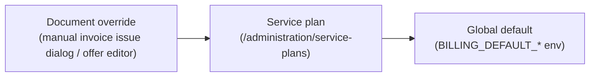

# Payment and delivery terms

Decabill prints **payment terms** and **delivery terms** on invoices and offers, embeds them in the ZUGFeRD / Factur-X XML, and shows them in the billing console (administration and customer views).

## What the terms are

| Terms          | Shape                                                                                                                                                                                                                                                                                                                                               |
| -------------- | --------------------------------------------------------------------------------------------------------------------------------------------------------------------------------------------------------------------------------------------------------------------------------------------------------------------------------------------------- |
| Payment terms  | `paymentDueDays` — payable within N days of the invoice date without deduction (`0` = immediately, max `365`). The invoice due date is the issue date plus N days.                                                                                                                                                                                  |
| Delivery terms | `deliveryTermsCode` — one of the eleven Incoterms® 2020 rules (`EXW`, `FCA`, `CPT`, `CIP`, `DAP`, `DPU`, `DDP`, `FAS`, `FOB`, `CFR`, `CIF`) with an optional named place (`deliveryTermsPlace`), or `CUSTOM` with free text (`deliveryTermsText`, max 1000 characters). Use `CUSTOM` for digital goods and services, where Incoterms do not apply. |

## Where they are set (cascade)

Each facet (payment, delivery) resolves independently; the first level that sets a value wins:

| Document                           | Levels considered                                                         |
| ---------------------------------- | ------------------------------------------------------------------------- |
| Subscription / billing-day invoice | Service plan of the invoice's subscription → global default               |
| Manual invoice                     | Issue dialog (`dueInDays`, delivery terms) → subscription's plan → global |
| Offer                              | Offer editor → global default                                             |
| Invoice from an accepted offer     | The offer's terms (as archived) → global default                          |
| Project time invoice               | Global default                                                            |

Global defaults come from `BILLING_DEFAULT_PAYMENT_DUE_DAYS` (default `14`, the previous fixed value) and `BILLING_DEFAULT_DELIVERY_TERMS_CODE` / `_PLACE` / `_TEXT` (unset = no delivery terms). Invalid values are ignored with a startup warning. See [Environment configuration](../deployment/environment-configuration.md).

## Freezing

Terms are resolved and **stored on the document** when it becomes final:

- **Invoices** — on issue (`InvoiceIssuanceService.issueDraft`), together with the due date. A fully promotional (zero balance) invoice is paid on issue and carries no payment terms.
- **Offers** — on archive. Acceptance carries the archived terms to the resulting invoice.

Later changes to the plan or the environment do not alter documents that are already issued or archived; regenerated PDFs show the stored terms. Documents issued before this feature have no stored terms and render as before.

## Documents

| Output                        | Payment terms                                                                                                                                                        | Delivery terms                                                                                           |
| ----------------------------- | -------------------------------------------------------------------------------------------------------------------------------------------------------------------- | -------------------------------------------------------------------------------------------------------- |
| Invoice / offer PDF           | "Terms" section ("Payable within 14 days of the invoice date without deduction.")                                                                                    | Same section, e.g. `DAP – Delivered at Place, Berlin (Incoterms® 2020)` or the custom text              |
| E-invoice XML (CII, EN 16931) | `SpecifiedTradePaymentTerms/Description` (BT-20) and, on invoices, `DueDateDateTime` (BT-9)                                                                          | `ExchangedDocument/IncludedNote` with `SubjectCode` `AAR` (UNTDID 4451 "terms of delivery"; BT-21/BT-22) |
| Full credit notes (void)      | — (no amount due)                                                                                                                                                    | —                                                                                                        |
| Partial credit notes          | BT-20 settlement text ("Offset against the open balance of invoice …; any amount already paid is refunded or credited to future invoices."), also printed on the PDF | —                                                                                                        |

EN 16931 has no dedicated delivery-terms business term (`ApplicableTradeDeliveryTerms` exists only in the EXTENDED profile), so the note keeps the XML valid for the EN 16931 profile. Emitting BT-20 / BT-9 also satisfies rule BR-CO-25 (due date or payment terms required when an amount is due).

Customer invoice PDFs also print the **service period** (`Service period` / `Service date`), the same period that is embedded as `BillingSpecifiedPeriod` (BG-14).

## API

| Endpoint                                                      | Fields                                                                                                                           |
| ------------------------------------------------------------- | -------------------------------------------------------------------------------------------------------------------------------- |
| `POST /service-plans`, `POST /service-plans/:id`              | `paymentDueDays`, `deliveryTermsCode`, `deliveryTermsPlace`, `deliveryTermsText` (update: omitted = unchanged, `null` = inherit) |
| `GET /service-plans`, `GET /public/service-plan-offerings`    | Stored overrides plus `effectiveDocumentTerms` (resolved against the global default)                                             |
| `POST /admin/billing/offers`, `PUT /admin/billing/offers/:id` | Same four fields (`null` = global default)                                                                                       |
| `GET /admin/billing/offers/:id`                               | Stored terms plus `effectiveDocumentTerms`                                                                                       |
| `GET /offers/:id` (customer)                                  | Effective terms of the offer                                                                                                     |
| `POST /admin/billing/invoices/:invoiceRefId/issue`            | `dueInDays` (payment terms), `deliveryTermsCode`, `deliveryTermsPlace`, `deliveryTermsText`                                      |
| Invoice detail (customer and admin)                           | Stored terms (`null` for drafts and legacy invoices)                                                                             |

Validation: `CUSTOM` requires `deliveryTermsText`; an Incoterms rule drops any text and a `CUSTOM` code drops any place. Control characters are stripped, whitespace in the place is collapsed.

## Billing console

- **Administration → Service plans:** payment and delivery terms per plan; empty fields show the effective global default.
- **Administration → Offers:** terms per offer draft; the offer detail shows the effective terms.
- **Administration → Invoices → Issue:** due in days and delivery terms for the manual invoice.
- **Customer views:** invoice and offer details show the terms; plan ordering shows the plan's effective terms.
