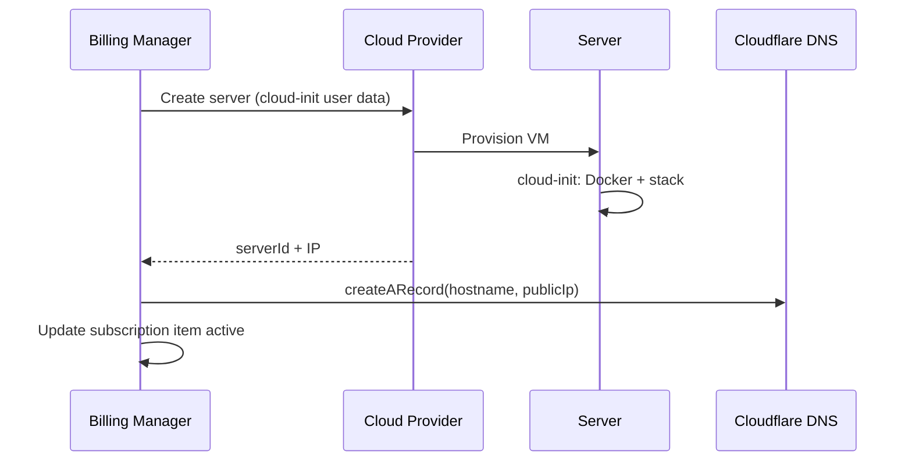

# Server Provisioning

Automated cloud server provisioning via cloud-init when service plans include infrastructure providers.

## Overview

When a [Subscription](./subscriptions.md) order includes a provisioning-enabled [Service Type](./service-types-and-plans.md), the billing manager:

1. Checks provider availability
2. Reserves a hostname under `DNS_BASE_DOMAIN`
3. Creates a cloud server via Hetzner Cloud or DigitalOcean
4. Runs cloud-init to install Docker and deploy the bundled product stack
5. Creates a DNS A record (Cloudflare) when configured
6. Stores the provider server id on the subscription item

## Supported Providers

First-party Hetzner and DigitalOcean are **contributor Nest modules** under `contributors/hetzner` and `contributors/digital-ocean`. Each registers provider metadata and runtime hooks (`provision`, lifecycle, catalog) in `onModuleInit`. Both share `compatibilityGroup: host-cloud-init` so a service type may offer them as interchangeable options (see [Customer provider selection](./customer-provider-selection.md)). Host code dispatches through `ProvisioningDispatchService` and `ProviderCatalogDispatchService` (unknown provider ids or missing hooks **fail closed**).

#### Hetzner Cloud

- **Provider id:** `hetzner`
- **Requires:** `HETZNER_API_TOKEN`
- **Config keys:** `location` or `region`, `serverType` (required), optional `firewallId`
- **Server types:** Loaded live from `GET /service-types/providers/hetzner/server-types`

#### DigitalOcean

- **Provider id:** `digital-ocean`
- **Requires:** `DIGITALOCEAN_API_TOKEN`
- **Config keys:** `region` (required), `serverType` (required)
- **Server types:** Loaded live from `GET /service-types/providers/digital-ocean/server-types`

Additional cloud backends can be added via [Dynamic Provider Plugins](./dynamic-provider-plugins.md) (`DYNAMIC_BILLING_PROVIDER_METADATA` for admin-only metadata, or `DYNAMIC_BILLING_PROVIDER_MODULES` with full `provision` hooks and optional `nestModule`).

## Provisioning Process



## Bundled Product Stack

Cloud-init installs Docker CE and deploys a docker-compose stack on the instance. Integrated service kinds:

| Service id            | Stack                                                                                                                                                                                                                                                                                                      |
| --------------------- | ---------------------------------------------------------------------------------------------------------------------------------------------------------------------------------------------------------------------------------------------------------------------------------------------------------- |
| `agenstra-controller` | PostgreSQL (pgvector), Valkey, OpenSearch, Agenstra Controller API (api/worker/scheduler), agent console, Nginx + Certbot under `/opt/agent-controller`. Provisions `MCP_OAUTH_PUBLIC_BASE_URL` (`http://{fqdn}:3100`) and a random `MCP_OAUTH_CALLBACK_SECRET` for Environment MCP OAuth callbacks.       |
| `agenstra-manager`    | PostgreSQL, Agenstra Manager API, Nginx under `/opt/agent-manager`                                                                                                                                                                                                                                         |
| `decabill-billing`    | PostgreSQL, Valkey, OpenSearch, Decabill billing API (api/worker/scheduler), billing console, Nginx + Certbot under `/opt/decabill-billing`                                                                                                                                                                |
| `loadweaver`          | Single-node Loadweaver cluster: node agent from the signed release, `loadweaver-agent bootstrap` (control plane, etcd, Postgres, API), node components, and a management endpoint (Loadweaver console + Nginx + Certbot) under `/opt/loadweaver`. See [Loadweaver service kind](#loadweaver-service-kind). |

Containers share a defined application directory on the host (typically under `/opt/`). Environment variables for authentication, database connection, and product-specific settings are interpolated into the generated compose file from the subscription's requested configuration.

OpenSearch on `agenstra-controller` and `decabill-billing` is single-node, bound only to the compose network (no host port), with `vm.max_map_count=262144` set during cloud-init. Existing provisioned hosts do not pick this up from image pull alone; re-provision or replace the host compose file.

On `agenstra-manager` hosts, cloud-init installs a pinned, checksum-verified gVisor release right after Docker. It registers the Docker runtimes `runsc-systrap` and `runsc-systrap-hostnet`, which enable the **sandboxed** container isolation level for Agenstra environments. Docker's default runtime stays `runc`.

When the host exposes hardware virtualization (`/dev/kvm`, or a CPU with `vmx` / `svm` whose KVM modules can be loaded), cloud-init also registers `runsc-kvm` and `runsc-kvm-hostnet` for the **sandboxed-kvm** level (gVisor on its KVM platform). No libvirt or QEMU is installed on the host. The same `/dev/kvm` also enables the **microvm** level (a KVM microVM per environment). cloud-init prepares it first and independently of gVisor, so it is available even when the gVisor installation fails. The level needs nothing else on the host, because libvirt and QEMU ship inside the microVM worker image that the agent manager pulls. Hetzner Cloud and DigitalOcean servers normally do not expose KVM, so those hosts offer `sandboxed` only.

Both steps are optional and never fail provisioning. On any failure they are rolled back; a KVM failure only rolls back the KVM runtimes, and the host keeps whatever it could set up (at least standard Docker).

**User data limits:** Decabill submits user data to Hetzner Cloud as plain text, because Hetzner limits the submitted `user_data` string to 32768 characters and base64 would add a third. Hetzner user data above that limit is rejected before the server is created. DigitalOcean user data is limited to 64 KiB.

Hosts provisioned earlier receive new isolation runtimes with the next scheduled update (see [Subscription Item Update Scheduler](#subscription-item-update-scheduler)). See [Agenstra Container Isolation Levels](../../agenstra/features/container-isolation.md).

Operators choose service kind and image tags through service type and plan configuration; the update scheduler pulls latest tagged images on a schedule (except for `loadweaver`, which updates itself).

## Loadweaver Service Kind

`loadweaver` provisions a **dedicated, single-node Loadweaver cluster** per subscription (Loadweaver Cloud). Decabill provisions and bills **only this node** (control plane and console) as a normal subscription; further nodes run on the customer's own servers or provider accounts, join with a join token from the cluster and are never provisioned, metered or billed by Decabill.

### Plan configuration

Offer the integrated provisioning option **Loadweaver** on a host-provider plan (Hetzner, DigitalOcean; Debian 12 / 13 or Ubuntu 22.04 / 24.04 images, amd64 or arm64) and set the release:

| Setting                                             | Where                         | Purpose                                                                                                     |
| --------------------------------------------------- | ----------------------------- | ----------------------------------------------------------------------------------------------------------- |
| `loadweaverVersion`                                 | plan `providerConfigDefaults` | Exact Loadweaver release to bootstrap (e.g. `1.4.0`); required unless the env default is set                |
| `loadweaverConsoleImageDigest`                      | plan `providerConfigDefaults` | Optional `sha256:…` pin for the console; wins over the digest of the release manifest (kept on updates)     |
| `clusterName`, `defaultLocale` (`en` / `de`)        | plan defaults or order config | Optional cluster display name and console locale                                                            |
| `smtp` (`host`, `port`, `user`, `password`, `from`) | plan `providerConfigDefaults` | Optional operator SMTP for the cluster's email (2FA codes, confirmations); same block as the sibling stacks |
| `LOADWEAVER_CLOUD_RELEASE_VERSION`                  | billing manager environment   | Release used when the plan sets none                                                                        |
| `LOADWEAVER_CLOUD_RELEASE_BASE_URL`                 | billing manager environment   | Release asset base (default `https://github.com/forepath/one/releases/download`; https only)                |
| `LOADWEAVER_TEARDOWN_GRACE_DAYS`                    | billing manager environment   | Days a cancelled cluster keeps running before deletion (default `7`, `0` disables, max `90`)                |
| `LOADWEAVER_FLEET_URL` / `LOADWEAVER_FLEET_TOKEN`   | billing manager environment   | Loadweaver fleet service and its `cloud:teardown` PAT for the final backup + read-only grace (empty = off)  |

Without a valid release version provisioning fails closed (`subscription.provision_failed`). The order form shows no authentication or SMTP fields for this kind; SMTP comes from the plan (operator).

**Email (operator SMTP):** with `smtp.host` set, user-data passes the block to `bootstrap` as `--smtp-host`, `--smtp-port` (bootstrap default 587 when unset), `--smtp-user` and `--email-from`; they become the cluster's control-plane environment (`SMTP_*`, `EMAIL_FROM`). The **password** is handed over like the admin claim token: a root-only file (`umask 077`), `--smtp-password-file`, deleted right after bootstrap; never on a command line or in the log. All values are shell-quoted. Settings bootstrap would reject (control characters, port outside 1–65535, user without password or the other way round) fail provisioning closed. Without `smtp.host` no email flags are passed and the cluster starts without email (forced email 2FA isn't enforced until SMTP is set in the control-plane environment). The `--email-company-*` flags are not set (the `smtp` block has no company fields). Note: the password is part of the provider's user-data, like the SMTP credentials of the sibling stacks.

### Cloud-init flow

1. SSH key for platform automation (key-only `sshd`, `PermitRootLogin prohibit-password`).
2. Download `loadweaver-bundle-<version>.manifest.json` and `.manifest.sig` from the release and verify the ECDSA P-256 signature with OpenSSL against the Loadweaver release keys compiled into the billing manager (`RELEASE_SIGNING_KEYS.loadweaver`); product and version must match.
3. Download `loadweaver-agent-<version>-linux-<arch>` (release asset) and check it against the SHA-256 the signed manifest lists for the node agent. The console image is taken **by digest** from the same verified manifest (`consoleImage`, repository `ghcr.io/forepath/loadweaver-console-server`); a release whose manifest lists none fails closed unless the plan sets `loadweaverConsoleImageDigest`.
4. Install Docker CE from Docker's apt repository with `live-restore`, as the Loadweaver installer does. Load the `loadweaver-cloud-firewall` unit (nftables table `inet loadweaver_cloud`, at every boot before Docker and the agent): the API port 3400 is dropped on every interface but loopback and Loadweaver's own (overlay, pod bridge), so the API is only reachable through Nginx.
5. `loadweaver-agent bootstrap --name <host> --public-host <fqdn> --public-url https://<fqdn> --admin-claim-token-file <file>` (plus the email flags with operator SMTP, see above): the cluster secrets (database passwords, `ENCRYPTION_KEY`, `JWT_SECRET`, cluster CA) are generated **on the node**; they never pass through Decabill, its database or the provider's user-data.
6. Node components (`/api/install/components.sh` of the local control plane: gVisor, WireGuard, nftables, BIRD, keepalived, storage userland) and the agent's systemd unit; the agent starts.
7. Management endpoint under `/opt/loadweaver`: the console server (loopback only) and Nginx (host network, digest-pinned) serve the console on `https://<fqdn>/` and the API on `/api`, `/socket`, `/socket.io` and the registry on `/v2`; Let's Encrypt through Certbot as for the other stacks. The DNS A record is created by the normal provisioning flow. Nginx: `server_tokens off`, HSTS (`max-age=31536000; includeSubDomains`) on the TLS server only, `X-Forwarded-For` overwritten with the peer address, 20 requests/s (burst 60) per client on `/api/`, request bodies up to 64 MB on the API and 1 MB on the console; unlimited only for the streamed uploads the control plane caps itself (`/api/updates/bundles`, `/api/backups/imports`, `/v2/`).

**Initial credentials (admin claim):** the first account registered in the console becomes the cluster administrator, but only with a **one-time admin claim token**, so whoever finds a fresh public console first can't take the cluster over:

- Decabill generates the token per provisioning (`lwc_` + 32 random bytes; contributor hook `prepareProvisioningConfig`) and stores it in the item's AES-256-GCM-encrypted `configSnapshot` (`loadweaverAdminClaimToken`, never part of item responses). Missing or malformed token: provisioning fails closed.
- User-data writes it to a root-only file (`umask 077`), passes it with `--admin-claim-token-file` (never on a command line or in the provisioning log) and deletes the file after bootstrap. The control plane keeps only its SHA-256 (`ADMIN_CLAIM_TOKEN_SHA256`).
- While no account exists, `POST /api/auth/register` needs `adminClaimToken` (constant-time hash comparison; 403 without / with a wrong token; 429 after 10 failures per client in 15 minutes). Once the first account exists the token is never consulted again; registration follows the usual `DISABLE_SIGNUP` rules.
- The Cluster tab shows the token (owning customer only, never the admin view) with instructions until the public `GET /api/install/claim-status` (`{ "claimRequired": boolean, "claimConfigured": boolean }`, no secrets) reports the claim done — `claimConfigured: true` with `claimRequired: false`; then Decabill wipes the token and records `loadweaverAdminClaimedAt`. An answer without `claimConfigured: true` (older cluster release, or an instance missing the hash) proves nothing: the token stays shown and the claim state is "unknown".
- The token never reaches addon scripts: secret snapshot keys (`loadweaverAdminClaimToken`) are excluded from addon script interpolation.
- After the claim the cluster's open signup is closed; the customer's administrator adds further users.
- **User-data exposure:** the token is part of the server's user-data. Provider metadata services serve user-data to the server itself (and the provider account, i.e. the operator) only; it is useless once the first account exists.

### Service tab and status

Loadweaver items get a **Cluster** tab (`GET /subscriptions/{subscriptionId}/items/{itemId}/loadweaver/cluster`, admin variant under `/admin/billing/subscriptions/…`): endpoint, health, how to add nodes (join token + installer line), deep links to platform backups, recovery kit and nodes, and the scheduled deletion date of a cancelled subscription. Health comes from unauthenticated probes of `GET /api/health` and the console (Decabill holds no credentials for the customer's cluster):

| Status         | Meaning                                                          |
| -------------- | ---------------------------------------------------------------- |
| `provisioning` | Provisioning is still running                                    |
| `starting`     | Endpoint not reachable yet, within 45 minutes after provisioning |
| `healthy`      | API and console answer                                           |
| `degraded`     | API answers, console does not                                    |
| `unreachable`  | API does not answer (after the startup window)                   |
| `failed`       | Provisioning failed                                              |
| `removed`      | The server was deprovisioned                                     |

### Updates

Loadweaver updates itself (control plane, agents, OS packages) through its own rollout from signed release bundles (Updates in the Loadweaver console). The subscription item update scheduler therefore **never** runs `docker compose up --pull=always` for `loadweaver` items (`selfUpdating` stack): its command only re-pins the management endpoint's console image to the version the cluster's rollout installed (`loadweaver-agent version`), logged to `/var/log/loadweaver-console-update.log`. It fetches that release's manifest and signature from `LOADWEAVER_CLOUD_RELEASE_BASE_URL`, verifies them against the release keys compiled into the billing manager (embedded in the command, so key rotations reach existing servers) and checks product and version, then pins the console to the manifest's `consoleImage` digest (`LOADWEAVER_CONSOLE_PIN=manifest` in `/opt/loadweaver/.env`). If the manifest can't be fetched or verified, or lists no console digest, nothing changes and the run fails (retried by the next run). A console pinned by the plan (`LOADWEAVER_CONSOLE_PIN=plan`) stays pinned; to move it, change the plan's digest and set it on the server (the command has no access to the plan).

### Data-safe teardown

Ending a subscription that runs a Loadweaver cluster deletes the cluster's only Decabill-provisioned node and its data:

- **Confirmation required:** customer cancel and withdraw, and admin cancel, withdraw and instant cancel, return `400 LOADWEAVER_TEARDOWN_CONFIRMATION_REQUIRED` unless the body sets `confirmDataTeardown: true`. The billing console shows a warning dialog with the steps below and a required checkbox; the admin dialogs have an explicit confirmation checkbox.
- **Before cancelling (customer, in the Loadweaver console):** run a final platform backup and copy it to the external target, save the recovery kit and the disaster-recovery info file, drain and remove (or keep) nodes in the customer's own provider accounts.
- **Grace period:** a regular cancellation keeps the cluster running for `LOADWEAVER_TEARDOWN_GRACE_DAYS` after the effective date (not billed; billing ends at the effective date) before the expiration job tears it down. The cancellation stores the effective teardown time (`billing_subscriptions.teardown_not_before`); the expiration queue selects on `COALESCE(teardown_not_before, cancel_effective_at)`, so subscriptions in their grace period never occupy `EXPIRATION_SCHEDULER_BATCH_SIZE` slots (ordering and batching unchanged). Withdrawal and instant cancel tear down immediately after the confirmation. Once the effective date has passed (grace period running), resume and instant cancel are refused with `400 SUBSCRIPTION_CANCELLATION_EFFECTIVE`, and withdrawal isn't possible for a pending cancellation.
- **Final backup and read-only grace (fleet):** with `LOADWEAVER_FLEET_URL` (HTTPS) and `LOADWEAVER_FLEET_TOKEN` (a PAT of a Loadweaver fleet admin with only `cloud:teardown`) set, the `loadweaver` integrated stack's contributor job `fleet-teardown` (every `LOADWEAVER_FLEET_SYNC_INTERVAL_MS`, default 15 min) calls the fleet for every Loadweaver item in its grace period (`PUT /api/cloud/clusters/decabill:<subscription>:<item>/teardown` with `readOnlyUntil` = `teardown_not_before`): the fleet runs the cluster's final backup once and caps access through the fleet at viewer until the teardown. Idempotent; clusters not registered in the fleet are skipped; unset = previous behaviour. See [Fleet service](../../loadweaver/features/fleet.md#loadweaver-cloud).
- **Teardown:** the normal subscription teardown deletes the Decabill-provisioned server, its DNS record and hostname reservation. Nodes in the customer's own provider accounts are never touched.

## Custom Service Kind

Plans may set `providerConfigDefaults.service` to `custom` and reference a CloudInit config id. This path deploys a single Docker service defined by an admin template instead of the bundled agenstra-controller, agenstra-manager, or decabill-billing stacks.

Custom cloud-init installs Docker and runs one compose service with resolved environment variables. It does not install Nginx, Certbot, or the bundled PostgreSQL and product containers. The subscription item update scheduler skips custom items.

See **[CloudInit Configs](./cloud-init-configs.md)** for environment variable metadata, admin UI, and order form behavior.

## TLS and DNS

TLS uses Let's Encrypt via Certbot installed in cloud-init (pip/venv under `/opt/certbot`):

- Initial bootstrap certificate generated with OpenSSL so Nginx can start immediately
- Production certificates requested with `certbot certonly --webroot` for the instance FQDN (`hostname.DNS_BASE_DOMAIN`)
- On success, Nginx switches to Let's Encrypt certificate paths
- Automatic renewal in crontab with deploy hook to reload the Nginx container

Environment:

| Variable               | Purpose                                                           |
| ---------------------- | ----------------------------------------------------------------- |
| `LETS_ENCRYPT_EMAIL`   | ACME account email                                                |
| `DNS_BASE_DOMAIN`      | Base domain for hostnames and certificates (default `spirde.com`) |
| `CLOUDFLARE_API_TOKEN` | DNS API token                                                     |
| `CLOUDFLARE_ZONE_ID`   | Zone for A records                                                |

Cloud-init waits for the DNS A record (`proxied: false`) to resolve to the host before requesting the certificate.

## SSH Access

Provisioning templates configure SSH for operational access. Key-based authentication is enabled; password authentication is disabled in generated `sshd` configuration.

The provisioning private key is stored encrypted on the subscription item and used by platform automation (updates, addons, resize helpers). Customers who need direct machine access can reveal that key **once** via:

`GET /subscriptions/{subscriptionId}/items/{itemId}/ssh-access-key`

Successful reveal sets `sshAccessGranted` on the item (from `ssh_access_granted_at`), returns the OpenSSH private key once, and blocks further reveals (`409`). Viewing the key may limit technical support for that specific service. The Overview dashboard shows a confirmation disclaimer before reveal and a badge after access is granted.

A webhook (`subscription.ssh_access_granted`) and customer email are sent on successful reveal with metadata only (never the key). The email asks the recipient to contact support if they did not perform the action.

**Accepted risk [DR-001](../security/accepted-risks.md#dr-001-provisioning-ssh-cloud-init-templates):** Cloud-init may configure root SSH access and install root `authorized_keys` for first-boot automation. Compensating controls include network restrictions, key rotation, and bastion access. See [Security (Accepted risks)](../security/accepted-risks.md).

## Nested Provisioning Tokens

Optional `requestedConfig` keys on subscription order allow the provisioned instance to provision additional servers:

- `hetznerApiToken` - Hetzner API token injected into instance environment
- `digitaloceanApiToken` - DigitalOcean API token injected into instance environment

Use only when the product stack requires nested cloud automation.

## Server Information and Control

After provisioning:

- `GET /subscriptions/{subscriptionId}/items/{itemId}/server-info` - Live status from provider API
- Start, stop, restart via action endpoints (see [Dashboard and Server Control](./dashboard-and-server-control.md))

## Subscription Item Update Scheduler

A background scheduler connects to each provisioned host via SSH (key stored on the subscription item) at `SUBSCRIPTION_UPDATE_SCHEDULER_INTERVAL` (default 24 hours) and runs:

```bash
docker compose up -d --pull=always
```

in the application directory (custom items are skipped; `loadweaver` items only re-pin their console image, see [Updates](#updates)). This pulls latest container images and recreates services. Failures are logged on the host under `/var/log/agent-controller-update.log`, `/var/log/decabill-billing-update.log`, or equivalent per service kind.

On `agenstra-manager` hosts the update first refreshes the container isolation runtimes. It writes the current host preparation script to `/opt/agent-manager/agenstra-gvisor.sh` and runs `install`. Hosts provisioned before an isolation level existed (e.g. `sandboxed-kvm`) get it this way when the host supports it.

The refresh is idempotent. It only reloads Docker, so running environments are not restarted. It never fails the update: a failure is logged as a warning and the host keeps its previous runtimes, and the agent manager probes what it can actually run. New runtimes show up in the manager's capabilities right away when the update recreated the manager. Otherwise they appear at its next scheduled probe, or on **Re-check isolation** in the console.

The update command fails (non-zero exit, `ERROR: Update failed` in the log) when `docker compose` fails or the application directory is missing.

## Provisioning outcome notifications

When a subscription item finishes (or fails) cloud provisioning, Decabill publishes:

| Event                           | When                                                                                                                 |
| ------------------------------- | -------------------------------------------------------------------------------------------------------------------- |
| `subscription.provisioned`      | Item reaches `provisioningStatus=active` after server create (includes itemId, hostname, service, providerReference) |
| `subscription.provision_failed` | Provisioning fails (includes itemId, errorMessage, optional providerReference; never config secrets)                 |

See [Webhooks](./webhooks.md).

## Optional Instance Configuration

Subscription `requestedConfig` can include authentication mode for the provisioned stack (`users`, `api-key`, `keycloak`), SMTP settings, and Git or API credentials where the plan schema allows. Values are passed securely through user-data into the generated compose environment.

## API Endpoints

| Method | Path                                                 | Purpose                    |
| ------ | ---------------------------------------------------- | -------------------------- |
| GET    | `/service-types/providers`                           | List providers and schemas |
| GET    | `/service-types/providers/{providerId}/server-types` | Server types and pricing   |
| POST   | `/availability/check`                                | Pre-order capacity check   |
| GET    | `/subscriptions/.../server-info`                     | Live server metadata       |

Provisioning itself is triggered internally by subscription and backorder services, not via a standalone public provision endpoint.

## Related documentation

- **[Subscriptions](./subscriptions.md)** Order flow
- **[Backorders](./backorders.md)** Retry when capacity unavailable
- **[Service Types and Plans](./service-types-and-plans.md)** Provider schemas
- **[Dashboard and Server Control](./dashboard-and-server-control.md)** Power actions
- **[Security (Accepted risks)](../security/accepted-risks.md)** **DR-001** provisioning SSH
- **[Billing Manager OpenAPI](/spec/billing-manager/openapi.yaml)** Server info schemas

---

_Provisioned instances are owned by the subscribing customer within the current tenant scope._
